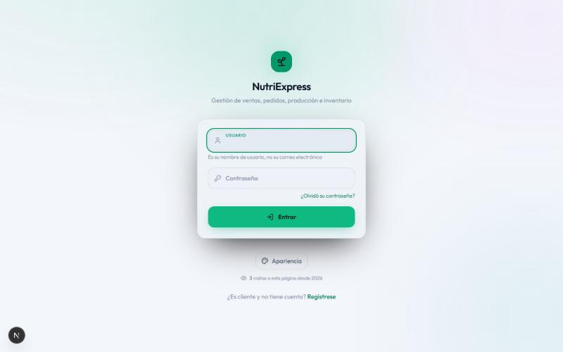
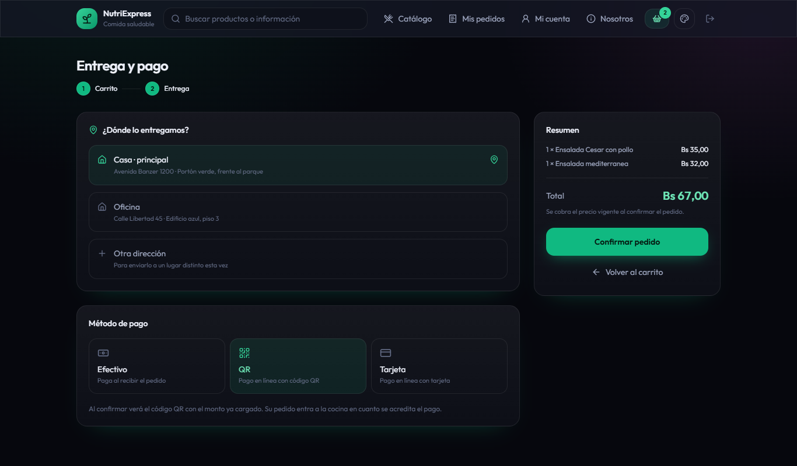
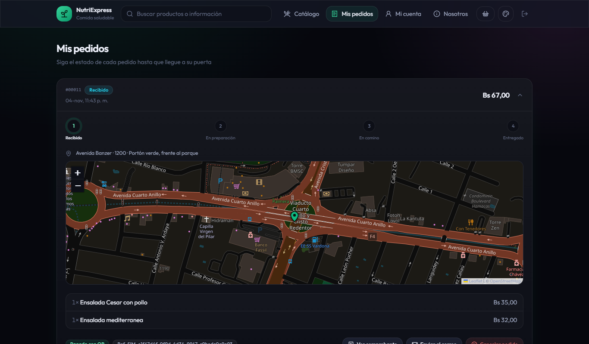
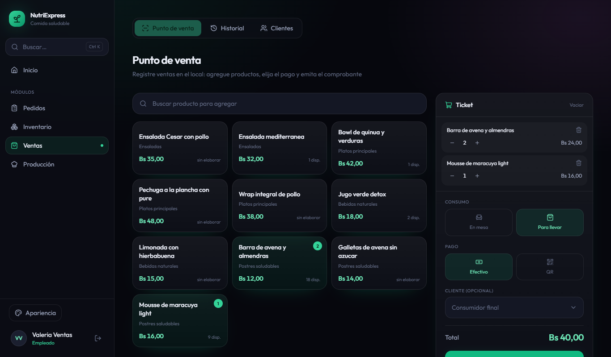
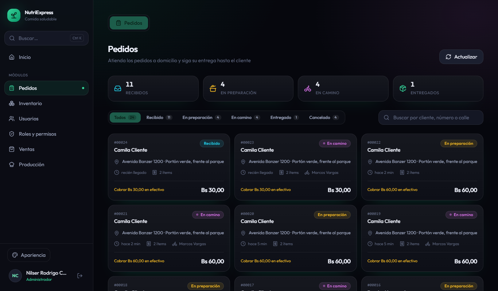
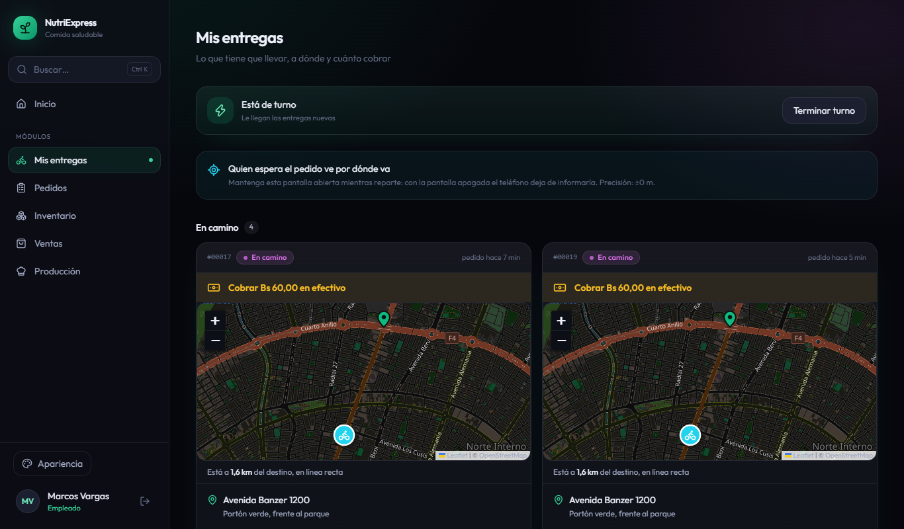
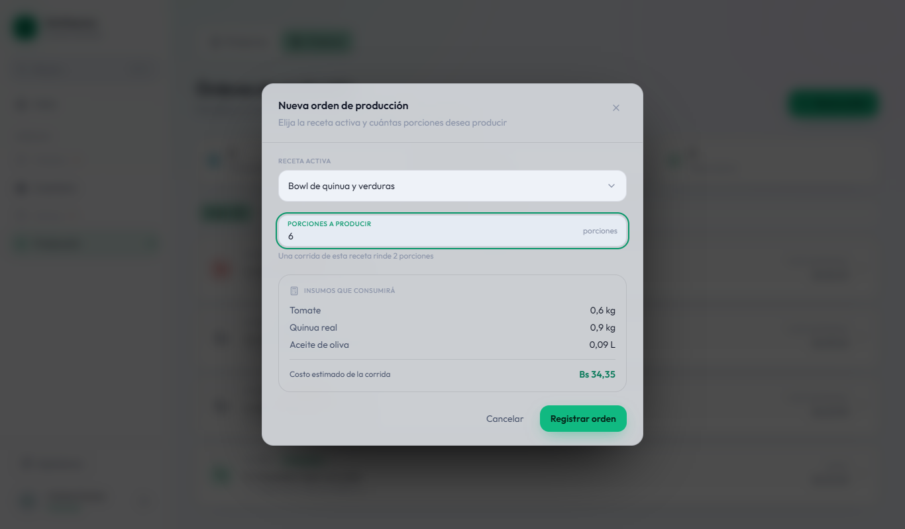
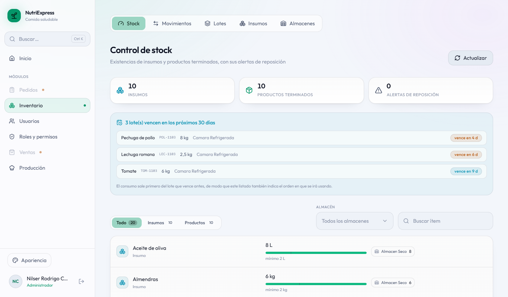
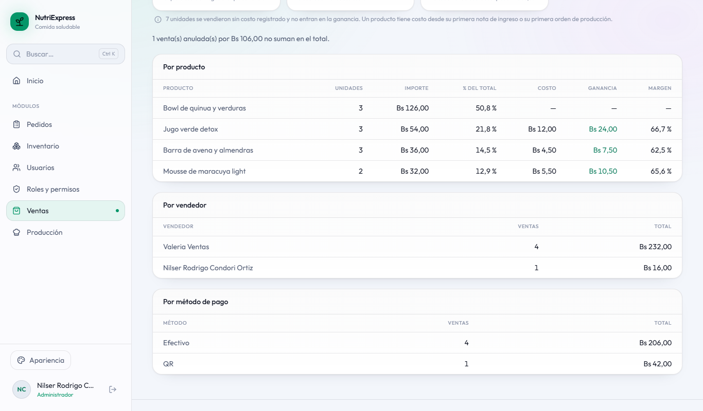

# ANEXOS

## Anexo A. Manual de usuario

NutriExpress se usa desde el navegador en https://nutriexpress.109-123-254-213.sslip.io. Cada persona
entra con su usuario y contraseña y ve solo lo que su rol le permite: el cliente, el portal; el personal,
el escritorio con los módulos de su tarea.

### A.1 Entrar al sistema

En la pantalla de inicio de sesión se escribe el **nombre de usuario** (no el correo) y la contraseña.
Quien no tiene cuenta puede registrarse como cliente desde «Regístrese». Si olvidó su contraseña,
«¿Olvidó su contraseña?» le envía un código a su correo. Tras tres intentos fallidos la cuenta se
bloquea por un tiempo que crece con cada bloqueo.

<!-- figura: Inicio de sesión -->

### A.2 Cliente: pedir a domicilio

1. En **Catálogo** se ven los productos con su información nutricional y lo que hay disponible. «Agregar»
   los lleva al carrito.
2. En el **carrito** se revisa el pedido y, con «Continuar», se elige la dirección de entrega (la
   principal aparece primero; se puede marcar otra en el mapa) y cómo pagar: efectivo, QR o tarjeta.
3. Con QR o tarjeta se abre el cobro; al acreditarse aparece el comprobante y el pedido pasa a
   preparación. En efectivo se paga al repartidor.
4. En **Mis pedidos** se sigue cada pedido; mientras está «En camino», se ve al repartidor en el mapa. Un
   pedido se puede cancelar hasta que sale del local.

<!-- figura: Entrega y pago del pedido -->

<!-- figura: Mis pedidos -->

En **Mi cuenta** el cliente corrige sus datos y preferencias alimentarias, y cambia su contraseña (se
pide la actual; al cambiarla se cierra la sesión en sus otros dispositivos). El botón de la paleta elige
el tema (Niños, Jóvenes o Adultos) y el modo día, noche o automático, que se recuerdan en la cuenta.

### A.3 Vendedor: mostrador y pedidos

- **Ventas › Punto de venta:** se tocan los productos para armar el ticket, se elige en mesa o para
  llevar y el pago (efectivo o QR), y opcionalmente el cliente. «Registrar venta» descuenta el stock y
  muestra el comprobante `V-000001`.
- **Ventas › Historial:** cada venta con su comprobante; una venta equivocada se anula con su motivo y el
  stock vuelve al almacén.
- **Ventas › Clientes:** búsqueda por nombre o correo (sin importar las tildes) y corrección de la ficha.
- **Pedidos:** el tablero de todos los pedidos por estado. Al abrir uno se lo pasa a la etapa siguiente
  y se le asigna un repartidor; el sistema sugiere al que está de turno con menos entregas.

<!-- figura: Punto de venta -->

<!-- figura: Tablero de pedidos -->

### A.4 Repartidor: mis entregas

En **Mis entregas** el repartidor marca que está de turno, ve los pedidos que lleva, con la dirección en el
mapa y cuánto cobrar, y comparte su ubicación con el cliente mientras tiene la pantalla abierta. Al llegar
toca «Registrar entrega» (en efectivo, confirma que cobró) o «No se pudo entregar».

<!-- figura: Mis entregas -->

### A.5 Cocinero y almacenero: producción e inventario

- **Producción › Productos y recetas:** cada producto tiene su receta activa con los insumos y el
  rendimiento.
- **Producción › Órdenes:** una orden se registra, se inicia y se finaliza indicando cuánto salió de
  verdad; al finalizarla se descuentan los insumos y entra el producto terminado.
- **Inventario:** stock por almacén con alertas de mínimo, notas de ingreso (compras, ajustes) y de egreso
  (mermas, devoluciones al proveedor), lotes con vencimiento y el historial de movimientos.

<!-- figura: Nueva orden de producción -->

<!-- figura: Stock por almacén -->

### A.6 Administrador: usuarios, reportes y cobro

- **Usuarios y Roles y permisos:** alta de empleados con su cargo, roles y permisos por usuario. Un cambio
  de permisos rige en la siguiente acción de la persona, en todos los módulos.
- **Reportes** (en Ventas, Pedidos, Producción e Inventario): se eligen las fechas y los filtros; «Ver en
  PDF» lo descarga y «Enviar por correo» lo manda a hasta cinco direcciones separadas por coma.
- **Mi cuenta › Modo de cobro:** simulado (para probar) o real con Libélula.

<!-- figura: Reporte de ventas -->

## Anexo B. Instalación y despliegue

**En una computadora de desarrollo** (detalle en `INSTALACION.md` del repositorio): instalar Git, Node.js
22 y Docker Desktop; clonar el repositorio y correr `docker compose up -d --build`, que levanta los doce
contenedores (siete microservicios, el gateway, PostgreSQL, MongoDB, Redis y RabbitMQ). El portal se
corre aparte con `npm run dev` en `frontend`. Las cuentas de prueba (`admin`, `vendedor`, `repartidor`,
`cocinero`, `almacenero` y `cliente`) se crean solas la primera vez.

**En el servidor** (detalle en `herramientas/vps/LEEME.md`): el proyecto se copia a `/opt/nutriexpress` y
`herramientas/vps/desplegar.sh` crea el `.env` con contraseñas al azar, construye las imágenes de a una y
levanta todo con `docker-compose.prod.yml`, que no publica los puertos de las bases. Caddy da el HTTPS y
reparte `/api` al gateway y el resto al portal. Un respaldo diario guarda las bases con siete días de
historia.

## Anexo C. Evidencias de los sprints

| Sprint | Fechas | Puntos | Pruebas que pasan al cierre | Entregable principal |
|---|---|---|---|---|
| 0 | 14 al 16-oct | — | — | Perfil, organización, Product Backlog y arquitectura |
| 1 | 17 al 21-oct | 31 | 286 | Docker Compose, gateway, identidad, visitas y portal reutilizado |
| 2 | 22 al 28-oct | 33 | 308 | Catálogo e inventario con réplicas entre servicios |
| 3 | 29-oct al 4-nov | 34 | 394 | Eventos en RabbitMQ, recetas, órdenes de producción y reservas de stock |
| 4 | 5 al 11-nov | 31 | 422 | Pedido a domicilio con pago en línea (saga) |
| 5 | 12 al 18-nov | 32 | 464 | Tablero, reparto, venta de mostrador y clientes |
| 6 | 19 al 25-nov | 28 | 487 | Reportes, avisos por correo, temas y despliegue |
| 7 | 26-nov al 2-dic | 16 | 499 | Perfil propio, reportes de producción e inventario y cierre |

Hasta el Sprint 3 la columna de pruebas incluye las de punta a punta; desde el Sprint 4, solo las de
integración y de componentes (las de punta a punta se corren aparte, contra el portal compilado).

**Repositorio:** el código, el informe y sus herramientas están en GitHub
(`nutriexpress2026-alt/nutriexpress-microservicios`), con más de 85 commits al cerrar el proyecto. Cada commit
cita la historia o el requisito que lo justifica. El seguimiento diario (Sprint Backlog, Daily,
Scrumboard y gráficas) está en `docs/scrum/seguimiento-scrum.xlsx`, y los diagramas, en
`docs/diagramasEA/NutriExpress_Microservicios.eapx`.
