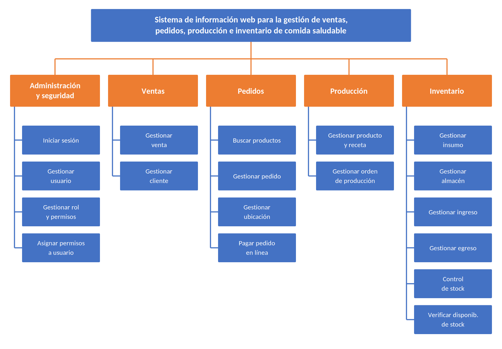

# PARTE I: FUNDAMENTOS TEÓRICOS

# CAPÍTULO 1 – PERFIL DE PROYECTO

## 1.1 Introducción

En las últimas décadas, la alimentación dejó de verse solo como una necesidad fisiológica y pasó a
ser un factor determinante de la calidad de vida. El aumento de las enfermedades asociadas a malos
hábitos alimenticios y la mayor difusión de información sobre nutrición cambiaron los patrones de
consumo: cada vez más personas buscan comida preparada con insumos frescos y con información clara
sobre lo que contiene.

Al mismo tiempo, la transformación digital cambió la forma en que los consumidores acceden a los
alimentos. El comercio electrónico y las plataformas de entrega a domicilio crearon nuevas
expectativas: atención rápida, servicio disponible en todo momento, información detallada del
producto y la posibilidad de pagar y seguir un pedido desde el teléfono.

Atender a la vez el canal presencial y el canal digital es un desafío operativo considerable para
un negocio de comida saludable. Debe coordinar la atención en el local, los pedidos a domicilio, la
producción diaria en cocina y un inventario formado sobre todo por insumos perecederos. Cada área
genera información que las demás necesitan en el momento.

En este contexto se ubica **NutriExpress**, un negocio de Montero dedicado a preparar y vender
comida saludable, con atención en el local y entrega a domicilio. El presente proyecto propone un
sistema de información web que integre la gestión de ventas, pedidos, producción e inventario,
**construido con una arquitectura de microservicios**: el sistema se divide en servicios pequeños e
independientes, cada uno responsable de un área del negocio y con su propia base de datos, que se
comunican mediante interfaces de programación (API) y mensajes. El desarrollo se organiza con el
marco de trabajo ágil **Scrum**, en iteraciones cortas (sprints) que entregan en cada semana una
parte funcional del sistema.

## 1.2 Antecedentes

La gestión de restaurantes evolucionó desde el registro manual en cuadernos y planillas hacia
sistemas informáticos especializados. Primero aparecieron los sistemas de punto de venta (POS),
enfocados solo en registrar transacciones y emitir comprobantes, sin conexión con la cocina ni con
el control de insumos. Después surgieron soluciones más completas, que incorporaron el inventario y
las recetas para relacionar cada plato vendido con los insumos que consume. La masificación de las
plataformas de delivery agregó un canal de venta que exige coordinar los pedidos en línea con la
producción y la logística de entrega.

En la arquitectura de estos sistemas también hubo una evolución. Las primeras aplicaciones web se
construían como **monolitos**: un único programa y una única base de datos con toda la lógica del
negocio. Este modelo es simple de comenzar, pero a medida que el sistema crece cualquier cambio
obliga a volver a desplegar todo, una falla en un módulo (por ejemplo, la pasarela de pagos) puede
dejar sin servicio a los demás y no es posible escalar solo la parte que recibe más carga. Como
respuesta surgió la **arquitectura de microservicios**, adoptada por empresas de comercio y delivery
de gran escala, que divide la aplicación en servicios autónomos desplegables por separado.

En cuanto al proceso de desarrollo, las metodologías tradicionales planifican todo el sistema al
inicio y entregan al final. Los marcos ágiles como **Scrum** entregan valor en ciclos cortos y
permiten ajustar el rumbo con la retroalimentación del cliente en cada iteración.

Antes de este proyecto, el equipo desarrolló una primera versión de NutriExpress como aplicación
monolítica bajo la metodología PUDS. Esa experiencia permitió conocer a fondo las reglas del negocio
(flujo de pedidos, recetas, costeo de insumos, cobros en línea) y sirve como referencia funcional
del presente proyecto, que se diseña y construye desde cero con otra arquitectura y otra metodología.

## 1.3 Definición del problema

NutriExpress enfrenta limitaciones operativas por la falta de herramientas tecnológicas que
coordinen sus procesos:

- **Gestión manual y dispersa:** los pedidos se registran en cuadernos, mensajes de WhatsApp o
  planillas independientes, lo que duplica información y demora la atención.
- **Falta de integración entre áreas:** ventas, cocina e inventario no comparten información en
  tiempo real, y no se sabe con certeza qué se vendió, qué se cocinó y qué queda en el almacén.
- **Control de inventario deficiente:** sin un registro automático del consumo de insumos por
  receta, son frecuentes los faltantes y las mermas de productos perecederos.
- **Ineficiencia operativa:** es difícil conocer el estado de un pedido, obtener reportes
  confiables de ventas y planificar la producción según la demanda.
- **Ausencia de control de accesos:** no se registra quién realizó cada operación.

Además, un sistema que integre todas estas áreas en una sola aplicación hereda los problemas del
monolito: si se cae el cobro en línea o el envío de correos, se detiene también la venta en el
local, y cualquier mejora en un módulo obliga a detener y volver a publicar el sistema completo.

## 1.4 Situación problemática

La ausencia de un sistema integrado para la gestión de ventas, pedidos, producción e inventario
genera en NutriExpress descoordinación entre atención al cliente, cocina y almacén, errores en el
registro de pedidos, demoras en las entregas, pérdida de control sobre los insumos y decisiones
tomadas sin información confiable. A esto se suma el riesgo de que una solución construida como un
único bloque se vuelva frágil y difícil de mantener a medida que el negocio crezca.

## 1.5 Situación deseada

NutriExpress contará con un sistema de información web que centralice la gestión de ventas y
pedidos, coordine la producción según la demanda real, controle con precisión el inventario de
insumos y emita reportes para la toma de decisiones. El sistema estará formado por microservicios
independientes: cada área del negocio podrá evolucionar, desplegarse y recuperarse de una falla sin
detener a las demás, y los servicios con más demanda (como el catálogo o los pedidos) podrán
escalarse por separado.

## 1.6 Objetivos

### 1.6.1 Objetivo general

Desarrollar un sistema de información web basado en microservicios para la gestión de ventas,
pedidos, producción e inventario de comida saludable del negocio NutriExpress, aplicando el marco de
trabajo ágil Scrum.

### 1.6.2 Objetivos específicos

1. Identificar los requisitos del negocio y expresarlos como historias de usuario priorizadas en un
   Product Backlog.
2. Diseñar la arquitectura de microservicios del sistema con el modelo C4, delimitando la
   responsabilidad y los datos de cada servicio.
3. Diseñar las bases de datos de cada microservicio empleando al menos dos sistemas gestores de bases
   de datos: uno relacional (PostgreSQL) y uno documental (MongoDB).
4. Implementar los microservicios de identidad, catálogo y producción, inventario, ventas, pedidos,
   pagos y reportes, comunicados mediante API REST y mensajería asíncrona.
5. Implementar el portal web del cliente y el escritorio del personal, con temas visuales
   seleccionables, contador de visitas y búsqueda de información del negocio.
6. Verificar el funcionamiento del sistema con al menos tres tipos de pruebas automatizadas.
7. Desplegar el sistema en un servidor en la nube mediante contenedores.

## 1.7 Justificación

### 1.7.1 Justificación técnica

El proyecto integra en una sola aplicación web procesos que hoy se registran por separado: la venta
en el local, los pedidos a domicilio, la producción en cocina y el control de insumos. La
arquitectura de microservicios permite que cada área sea un servicio independiente, con su propia
base de datos, que se despliega en un contenedor Docker y se comunica con los demás mediante API REST
y eventos. Esto aísla las fallas (si la pasarela de pagos no responde, la venta en el local sigue
funcionando), permite escalar solo los servicios con más carga y facilita incorporar nuevas funciones
sin modificar las existentes. El uso de dos gestores de bases de datos permite elegir el modelo de
datos más adecuado para cada servicio: relacional para las transacciones del negocio y documental
para los reportes y las estadísticas.

### 1.7.2 Justificación teórica

El proyecto se apoya en los fundamentos de los sistemas de información, que integran la captura, el
procesamiento y la distribución de datos para apoyar la operación y la toma de decisiones. Aplica
además los principios del diseño de sistemas distribuidos: separación por dominios de negocio, una
base de datos por servicio, comunicación síncrona y asíncrona, consistencia eventual y el patrón Saga
para las operaciones que involucran a varios servicios. Su resultado beneficia a los consumidores de
alimentos saludables, con un servicio ágil y transparente, y al personal del negocio, al reducir el
trabajo manual.

### 1.7.3 Justificación metodológica

El desarrollo aplica el marco de trabajo **Scrum**, que organiza el proyecto en sprints de duración
fija con entregas funcionales al final de cada uno. Los requisitos se expresan como historias de
usuario priorizadas en el Product Backlog; en cada Sprint Planning se seleccionan las historias a
construir, el avance se controla en reuniones diarias y en un tablero Scrum, y cada sprint termina
con una revisión del incremento y una retrospectiva. El modelado se complementa con UML en Enterprise
Architect y con el modelo C4 para la arquitectura.

## 1.8 Alcance

El sistema abarcará los siguientes módulos, cada uno implementado como uno o más microservicios:

<!-- figura: Módulos y casos de uso del sistema -->

## 1.9 Metodología de desarrollo

### 1.9.1 Scrum

Scrum es un marco de trabajo ágil para desarrollar productos complejos de forma iterativa e
incremental. Define:

- **Roles:** el *Product Owner* (responsable de qué se construye y en qué orden), el *Scrum Master*
  (facilita el proceso y elimina impedimentos) y el *Equipo de Desarrollo* (construye el incremento).
- **Eventos:** el *Sprint* (iteración de duración fija), el *Sprint Planning* (qué se hará y cómo),
  la *Daily Meeting* (reunión diaria breve de seguimiento), la *Sprint Review* (demostración del
  incremento) y la *Sprint Retrospective* (mejora del proceso).
- **Artefactos:** el *Product Backlog* (lista priorizada de historias de usuario), el *Sprint
  Backlog* (historias y tareas del sprint) y el *Incremento* (producto funcionando al final del
  sprint), acompañados del tablero Scrum y de las gráficas Burndown y Burnup.

En este proyecto se trabajará con **sprints de una semana**. El Sprint 0 se dedica a la
planificación (requisitos, backlog, arquitectura y herramientas) y los sprints siguientes entregan
cada uno microservicios funcionando.

### 1.9.2 Arquitectura de microservicios

Un microservicio es un servicio pequeño y autónomo que implementa una capacidad del negocio, tiene su
propia base de datos y se despliega de forma independiente. Los principios que guían el diseño son:

- **Un servicio por dominio del negocio**, delimitado según las áreas de NutriExpress.
- **Una base de datos por servicio:** ningún servicio lee directamente las tablas de otro.
- **API Gateway:** una única puerta de entrada que recibe las peticiones del navegador y las dirige
  al servicio correspondiente.
- **Comunicación síncrona (REST)** cuando se necesita una respuesta inmediata, y **asíncrona
  (eventos a través de un broker de mensajes)** para avisar que algo ocurrió.
- **Patrón Saga** para las operaciones que abarcan varios servicios (por ejemplo, un pedido que
  reserva stock y espera el pago), con acciones de compensación si algún paso falla.
- **Contenedores Docker** para empaquetar y desplegar cada servicio.
