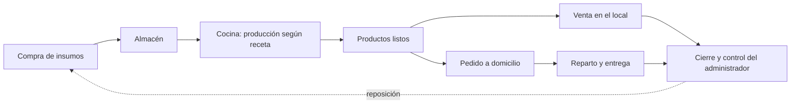
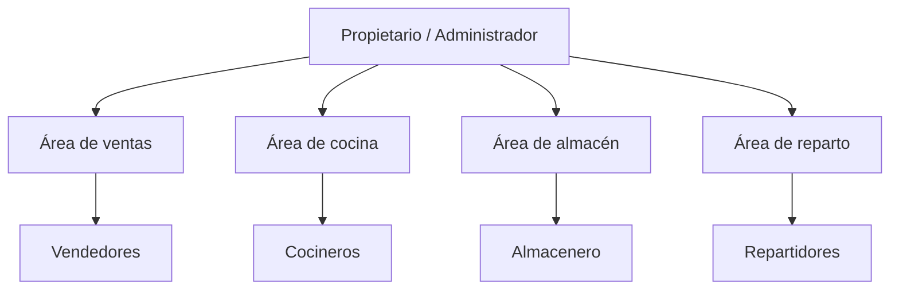

# CAPÍTULO 2 – LA ORGANIZACIÓN

> Los datos marcados con **[COMPLETAR]** dependen del negocio y deben confirmarse antes de pasar el
> capítulo al informe final.

## 2.1 Antecedentes

NutriExpress es un emprendimiento de la ciudad de Montero (Santa Cruz, Bolivia) dedicado a la
preparación y venta de comida saludable. Nació **[COMPLETAR: año de fundación]** como respuesta a la
demanda creciente de alimentos preparados con insumos frescos, porciones balanceadas e información
nutricional clara, una oferta poco común entre los locales de comida de la zona, orientados en su
mayoría a la comida rápida tradicional.

El negocio comenzó atendiendo en su local y, con el aumento de la demanda, incorporó la entrega a
domicilio, coordinada por mensajes de WhatsApp y llamadas telefónicas. Su lema resume la propuesta:
*«Comida saludable a domicilio en Montero»*.

## 2.2 Situación actual

NutriExpress atiende en dos canales:

- **Local:** el cliente elige sus productos en el mostrador, consume en mesa o pide para llevar y
  paga en efectivo o con QR.
- **Domicilio:** el cliente hace su pedido por WhatsApp o por teléfono, indica su dirección y un
  repartidor del negocio lo entrega; el pago se hace en efectivo al recibir o por transferencia.

Hoy estos procesos se registran de forma manual y separada:

| Área | Cómo se registra hoy | Problema que genera |
|---|---|---|
| Ventas en el local | Cuaderno de ventas y caja | Cierres de caja lentos, sin reportes por producto ni por fecha. |
| Pedidos a domicilio | Chats de WhatsApp y notas en papel | Pedidos perdidos o duplicados; el cliente pregunta varias veces por el estado. |
| Cocina | Producción según la experiencia del cocinero | Se cocina de más o de menos; no se conoce el costo real de cada plato. |
| Almacén | Planilla de cálculo actualizada a mano | Faltantes de insumos y mermas de perecederos que se descubren tarde. |
| Personal y accesos | Sin registro | No se sabe quién registró cada venta o movimiento. |

Horario de atención: lunes a sábado de 08:00 a 20:00 y domingos de 09:00 a 14:00.

## 2.3 Servicios que presta

1. **Venta de comida saludable en el local**, para consumir en mesa o para llevar.
2. **Entrega a domicilio** dentro de la zona de cobertura de Montero.
3. **Línea de productos:**
   - **Ensaladas** preparadas al momento con vegetales frescos.
   - **Platos principales** balanceados (proteína, carbohidrato complejo y verduras).
   - **Bebidas** naturales: jugos, batidos y refrescos sin azúcar añadida.
4. **Información nutricional** de cada producto: calorías, proteínas, carbohidratos, grasas y fibra.
5. **Medios de pago:** efectivo, QR y, en los pedidos en línea, tarjeta de débito o crédito.

## 2.4 Metodología de trabajo

El trabajo diario del negocio sigue este ciclo:

1. **Abastecimiento:** el encargado de almacén compra los insumos a los proveedores y los guarda en el
   almacén que corresponde a su tipo de conservación (ambiente, refrigerado o congelado). Los
   perecederos se controlan por fecha de vencimiento.
2. **Producción:** al inicio de la jornada, y cuando el stock de un producto se agota, el cocinero
   prepara los productos siguiendo la receta de cada uno, que indica los insumos y las cantidades por
   porción.
3. **Venta en el local:** el vendedor atiende al cliente, registra los productos, cobra y entrega el
   pedido.
4. **Pedidos a domicilio:** el pedido se recibe, se confirma el pago (si es en línea), pasa a
   preparación, se asigna a un repartidor y se entrega en la dirección del cliente, donde se cobra si
   el pago es en efectivo.
5. **Control y cierre:** el administrador revisa las ventas del día, los pedidos entregados y
   cancelados, el stock disponible y los insumos que deben reponerse.

## 2.5 Estructura organizacional

| Cargo | Funciones principales |
|---|---|
| **Administrador** | Dirige el negocio, define precios y productos, administra el personal y revisa los reportes. |
| **Vendedor** | Atiende en el mostrador, registra las ventas, cobra y gestiona los pedidos recibidos. |
| **Cocinero** | Elabora los productos según las recetas y registra la producción. |
| **Almacenero** | Recibe las compras, controla el stock y los vencimientos y registra ingresos y egresos. |
| **Repartidor** | Entrega los pedidos a domicilio y cobra los pagos en efectivo. |

Personal actual: **[COMPLETAR: cantidad de personas por cargo]**.

Estos cargos son la base de los actores del sistema: el **Administrador**, el **Empleado** (según su
cargo de vendedor, cocinero, almacenero o repartidor) y el **Cliente**, que interactúa desde el
portal web.
