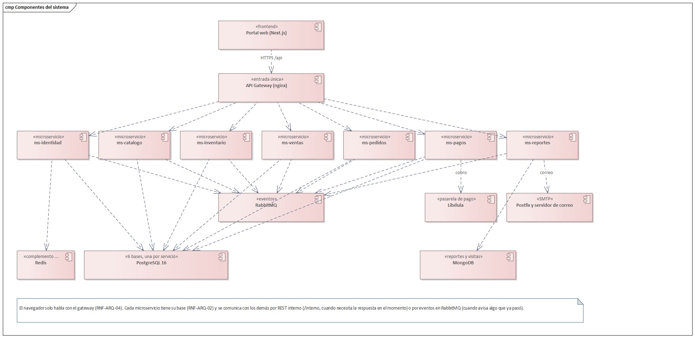
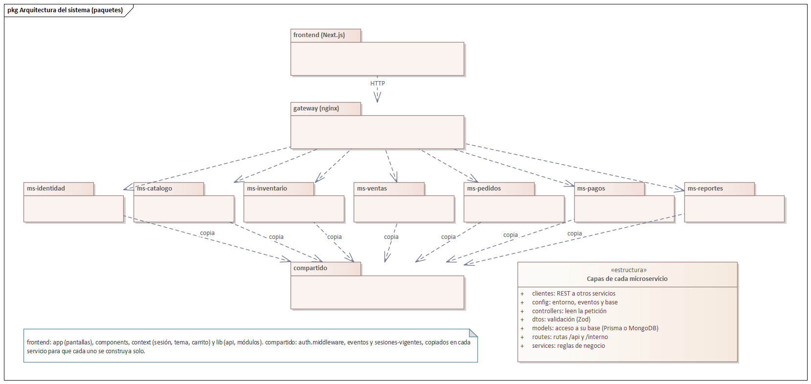
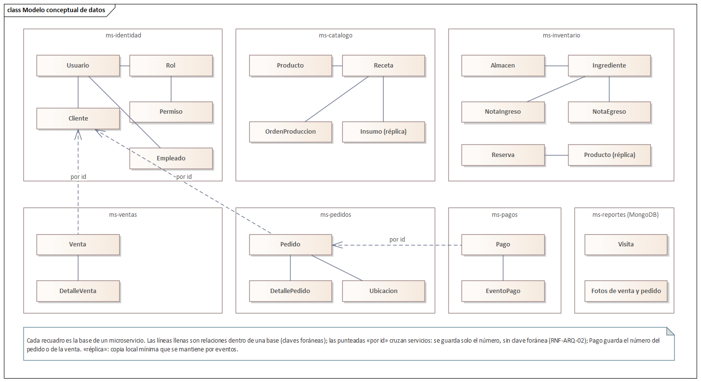
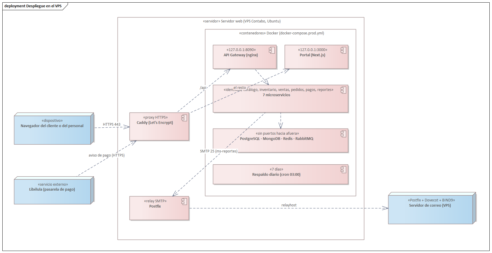
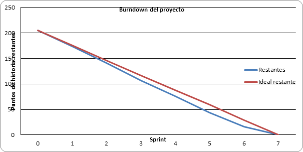
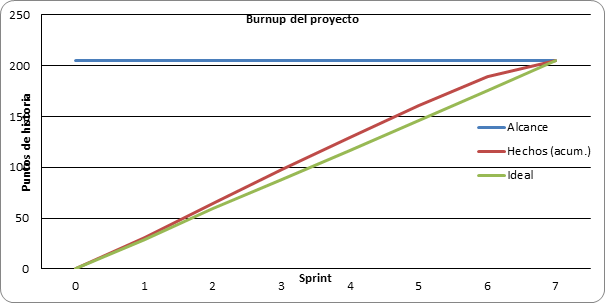

## 3.9 Artefactos (diagrama de componentes)

Este capítulo reúne cómo quedó el sistema al cerrar el último sprint. El diagrama de componentes muestra
las piezas en funcionamiento y cómo se hablan: el navegador solo entra por el API Gateway; cada
microservicio tiene su base de datos; entre ellos se comunican por REST interno cuando necesitan la
respuesta en el momento, y por eventos en RabbitMQ cuando avisan algo que ya pasó.

<!-- figura: Componentes del sistema -->

| Componente | Tecnología | Responsabilidad |
|---|---|---|
| Portal web | Next.js 16, React, Tailwind | Pantallas del cliente (portal) y del personal (módulos por permiso), temas y modo día/noche. |
| API Gateway | nginx 1.27 | Única entrada desde el navegador: reparte `/api` a cada servicio y responde 503 si uno no está. |
| ms-identidad | Node.js 22, Express 5, Prisma, PostgreSQL, Redis | Usuarios, roles, permisos, sesión (RS256), clientes, perfil y apariencia. |
| ms-catalogo | Node.js, Express, Prisma, PostgreSQL | Productos, catálogo y búsqueda, recetas y órdenes de producción. |
| ms-inventario | Node.js, Express, Prisma, PostgreSQL | Insumos, almacenes, lotes, notas de ingreso y egreso, stock y reservas. |
| ms-ventas | Node.js, Express, Prisma, PostgreSQL | Venta de mostrador, comprobante y anulación. |
| ms-pedidos | Node.js, Express, Prisma, PostgreSQL | Carrito, pedidos, direcciones, tablero, reparto y seguimiento. |
| ms-pagos | Node.js, Express, Prisma, PostgreSQL | Cobros con QR o tarjeta (simulada o Libélula), efectivo y modo de cobro. |
| ms-reportes | Node.js, Express, MongoDB | Visitas, reportes con PDF y correo, avisos al cliente. |
| RabbitMQ | 3.13 | Intercambio de eventos `nutriexpress.eventos` con una cola por servicio. |

### 3.9.1 Product Backlog final

Los 39 elementos del Product Backlog quedaron hechos, cada uno en el sprint para el que se planificó.
Donde la columna «Microservicio» cambió respecto del Sprint 0 fue por decisiones tomadas en el camino:
HU-20 se quedó en ms-identidad porque la ficha del cliente ya vivía allí, y los reportes y avisos
necesitaron rutas o eventos en los servicios dueños de los datos.

<!-- anchos: 8 9 28 27 6 9 13 -->
| N.º | ID | Elemento | Microservicio | Pts | Sprint | Estado |
|---|---|---|---|---|---|---|
| 1 | HT-01 | Repositorio y Docker Compose | Todos | 5 | 1 | Hecho |
| 2 | HT-02 | API Gateway | gateway | 3 | 1 | Hecho |
| 3 | HU-01 | Iniciar sesión | ms-identidad | 5 | 1 | Hecho |
| 4 | HU-02 | Registro de cliente | ms-identidad | 3 | 1 | Hecho |
| 5 | HU-03 | Gestionar usuarios | ms-identidad | 5 | 1 | Hecho |
| 6 | HU-04 | Gestionar roles y permisos | ms-identidad | 5 | 1 | Hecho |
| 7 | HU-34 | Menú dinámico | frontend | 3 | 1 | Hecho |
| 8 | HU-31 | Contador de visitas | ms-reportes | 2 | 1 | Hecho |
| 9 | HU-08 | Gestionar productos | ms-catalogo | 5 | 2 | Hecho |
| 10 | HU-11 | Catálogo y búsqueda | ms-catalogo | 5 | 2 | Hecho |
| 11 | HU-12 | Gestionar insumos | ms-inventario | 3 | 2 | Hecho |
| 12 | HU-13 | Gestionar almacenes | ms-inventario | 2 | 2 | Hecho |
| 13 | HU-14 | Notas de ingreso | ms-inventario | 8 | 2 | Hecho |
| 14 | HU-15 | Notas de egreso | ms-inventario | 5 | 2 | Hecho |
| 15 | HU-16 | Stock y alertas | ms-inventario | 5 | 2 | Hecho |
| 16 | HT-03 | Eventos en RabbitMQ | Todos | 5 | 3 | Hecho |
| 17 | HU-09 | Gestionar recetas | ms-catalogo | 5 | 3 | Hecho |
| 18 | HU-10 | Órdenes de producción | ms-catalogo + ms-inventario | 8 | 3 | Hecho |
| 19 | HU-17 | Reservar y liberar stock | ms-inventario | 8 | 3 | Hecho |
| 20 | HU-05 | Permisos por usuario | ms-identidad | 3 | 3 | Hecho |
| 21 | HU-06 | Recuperar contraseña | ms-identidad + ms-reportes | 5 | 3 | Hecho |
| 22 | HU-21 | Carrito y pedido | ms-pedidos | 8 | 4 | Hecho |
| 23 | HU-22 | Direcciones en mapa | ms-pedidos | 3 | 4 | Hecho |
| 24 | HU-26 | Pago en línea (saga) | ms-pagos + ms-pedidos + ms-inventario | 13 | 4 | Hecho |
| 25 | HU-27 | Modo de cobro | ms-pagos | 2 | 4 | Hecho |
| 26 | HU-25 | Mis pedidos y seguimiento | ms-pedidos | 5 | 4 | Hecho |
| 27 | HU-23 | Tablero de pedidos | ms-pedidos | 8 | 5 | Hecho |
| 28 | HU-24 | Mis entregas (repartidor) | ms-pedidos | 8 | 5 | Hecho |
| 29 | HU-18 | Venta de mostrador | ms-ventas | 8 | 5 | Hecho |
| 30 | HU-19 | Comprobante y anulación | ms-ventas | 5 | 5 | Hecho |
| 31 | HU-20 | Gestionar clientes | ms-identidad | 3 | 5 | Hecho |
| 32 | HU-28 | Reporte de ventas | ms-reportes + ms-ventas | 8 | 6 | Hecho |
| 33 | HU-29 | Reporte de pedidos | ms-reportes + ms-pedidos | 5 | 6 | Hecho |
| 34 | HU-33 | Temas y modo día/noche | frontend + ms-identidad | 5 | 6 | Hecho |
| 35 | HU-32 | Notificaciones por correo | ms-reportes + ms-pedidos | 5 | 6 | Hecho |
| 36 | HT-04 | Despliegue en el VPS | Todos | 5 | 6 | Hecho |
| 37 | HT-05 | Tres tipos de prueba | Todos | 8 | 1–7 | Hecho |
| 38 | HU-07 | Perfil propio | ms-identidad | 3 | 7 | Hecho |
| 39 | HU-30 | Reporte de producción e inventario | ms-reportes + ms-catalogo + ms-inventario | 5 | 7 | Hecho |
| | | **Total** | | **205** | | **39 de 39** |

**Velocidad por sprint (puntos hechos):**

| Sprint | 1 | 2 | 3 | 4 | 5 | 6 | 7 | Total |
|---|---|---|---|---|---|---|---|---|
| Planificado | 31 | 33 | 34 | 31 | 32 | 28 | 8 | 197 + HT-05 (8) |
| Hecho | 31 | 33 | 34 | 31 | 32 | 28 | 16 | 205 |

En el Sprint 7 se suman los 8 puntos de HT-05, la historia de las pruebas que corrió en todos los
sprints y se cerró con el último.

### 3.9.2 Arquitectura del sistema (diagrama de paquetes)

El repositorio tiene un paquete por pieza desplegable: el frontend, el gateway y un paquete por
microservicio, cada uno con su `Dockerfile`, su `package.json` y su esquema de base. Lo que comparten
(verificar la sesión, publicar y consumir eventos, rechazar sesiones viejas) vive en `compartido` y se
**copia** en cada servicio: así cada uno se construye y se despliega solo, sin depender de una
biblioteca común. Dentro de cada microservicio se repiten las mismas capas.

<!-- figura: Arquitectura del sistema (paquetes) -->

### 3.9.3 Diseño de datos (conceptual, lógico y físico)

**Modelo conceptual.** Cada microservicio es dueño de sus datos (RNF-ARQ-02). Dentro de una base las
entidades se relacionan con claves foráneas; entre bases solo se guarda el número del otro (el cliente
de un pedido, el pedido de un cobro) y, cuando un servicio necesita algo más, lo pide por REST o guarda
una réplica mínima que mantiene por eventos.

<!-- figura: Modelo conceptual de datos -->

**Modelo lógico.** Las tablas de cada base de PostgreSQL con su clave primaria y sus claves foráneas,
tal como están en el `schema.prisma` de cada servicio (las generó `herramientas/informe/diseno_datos.py`).
Todas las bases tienen además `evento_procesado` (los eventos ya atendidos, RNF-DIS-03) y
`sesion_vigente` (desde cuándo valen las sesiones de un usuario o rol, HU-05).

**identidad_db** (ms-identidad, 9 tablas más `evento_procesado` y `sesion_vigente`)

<!-- anchos: 18 16 26 40 -->
| Tabla | Clave primaria | Claves foráneas | Otras columnas |
|---|---|---|---|
| `cargo` | id_cargo | — | nombre, salario_base |
| `cliente` | id_cliente | id_cliente → usuario | preferencia_alimentaria, restriccion_dietetica |
| `empleado` | id_empleado | id_cargo → cargo; id_empleado → usuario | fecha_ingreso, disponible |
| `permiso` | id_permiso | — | nombre |
| `rol` | id_rol | — | nombre |
| `rol_permiso` | id_rol_permiso | id_permiso → permiso; id_rol → rol |  |
| `usuario` | id_usuario | id_rol → rol | nombre, apellido, email, telefono, nombre_usuario, contrasena_hash, intentos_fallidos, bloqueado, fecha_bloqueo, activo, fecha_registro, ultimo_acceso, tema, modo, veces_bloqueado |
| `usuario_rol_permiso` | id_usuario_rol_permiso | id_rol_permiso → rol_permiso; id_usuario → usuario |  |
| `recuperacion_contrasena` | id_recuperacion | id_usuario → usuario | codigo_hash, creado_en, expira_en, intentos, usado_en |

**catalogo_db** (ms-catalogo, 9 tablas más `evento_procesado` y `sesion_vigente`)

<!-- anchos: 18 16 26 40 -->
| Tabla | Clave primaria | Claves foráneas | Otras columnas |
|---|---|---|---|
| `categoria` | id_categoria | — | nombre |
| `producto` | id_producto | id_categoria → categoria | nombre, descripcion, precio_venta, activo, tipo_conservacion, imagen_tipo, imagen_actualizada_en |
| `valor_nutricional` | id_producto | id_producto → producto | calorias, proteinas_g, carbohidratos_g, grasas_g, fibra_g |
| `configuracion` | clave | — | valor, descripcion, actualizado_en, id_usuario |
| `insumo` | id_ingrediente | — | nombre, unidad, costo_unitario, activo |
| `receta` | id_receta | id_producto → producto | nombre, rendimiento, tiempo_preparacion_minutos, instrucciones, divisible, activa, creada_en |
| `detalle_receta` | id_receta, id_ingrediente | id_ingrediente → insumo; id_receta → receta | cantidad_requerida |
| `detalle_orden_insumo` | id_orden_produccion, id_ingrediente | id_orden_produccion → orden_produccion | nombre, unidad, cantidad, costo_unitario |
| `orden_produccion` | id_orden_produccion | id_receta → receta | fecha, estado, cantidad, id_empleado, empleado_nombre, fecha_finalizacion, cantidad_obtenida, costo_total, id_almacen_destino, almacen_destino, id_nota_egreso, id_nota_ingreso |

**inventario_db** (ms-inventario, 18 tablas más `evento_procesado` y `sesion_vigente`)

<!-- anchos: 18 16 26 40 -->
| Tabla | Clave primaria | Claves foráneas | Otras columnas |
|---|---|---|---|
| `almacen` | id_almacen | — | nombre, tipo_conservacion, ubicacion_fisica, preferido |
| `detalle_egreso_insumo` | id_nota_egreso, id_ingrediente, id_almacen | id_nota_egreso → nota_egreso; id_ingrediente, id_almacen → ingrediente_almacen | cantidad |
| `detalle_egreso_producto` | id_nota_egreso, id_producto, id_almacen | id_nota_egreso → nota_egreso; id_producto, id_almacen → producto_almacen | cantidad |
| `detalle_ingreso_insumo` | id_nota_ingreso, id_ingrediente, id_almacen | id_lote → lote; id_nota_ingreso → nota_ingreso; id_ingrediente, id_almacen → ingrediente_almacen | cantidad, costo_unitario |
| `detalle_ingreso_producto` | id_nota_ingreso, id_producto, id_almacen | id_nota_ingreso → nota_ingreso; id_producto, id_almacen → producto_almacen | cantidad, costo_unitario |
| `empleado` | id_empleado | — | nombre, apellido |
| `ingrediente` | id_ingrediente | id_unidad → unidad_medida | nombre, stock_minimo, costo_unitario, activo, tipo_conservacion, controla_vencimiento |
| `ingrediente_almacen` | id_ingrediente, id_almacen | id_almacen → almacen; id_ingrediente → ingrediente | stock_actual |
| `nota_egreso` | id_nota_egreso | id_empleado → empleado; id_nota_ingreso → nota_ingreso | fecha, motivo, observacion |
| `nota_ingreso` | id_nota_ingreso | id_nota_egreso → nota_egreso; id_empleado → empleado | fecha, motivo, proveedor, numero_documento, total |
| `producto` | id_producto | — | nombre, tipo_conservacion, activo |
| `producto_almacen` | id_producto, id_almacen | id_almacen → almacen; id_producto → producto | stock_actual |
| `unidad_medida` | id_unidad | — | nombre, abreviatura |
| `lote` | id_lote | id_ingrediente → ingrediente | codigo, fecha_vencimiento, fecha_registro |
| `lote_almacen` | id_lote, id_almacen | id_almacen → almacen; id_lote → lote | stock_actual |
| `detalle_reserva_insumo` | id_reserva, id_ingrediente | id_ingrediente → ingrediente; id_reserva → reserva | cantidad |
| `detalle_reserva_producto` | id_reserva, id_producto | id_producto → producto; id_reserva → reserva | cantidad |
| `reserva` | id_reserva | id_almacen_destino → almacen | origen, estado, creada_en, cerrada_en |

**ventas_db** (ms-ventas, 2 tablas más `evento_procesado` y `sesion_vigente`)

<!-- anchos: 18 16 26 40 -->
| Tabla | Clave primaria | Claves foráneas | Otras columnas |
|---|---|---|---|
| `detalle_venta` | id_venta, id_producto, id_almacen | id_venta → venta | nombre_producto, nombre_almacen, cantidad, precio_unitario, costo_unitario |
| `venta` | id_venta | — | fecha, tipo_venta, metodo_pago, estado_pago, total, id_cliente, cliente_nombre, id_empleado, empleado_nombre, empleado_apellido, id_reserva, id_nota_egreso, id_pago, motivo_anulacion, anulada_en |

**pedidos_db** (ms-pedidos, 5 tablas más `evento_procesado` y `sesion_vigente`)

<!-- anchos: 18 16 26 40 -->
| Tabla | Clave primaria | Claves foráneas | Otras columnas |
|---|---|---|---|
| `detalle_pedido` | id_pedido, id_producto | id_pedido → pedido | nombre_producto, cantidad, precio_unitario, costo_unitario |
| `pedido` | id_pedido | id_ubicacion → ubicacion | fecha, estado_pedido, estado_pago, metodo_pago, referencia_pago, total, fecha_entrega, motivo_cancelacion, id_usuario, cliente_nombre, id_reserva, id_pago, id_repartidor, repartidor_nombre |
| `posicion_repartidor` | id_empleado | — | latitud, longitud, precision_m, actualizada_en |
| `ubicacion` | id_ubicacion | — | id_usuario, etiqueta, calle, numero, referencia, latitud, longitud, principal, vigente, fecha_registro |
| `turno_repartidor` | id_empleado | — | disponible, actualizado_en |

**pagos_db** (ms-pagos, 3 tablas más `evento_procesado` y `sesion_vigente`)

<!-- anchos: 18 16 26 40 -->
| Tabla | Clave primaria | Claves foráneas | Otras columnas |
|---|---|---|---|
| `configuracion` | clave | — | valor, actualizado_en, actualizado_por |
| `evento_pago` | id_evento | id_pago → pago | tipo, origen, cuerpo, recibido_en |
| `pago` | id_pago | — | monto, moneda, metodo, estado, modo, pasarela, id_transaccion_ext, datos_cobro, tipo_datos, fecha_creacion, fecha_expiracion, fecha_confirmacion, id_pedido, id_venta |

**Modelo físico.**

| Gestor | Bases o colecciones | Decisiones físicas |
|---|---|---|
| PostgreSQL 16 | `identidad_db`, `catalogo_db`, `inventario_db`, `ventas_db`, `pedidos_db`, `pagos_db` | Un usuario por base, dueño solo de la suya, sin permiso `CONNECT` en las demás. El esquema es `prisma/esquema.sql` de cada servicio (crea tablas, `CHECK` de estados y cantidades e índices por fecha y estado). Dinero en `NUMERIC(12,2)` y cantidades de insumo en `NUMERIC(12,3)`. Los cambios posteriores van al final del archivo y se aplican al arrancar. |
| MongoDB 4.4 | `reportes`: `visitas`, `ventas`, `pedidos`, `bandeja_correos`, `eventos_procesados`, `sesiones_vigentes` | Documentos con sus líneas adentro, índices por fecha. `ventas` y `pedidos` son la copia para los reportes; `bandeja_correos`, los avisos pendientes. |
| Redis 7 | base 0, claves `identidad:limite:*` | Contadores de los límites de intentos por IP de ms-identidad. Si Redis no responde, se cuenta en memoria. |

Los respaldos se describen en el despliegue: cada día a las 03:00 se guardan las seis bases y la de
MongoDB, con siete días de historia.

### 3.9.4 Diagrama de despliegue

El sistema corre en un servidor web (VPS) con Docker detrás de Caddy, que tiene el certificado HTTPS, y
envía su correo por el Postfix del servidor web hacia el servidor de correo. Solo el gateway y el portal
publican un puerto, y solo hacia adentro del servidor. El detalle está en la sección 3.7.3 y en
`herramientas/vps/LEEME.md`.

<!-- figura: Despliegue final en el VPS -->

### 3.9.5 Gráficas Burndown y Burnup de todo el proyecto

<!-- figura: Burndown del proyecto -->

**Análisis:** los 205 puntos bajan a cero en siete sprints. La línea real va por debajo de la ideal
desde el Sprint 1: el equipo terminó el Sprint 6 con 16 puntos pendientes, menos que los 29 que preveía
el plan, y el sprint de reserva alcanzó para cerrarlos.

<!-- figura: Burnup del proyecto -->

**Análisis:** el alcance no cambió en todo el proyecto (205 puntos). Los puntos hechos van por encima
de la línea ideal y la alcanzan en el Sprint 7.
