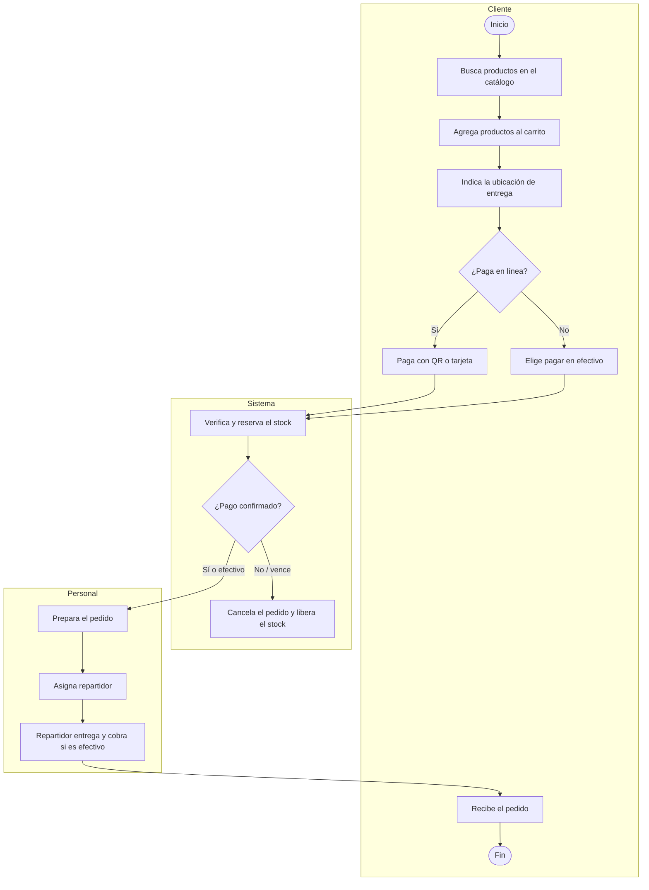
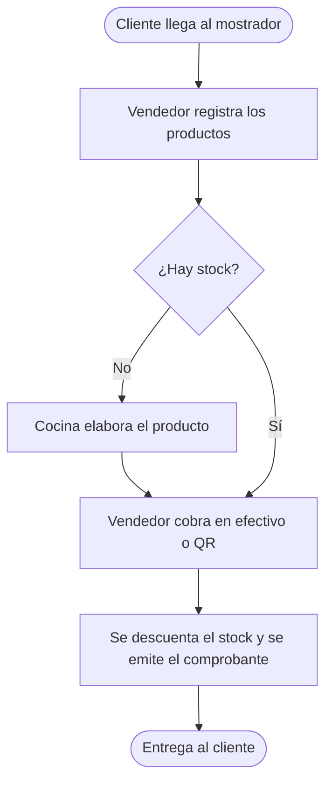
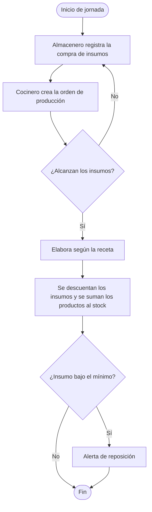
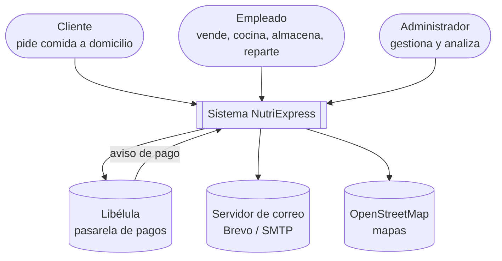
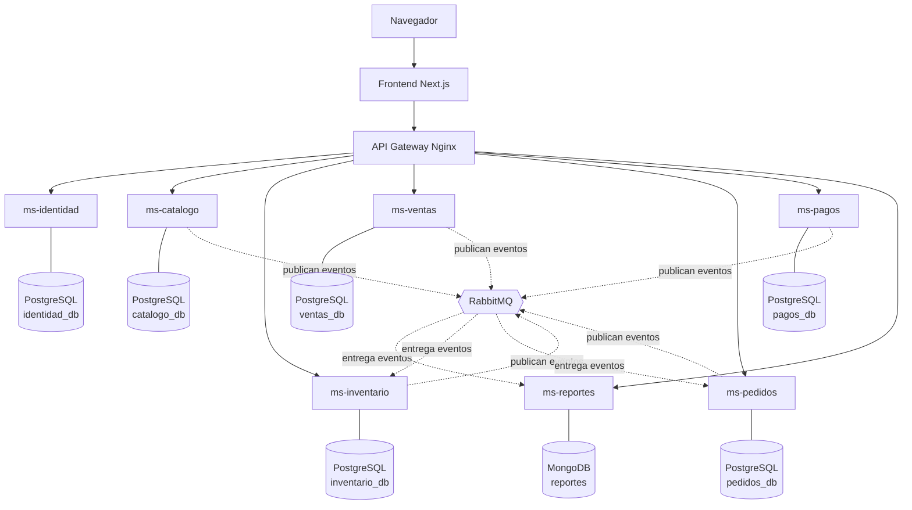
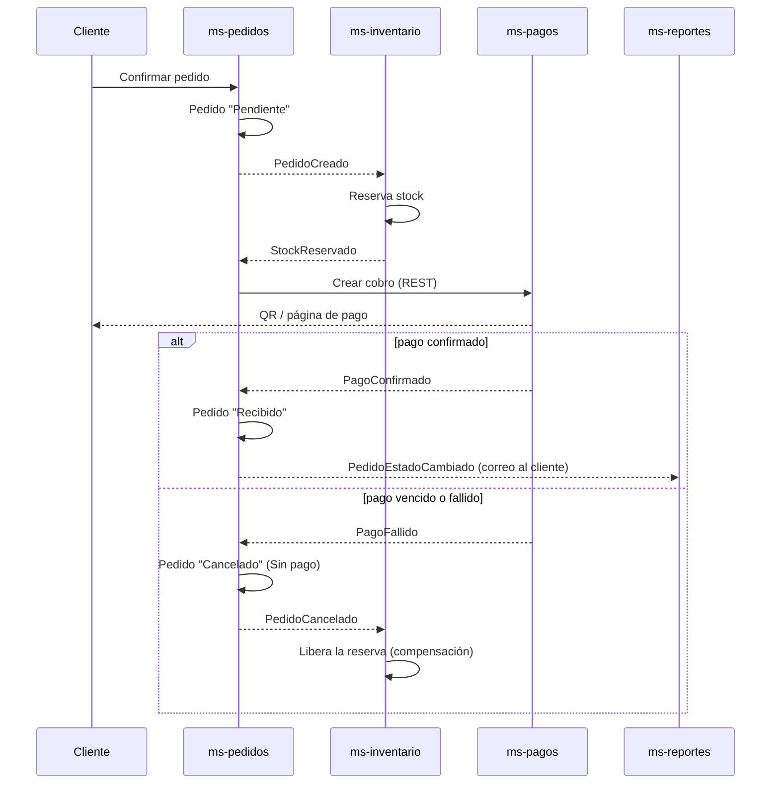

# PARTE II: DESARROLLO DEL SISTEMA

# CAPÍTULO 3

## 3.1 Sprint 0

**Duración:** martes 20 de octubre al domingo 25 de octubre de 2026.
**Objetivo del sprint:** dejar definido *qué* se va a construir y *cómo*: roles del equipo, modelo
del negocio, requisitos, historias de usuario priorizadas, arquitectura de microservicios,
herramientas y el plan de sprints. El Sprint 0 no entrega software funcionando; entrega el plan y el
repositorio preparado para comenzar el Sprint 1.

---

### 3.1.1 Personas y roles del proyecto

| Rol Scrum | Persona | Responsabilidades |
|---|---|---|
| **Product Owner** | Joseph Flores García **[CONFIRMAR]** | Representa al negocio NutriExpress. Mantiene y prioriza el Product Backlog, acepta o rechaza las historias terminadas en la Sprint Review. |
| **Scrum Master** | Nilser Rodrigo Condori Ortiz **[CONFIRMAR]** | Facilita los eventos Scrum, mantiene el tablero y las gráficas al día y elimina impedimentos. |
| **Equipo de desarrollo** | Nilser Rodrigo Condori Ortiz y Joseph Flores García | Diseñan, programan, prueban y despliegan los microservicios y el frontend. |
| **Interesado (stakeholder)** | Ing. Edwin Calle Terrazas (docente) | Revisa los incrementos y aporta retroalimentación. |

Por ser un equipo de dos personas, el Product Owner y el Scrum Master también forman parte del
equipo de desarrollo, práctica admitida por la Guía Scrum para equipos pequeños.

**Acuerdos de trabajo:**

| Evento | Cuándo | Duración |
|---|---|---|
| Sprint | Lunes a domingo (1 semana) | 7 días |
| Sprint Planning | Lunes al iniciar el sprint | 1 hora |
| Daily Meeting | Todos los días, por videollamada o mensaje | 15 minutos |
| Sprint Review | Domingo, demostración del incremento | 30 minutos |
| Sprint Retrospective | Domingo, después de la review | 15 minutos |

En la Daily cada integrante responde: ¿qué hice ayer?, ¿qué haré hoy?, ¿qué me lo impide? Las
respuestas se registran en el tablero para el apartado *Daily Meeting* de cada sprint.

**Definición de terminado (Definition of Done).** Una historia está terminada cuando:
1. Su código está en la rama principal del repositorio, revisado por el otro integrante.
2. Cumple todos sus criterios de aceptación.
3. Tiene pruebas automatizadas que pasan.
4. Funciona levantando el sistema completo con `docker compose up`.
5. Su tarjeta está en la columna *Done* del tablero.

---

### 3.1.2 Modelo de negocio (diagrama de actividades)

> Los diagramas definitivos se dibujan en Enterprise Architect; aquí se describe su contenido.

**Proceso de pedido a domicilio**

**Proceso de venta en el local**

**Proceso de producción e inventario**

---

### 3.1.3 Requisitos funcionales

Organizados por microservicio. Los códigos se citan en las historias de usuario y en el código.

**Identidad y seguridad (ms-identidad)**

| Código | Requisito |
|---|---|
| RF-SEG-01 | Autenticar a los usuarios con nombre de usuario y contraseña antes de permitir el acceso. |
| RF-SEG-02 | Almacenar las contraseñas cifradas con un algoritmo de hash con salt (bcrypt). |
| RF-SEG-03 | Exigir contraseñas de al menos 8 caracteres con mayúsculas, minúsculas, números y un carácter especial. |
| RF-SEG-04 | Bloquear la cuenta tras tres intentos fallidos consecutivos, con bloqueo temporal creciente. |
| RF-SEG-05 | Registrar, modificar, dar de baja y reactivar usuarios, con su rol y, si son empleados, su cargo. |
| RF-SEG-06 | Registrar y modificar roles y asociar a cada rol sus permisos (al menos dos roles: Administrador y Cliente, además de Empleado). |
| RF-SEG-07 | Asignar permisos a cada usuario dentro de los habilitados para su rol. |
| RF-SEG-08 | Restringir cada operación según los permisos del usuario, verificados en el servidor. |
| RF-SEG-09 | Permitir que el cliente se registre por sí mismo en el portal. |
| RF-SEG-10 | Recuperar la contraseña con un código enviado al correo de la cuenta. |
| RF-SEG-11 | Permitir a cada usuario editar sus datos y cambiar su contraseña desde su perfil. |

**Catálogo y producción (ms-catalogo)**

| Código | Requisito |
|---|---|
| RF-PRO-01 | Registrar y modificar productos con categoría, precio de venta y foto. |
| RF-PRO-02 | Registrar la información nutricional de cada producto (calorías, proteínas, carbohidratos, grasas y fibra). |
| RF-PRO-03 | Registrar recetas con rendimiento, tiempo de preparación, instrucciones e insumos con sus cantidades. |
| RF-PRO-04 | Mantener versiones de receta por producto, con una sola activa. |
| RF-PRO-05 | Generar órdenes de producción calculando los insumos requeridos según el rendimiento de la receta. |
| RF-PRO-06 | Verificar la disponibilidad de insumos antes de ejecutar una orden. |
| RF-PRO-07 | Al finalizar una orden, descontar los insumos y sumar el producto terminado al stock. |
| RF-PRO-08 | Mostrar el catálogo público con descripción, precio e información nutricional. |
| RF-PRO-09 | Buscar productos e información del negocio desde el encabezado de la página principal. |

**Inventario (ms-inventario)**

| Código | Requisito |
|---|---|
| RF-INV-01 | Registrar y modificar insumos con unidad de medida, stock mínimo y si es perecedero. |
| RF-INV-02 | Registrar y modificar almacenes con su tipo de conservación. |
| RF-INV-03 | Registrar notas de ingreso (compra, reposición, ajuste, devolución) actualizando el stock. |
| RF-INV-04 | Registrar notas de egreso (merma, ajuste, devolución) actualizando el stock. |
| RF-INV-05 | Impedir egresos que superen el stock disponible del almacén. |
| RF-INV-06 | Alertar cuando un insumo alcance o baje de su stock mínimo. |
| RF-INV-07 | Consultar el stock de insumos y productos por almacén. |
| RF-INV-08 | Controlar los lotes de perecederos con su fecha de vencimiento. |
| RF-INV-09 | Recalcular el costo del insumo por promedio ponderado en cada compra. |
| RF-INV-10 | Reservar y liberar stock a pedido de otros servicios (ventas y pedidos). |

**Ventas (ms-ventas)**

| Código | Requisito |
|---|---|
| RF-VEN-01 | Registrar, modificar y consultar los datos de los clientes. |
| RF-VEN-02 | Registrar una venta en el local, en mesa o para llevar, con uno o varios productos. |
| RF-VEN-03 | Calcular el total con los precios del catálogo y registrar el método de pago (efectivo o QR). |
| RF-VEN-04 | Descontar del stock los productos vendidos al confirmar la venta. |
| RF-VEN-05 | Impedir la venta cuando la cantidad supere el stock disponible. |
| RF-VEN-06 | Emitir el comprobante de la venta. |
| RF-VEN-07 | Anular una venta devolviendo el stock. |

**Pedidos (ms-pedidos)**

| Código | Requisito |
|---|---|
| RF-PED-01 | Permitir al cliente agregar productos a un carrito y modificar las cantidades. |
| RF-PED-02 | Permitir al cliente registrar sus ubicaciones de entrega marcándolas en un mapa. |
| RF-PED-03 | Confirmar el pedido reservando el stock de sus productos. |
| RF-PED-04 | Asignar al pedido un empleado con cargo de repartidor. |
| RF-PED-05 | Registrar el estado del pedido: recibido, en preparación, en camino, entregado o cancelado (con su motivo). |
| RF-PED-06 | Permitir al cliente consultar sus pedidos y cancelarlos mientras no estén en camino. |
| RF-PED-07 | Mostrar al cliente la posición del repartidor mientras el pedido está en camino. |

**Pagos (ms-pagos)**

| Código | Requisito |
|---|---|
| RF-PAG-01 | Cobrar el pedido en línea con QR o tarjeta mediante la pasarela Libélula. |
| RF-PAG-02 | Recibir y validar los avisos de pago de la pasarela. |
| RF-PAG-03 | Vencer los cobros no pagados y avisar a los servicios interesados. |
| RF-PAG-04 | Permitir al administrador alternar entre cobro simulado y real. |

**Reportes y notificaciones (ms-reportes)**

| Código | Requisito |
|---|---|
| RF-REP-01 | Generar un reporte parametrizado de ventas por rango de fechas, producto y vendedor. |
| RF-REP-02 | Generar un reporte parametrizado de pedidos por rango de fechas, estado y repartidor. |
| RF-REP-03 | Generar un reporte de producción y de movimientos de inventario por fechas e ítem. |
| RF-REP-04 | Exportar cada reporte a PDF y enviarlo a una o varias cuentas de correo. |
| RF-REP-05 | Enviar por correo el comprobante y los avisos de cambio de estado del pedido. |

**Sitio web (frontend)**

| Código | Requisito |
|---|---|
| RF-WEB-01 | Estilo CSS único con menú interactivo y dinámico según los permisos del usuario. |
| RF-WEB-02 | Tres temas seleccionables (niños, jóvenes, adultos) y modo día/noche automático según el horario del cliente. |
| RF-WEB-03 | Mostrar en el pie de cada página el número de visitas de esa página. |

---

### 3.1.4 Requisitos no funcionales

| Código | Categoría | Requisito |
|---|---|---|
| RNF-ARQ-01 | Arquitectura | El sistema se compone de microservicios independientes, uno por dominio del negocio. |
| RNF-ARQ-02 | Arquitectura | Cada microservicio tiene su propia base de datos; ningún servicio accede a la base de otro. |
| RNF-ARQ-03 | Arquitectura | Se emplean al menos dos gestores de bases de datos: PostgreSQL (relacional) y MongoDB (documental). |
| RNF-ARQ-04 | Arquitectura | Todo acceso desde el navegador pasa por un API Gateway. |
| RNF-ARQ-05 | Arquitectura | Los servicios se comunican por REST (síncrono) y por eventos en RabbitMQ (asíncrono). |
| RNF-ARQ-06 | Arquitectura | Cada servicio se empaqueta en un contenedor Docker y el sistema se levanta con Docker Compose. |
| RNF-DIS-01 | Disponibilidad | La falla de un servicio no debe detener a los que no dependen de él (por ejemplo, sin pagos la venta en efectivo sigue funcionando). |
| RNF-DIS-02 | Confiabilidad | Las operaciones entre servicios se coordinan con el patrón Saga y compensan los pasos ya hechos si uno falla; no quedan descuentos parciales de stock. |
| RNF-DIS-03 | Confiabilidad | Los eventos se procesan al menos una vez y los consumidores los tratan de forma idempotente. |
| RNF-SEG-01 | Seguridad | La comunicación externa usa HTTPS. |
| RNF-SEG-02 | Seguridad | Cada petición se autentica con un token JWT firmado; los servicios validan el token y los permisos antes de operar. |
| RNF-SEG-03 | Seguridad | Los datos de entrada se validan en el servidor; los precios los fija el servidor. |
| RNF-SEG-04 | Seguridad | La sesión expira tras un periodo de inactividad. |
| RNF-REN-01 | Rendimiento | Las consultas frecuentes responden en menos de 3 segundos. |
| RNF-REN-02 | Rendimiento | El sistema soporta 50 usuarios concurrentes sin degradación perceptible. |
| RNF-USA-01 | Usabilidad | La interfaz es responsiva (computadora, tableta y teléfono) y está en español. |
| RNF-USA-02 | Usabilidad | Las operaciones que modifican o eliminan piden confirmación. |
| RNF-COM-01 | Compatibilidad | Funciona en las versiones vigentes de Chrome, Firefox y Edge sin instalar software. |
| RNF-MAN-01 | Mantenibilidad | Código en TypeScript con tipado estático en todos los servicios y en el frontend. |
| RNF-MAN-02 | Mantenibilidad | Cada servicio tiene pruebas automatizadas; el proyecto aplica al menos tres tipos de prueba (unitarias, de integración y de punta a punta). |

---

### 3.1.5 Historias de usuario

Formato: *Como* <rol>, *quiero* <acción>, *para* <beneficio>. Estimación en puntos de historia
(serie de Fibonacci: 1, 2, 3, 5, 8, 13). Prioridad: **Alta** (sin ella el negocio no opera),
**Media** (necesaria para el producto completo), **Baja** (mejora).

#### Épica 0 – Infraestructura (historias técnicas)

| ID | Historia | Criterios de aceptación | Pts | Prior. |
|---|---|---|---|---|
| HT-01 | Como equipo, queremos un repositorio con Docker Compose que levante bases de datos, broker y servicios, para trabajar todos sobre el mismo entorno. | `docker compose up` levanta PostgreSQL, MongoDB, RabbitMQ y los servicios; cada servicio responde `GET /salud`. | 5 | Alta |
| HT-02 | Como equipo, queremos un API Gateway, para que el navegador tenga una única dirección de entrada. | Las rutas `/api/<servicio>/*` llegan a su servicio; una ruta inexistente responde 404. | 3 | Alta |
| HT-03 | Como equipo, queremos un catálogo de eventos publicado en RabbitMQ, para que los servicios se avisen sin depender unos de otros. | Un evento publicado por un servicio llega a sus consumidores; un evento repetido no se procesa dos veces. | 5 | Alta |
| HT-04 | Como equipo, queremos desplegar el sistema en el VPS con HTTPS, para que el docente y los clientes lo usen desde internet. | El sistema responde por HTTPS en su dominio; el despliegue no afecta a otros sistemas del servidor. | 5 | Alta |
| HT-05 | Como equipo, queremos pruebas unitarias, de integración y de punta a punta, para verificar el sistema en cada sprint. | Existen y pasan los tres tipos de prueba; se ejecutan con un solo comando. | 8 | Alta |

#### Épica 1 – Identidad y seguridad (ms-identidad)

| ID | Historia | Criterios de aceptación | Pts | Prior. |
|---|---|---|---|---|
| HU-01 | Como usuario, quiero iniciar sesión con mi usuario y contraseña, para acceder a las funciones que me corresponden. | Credenciales válidas devuelven un token; tres intentos fallidos bloquean la cuenta temporalmente; el mensaje no revela si el usuario existe. | 5 | Alta |
| HU-02 | Como cliente, quiero registrarme en el portal, para hacer pedidos a domicilio. | La contraseña cumple la política (RF-SEG-03); el correo y el usuario no se repiten; la cuenta nace con rol Cliente. | 3 | Alta |
| HU-03 | Como administrador, quiero registrar, modificar, dar de baja y reactivar usuarios, para controlar quién accede. | Se asigna rol y, a los empleados, cargo; nadie puede darse de baja ni cambiarse el rol a sí mismo. | 5 | Alta |
| HU-04 | Como administrador, quiero crear roles y asignarles permisos, para definir qué puede hacer cada tipo de usuario. | Existen al menos los roles Administrador, Empleado y Cliente; un rol con usuarios no se elimina. | 5 | Alta |
| HU-05 | Como administrador, quiero ajustar los permisos de un usuario, para darle o quitarle tareas puntuales. | Solo se asignan permisos habilitados para su rol; el cambio rige en la siguiente petición. | 3 | Media |
| HU-06 | Como usuario, quiero recuperar mi contraseña con un código enviado a mi correo, para volver a entrar si la olvido. | El código vence a los 15 minutos y sirve una vez; la respuesta es la misma exista o no la cuenta. | 5 | Media |
| HU-07 | Como usuario, quiero editar mis datos y cambiar mi contraseña, para mantener mi cuenta al día. | Se pide la contraseña actual para cambiarla; no se puede cambiar el rol ni el estado de la cuenta. | 3 | Media |

#### Épica 2 – Catálogo y producción (ms-catalogo)

| ID | Historia | Criterios de aceptación | Pts | Prior. |
|---|---|---|---|---|
| HU-08 | Como administrador, quiero registrar productos con su precio, foto e información nutricional, para ofrecerlos a los clientes. | Precio mayor a cero; la información nutricional no es negativa; se puede desactivar un producto. | 5 | Alta |
| HU-09 | Como cocinero, quiero registrar la receta de cada producto con sus insumos y cantidades, para elaborarlo siempre igual y conocer su costo. | Una sola receta activa por producto; los insumos se eligen de los registrados en inventario. | 5 | Alta |
| HU-10 | Como cocinero, quiero crear y finalizar órdenes de producción, para registrar lo que elaboro. | Calcula los insumos según el rendimiento; no se finaliza sin insumos suficientes; al finalizar se descuentan los insumos y se suma el producto. | 8 | Alta |
| HU-11 | Como cliente, quiero ver el catálogo y buscar productos e información del negocio desde el encabezado, para encontrar rápido lo que busco. | La búsqueda no distingue mayúsculas ni tildes; muestra productos activos con precio y nutrientes; encuentra horario y contacto. | 5 | Alta |

#### Épica 3 – Inventario (ms-inventario)

| ID | Historia | Criterios de aceptación | Pts | Prior. |
|---|---|---|---|---|
| HU-12 | Como almacenero, quiero registrar los insumos con su unidad y stock mínimo, para controlarlos. | Unidades kilogramo, litro o unidad; se indica si es perecedero. | 3 | Alta |
| HU-13 | Como administrador, quiero registrar los almacenes con su tipo de conservación, para ubicar cada ítem donde corresponde. | Tipos ambiente, refrigerado y congelado; un perecedero solo entra a un almacén apto. | 2 | Alta |
| HU-14 | Como almacenero, quiero registrar notas de ingreso, para sumar al stock lo que compro o repongo. | Motivos compra, reposición, ajuste y devolución; la compra recalcula el costo promedio; los perecederos generan lote con vencimiento. | 8 | Alta |
| HU-15 | Como almacenero, quiero registrar notas de egreso, para descontar mermas y ajustes. | No se egresa más de lo disponible; motivos merma, ajuste y devolución al proveedor. | 5 | Alta |
| HU-16 | Como administrador, quiero consultar el stock por almacén y ver alertas de stock mínimo y lotes por vencer, para reponer a tiempo. | Filtra por almacén; marca los insumos bajo el mínimo según la suma de todos los almacenes. | 5 | Alta |
| HU-17 | Como sistema, quiero reservar y liberar stock cuando otros servicios lo piden, para no vender lo que no hay. | Una reserva sin stock se rechaza; una reserva liberada vuelve al disponible; repetir la misma reserva no descuenta dos veces. | 8 | Alta |

#### Épica 4 – Ventas (ms-ventas)

| ID | Historia | Criterios de aceptación | Pts | Prior. |
|---|---|---|---|---|
| HU-18 | Como vendedor, quiero registrar una venta en el mostrador cobrando en efectivo o QR, para atender rápido al cliente. | El precio lo pone el sistema; sin stock no se confirma; al confirmar se descuenta el stock. | 8 | Alta |
| HU-19 | Como vendedor, quiero emitir el comprobante y anular una venta equivocada, para dar constancia y corregir errores. | El comprobante muestra productos, total y método; anular devuelve el stock y no cuenta en lo recaudado. | 5 | Media |
| HU-20 | Como vendedor, quiero registrar y buscar clientes, para asociarlos a sus ventas. | El correo no se repite; la búsqueda no distingue tildes. | 3 | Media |

#### Épica 5 – Pedidos (ms-pedidos)

| ID | Historia | Criterios de aceptación | Pts | Prior. |
|---|---|---|---|---|
| HU-21 | Como cliente, quiero armar un carrito y confirmar mi pedido, para recibirlo en casa. | Se reserva el stock al confirmar; si falta stock se informa qué producto; pago en línea o efectivo. | 8 | Alta |
| HU-22 | Como cliente, quiero guardar mis direcciones de entrega marcándolas en un mapa, para no escribirlas cada vez. | Coordenadas con seis decimales; una dirección puede quedar como principal. | 3 | Media |
| HU-23 | Como vendedor, quiero ver los pedidos en un tablero, cambiar su estado y asignar un repartidor, para despacharlos en orden. | Solo se asignan empleados con cargo Repartidor; los estados siguen el flujo definido. | 8 | Alta |
| HU-24 | Como repartidor, quiero ver mis entregas, compartir mi ubicación y marcar el pedido como entregado o no entregado, para cerrar el reparto. | Solo el repartidor asignado cierra la entrega; entregar cobra el efectivo; no entregar devuelve el stock. | 8 | Media |
| HU-25 | Como cliente, quiero ver el estado de mis pedidos, cancelarlos antes de que salgan y seguir al repartidor en el mapa, para saber cuándo llega. | Solo ve sus pedidos; cancelar libera el stock; la posición solo se ve con el pedido en camino. | 5 | Media |

#### Épica 6 – Pagos (ms-pagos)

| ID | Historia | Criterios de aceptación | Pts | Prior. |
|---|---|---|---|---|
| HU-26 | Como cliente, quiero pagar mi pedido en línea con QR o tarjeta, para no manejar efectivo. | Se genera el cobro en Libélula o en la pasarela simulada; al confirmarse el pago el pedido avanza; si vence, el pedido se cancela y el stock se libera. | 13 | Alta |
| HU-27 | Como administrador, quiero alternar entre cobro simulado y real, para hacer demostraciones sin dinero. | El cambio rige sin reiniciar; cada pago conserva el modo con que nació. | 2 | Media |

#### Épica 7 – Reportes y notificaciones (ms-reportes)

| ID | Historia | Criterios de aceptación | Pts | Prior. |
|---|---|---|---|---|
| HU-28 | Como administrador, quiero un reporte de ventas por fechas, producto y vendedor, exportable a PDF y enviable a varios correos, para analizar el negocio. | Las ventas anuladas no suman; el PDF llega a todos los correos indicados. | 8 | Alta |
| HU-29 | Como administrador, quiero un reporte de pedidos por fechas, estado y repartidor, exportable a PDF y enviable por correo, para medir el reparto. | Los cancelados no suman al total; distingue asignados de entregados. | 5 | Alta |
| HU-30 | Como administrador, quiero un reporte de producción y movimientos de inventario, para controlar consumos y mermas. | Filtra por fechas e ítem; cuenta como salida lo vendido. | 5 | Media |
| HU-31 | Como visitante, quiero ver cuántas visitas tiene cada página en su pie, para conocer su popularidad. | Cada página suma una visita al cargarse y muestra su total. | 2 | Alta |
| HU-32 | Como cliente, quiero recibir por correo el comprobante y los cambios de estado de mi pedido, para estar informado. | El correo sale aunque el servicio de pedidos esté ocupado (asíncrono). | 5 | Media |

#### Épica 8 – Sitio web (frontend)

| ID | Historia | Criterios de aceptación | Pts | Prior. |
|---|---|---|---|---|
| HU-33 | Como usuario, quiero elegir el tema niños, jóvenes o adultos y que el modo día/noche siga mi horario, para una experiencia a mi gusto. | Tres temas completos; el modo cambia según la hora local; la elección se recuerda. | 5 | Alta |
| HU-34 | Como empleado, quiero un menú que muestre solo los módulos a los que tengo acceso, para no perderme en opciones que no uso. | El menú se arma con los permisos del usuario; un cliente nunca ve el escritorio del personal. | 3 | Alta |

---

### 3.1.6 Product Backlog

Ordenado por prioridad y por dependencia técnica. **Total: 39 elementos, 205 puntos.**
Velocidad prevista: unos 33 puntos por sprint de una semana entre los dos integrantes.

| Orden | ID | Elemento | Microservicio | Pts | Prioridad | Sprint |
|---|---|---|---|---|---|---|
| 1 | HT-01 | Repositorio y Docker Compose | Todos | 5 | Alta | 1 |
| 2 | HT-02 | API Gateway | gateway | 3 | Alta | 1 |
| 3 | HU-01 | Iniciar sesión | ms-identidad | 5 | Alta | 1 |
| 4 | HU-02 | Registro de cliente | ms-identidad | 3 | Alta | 1 |
| 5 | HU-03 | Gestionar usuarios | ms-identidad | 5 | Alta | 1 |
| 6 | HU-04 | Gestionar roles y permisos | ms-identidad | 5 | Alta | 1 |
| 7 | HU-34 | Menú dinámico | frontend | 3 | Alta | 1 |
| 8 | HU-31 | Contador de visitas | ms-reportes | 2 | Alta | 1 |
| 9 | HU-08 | Gestionar productos | ms-catalogo | 5 | Alta | 2 |
| 10 | HU-11 | Catálogo y búsqueda | ms-catalogo | 5 | Alta | 2 |
| 11 | HU-12 | Gestionar insumos | ms-inventario | 3 | Alta | 2 |
| 12 | HU-13 | Gestionar almacenes | ms-inventario | 2 | Alta | 2 |
| 13 | HU-14 | Notas de ingreso | ms-inventario | 8 | Alta | 2 |
| 14 | HU-15 | Notas de egreso | ms-inventario | 5 | Alta | 2 |
| 15 | HU-16 | Stock y alertas | ms-inventario | 5 | Alta | 2 |
| 16 | HT-03 | Eventos en RabbitMQ | Todos | 5 | Alta | 3 |
| 17 | HU-09 | Gestionar recetas | ms-catalogo | 5 | Alta | 3 |
| 18 | HU-10 | Órdenes de producción | ms-catalogo + ms-inventario | 8 | Alta | 3 |
| 19 | HU-17 | Reservar y liberar stock | ms-inventario | 8 | Alta | 3 |
| 20 | HU-05 | Permisos por usuario | ms-identidad | 3 | Media | 3 |
| 21 | HU-06 | Recuperar contraseña | ms-identidad + ms-reportes | 5 | Media | 3 |
| 22 | HU-21 | Carrito y pedido | ms-pedidos | 8 | Alta | 4 |
| 23 | HU-22 | Direcciones en mapa | ms-pedidos | 3 | Media | 4 |
| 24 | HU-26 | Pago en línea (saga) | ms-pagos + ms-pedidos + ms-inventario | 13 | Alta | 4 |
| 25 | HU-27 | Modo de cobro | ms-pagos | 2 | Media | 4 |
| 26 | HU-25 | Mis pedidos y seguimiento | ms-pedidos | 5 | Media | 4 |
| 27 | HU-23 | Tablero de pedidos | ms-pedidos | 8 | Alta | 5 |
| 28 | HU-24 | Mis entregas (repartidor) | ms-pedidos | 8 | Media | 5 |
| 29 | HU-18 | Venta de mostrador | ms-ventas | 8 | Alta | 5 |
| 30 | HU-19 | Comprobante y anulación | ms-ventas | 5 | Media | 5 |
| 31 | HU-20 | Gestionar clientes | ms-ventas | 3 | Media | 5 |
| 32 | HU-28 | Reporte de ventas | ms-reportes | 8 | Alta | 6 |
| 33 | HU-29 | Reporte de pedidos | ms-reportes | 5 | Alta | 6 |
| 34 | HU-33 | Temas y modo día/noche | frontend | 5 | Alta | 6 |
| 35 | HU-32 | Notificaciones por correo | ms-reportes | 5 | Media | 6 |
| 36 | HT-04 | Despliegue en el VPS | Todos | 5 | Alta | 6 |
| 37 | HT-05 | Tres tipos de prueba | Todos | 8 | Alta | 1–6 |
| 38 | HU-07 | Perfil propio | ms-identidad | 3 | Media | 7 |
| 39 | HU-30 | Reporte de producción e inventario | ms-reportes | 5 | Media | 7 |

**Plan de sprints (release plan)**

| Sprint | Fechas | Objetivo | Pts |
|---|---|---|---|
| 0 | 20-oct – 25-oct | Planificación y arquitectura | — |
| 1 | 26-oct – 01-nov | Infraestructura, gateway e Identidad: se puede iniciar sesión en el sistema | 31 |
| 2 | 02-nov – 08-nov | Catálogo e inventario básico: se registran productos, insumos y stock | 33 |
| 3 | 09-nov – 15-nov | Recetas y producción comunicando servicios por eventos | 34 |
| 4 | 16-nov – 22-nov | Pedido a domicilio con pago en línea (saga completa) | 31 |
| 5 | 23-nov – 29-nov | Despacho de pedidos, reparto y venta de mostrador | 32 |
| 6 | 30-nov – 06-dic | Reportes, temas, notificaciones y despliegue | 28 |
| 7 | 07-dic – 13-dic | Reserva: historias pendientes, ajustes e informe final | 8 |

HT-05 (pruebas) se reparte en todos los sprints: cada historia trae sus pruebas (Definición de
terminado). Si la entrega se adelanta al 6 de diciembre, HU-07 y HU-30 quedan fuera del alcance.

---

### 3.1.7 Herramientas y tecnologías a utilizar

| Aspecto | Elección | Por qué |
|---|---|---|
| **Lenguaje de programación** | TypeScript 5 | Tipado estático en todos los servicios y en el frontend; un solo lenguaje para todo el equipo. |
| **Entorno de ejecución** | Node.js 22 LTS | Liviano, ideal para servicios pequeños de entrada y salida intensiva. |
| **Framework de los microservicios** | Express 5, Zod (validación), Prisma 7 (PostgreSQL), Mongoose 8 (MongoDB), amqplib (RabbitMQ) | Conocidos por el equipo y maduros. |
| **Framework del frontend** | Next.js 16 con React 19 y Tailwind CSS 4 | Interfaz responsiva y temas por variables CSS. |
| **API Gateway** | Nginx | Reparte las rutas `/api/*` a cada servicio y sirve de punto único de entrada. |
| **Broker de mensajes** | RabbitMQ 3 | Entrega de eventos entre servicios con colas persistentes y reintentos. |
| **SGBD** | PostgreSQL 16 y MongoDB 7 | Ver justificación abajo. |
| **Modelado de arquitectura** | Modelo C4 (contexto, contenedores, componentes) | Describe la arquitectura de microservicios por niveles de detalle. |
| **Diseño y modelado** | Enterprise Architect | Diagramas UML: actividades, clases, componentes y despliegue. |
| **Entorno de desarrollo** | Visual Studio Code, Docker Desktop, Git, asistente de IA Claude Code | Mismo entorno en ambas computadoras. |
| **Contenedores** | Docker y Docker Compose | Cada servicio en su contenedor; todo el sistema con un comando. |
| **Infraestructura en la nube** | Servidor virtual (VPS) Contabo con Ubuntu, Caddy como proxy HTTPS | Ya disponible para el equipo; Caddy obtiene el certificado HTTPS automáticamente. |
| **Seguimiento del proyecto** | Jira Software (tablero Scrum) **[CONFIRMAR]** | Tablero To Do / Doing / Done, sprints y gráficas Burndown y Burnup automáticas. |
| **Control de versiones** | Git | Historial de cambios y trabajo en ramas. |
| **Gestión de código en la nube** | GitHub (cuenta `nutriexpress2026-alt`) | Repositorio compartido y revisión de cambios por *pull request*. |
| **Pruebas** | Vitest (unitarias), Supertest (integración de API), Playwright (punta a punta) | Cubren los tres tipos de prueba exigidos. |
| **Servicios externos** | Libélula (pasarela de pagos), Brevo/SMTP (correo), OpenStreetMap + Leaflet (mapas) | Integraciones del negocio. |

**Justificación de los dos gestores de bases de datos**

| Servicio | SGBD | Motivo |
|---|---|---|
| ms-identidad, ms-catalogo, ms-inventario, ms-ventas, ms-pedidos, ms-pagos | **PostgreSQL** | Manejan transacciones del negocio con reglas estrictas (stock que no puede quedar negativo, estados de pedido, montos). El modelo relacional ofrece restricciones `CHECK`, claves foráneas y transacciones ACID. |
| ms-reportes | **MongoDB** | Recibe los eventos de todos los servicios y guarda cada venta, pedido o movimiento como un documento completo, ya armado para el reporte, sin uniones entre tablas. Los contadores de visitas se incrementan con una sola operación atómica (`$inc`). El modelo documental se adapta a datos que llegan de fuentes distintas y cambian de forma. |

Cada servicio con PostgreSQL tiene **su propia base** dentro del mismo servidor de PostgreSQL
(`identidad_db`, `catalogo_db`, etc.) y su propio usuario, sin permisos sobre las bases de los demás.

#### Modelo de arquitectura (C4)

**Nivel 1 – Contexto:** quién usa el sistema y con qué sistemas externos se comunica.

**Nivel 2 – Contenedores:** las piezas que se ejecutan por separado.

**Responsabilidad de cada microservicio**

| Microservicio | Qué hace | Datos que le pertenecen |
|---|---|---|
| ms-identidad | Inicio de sesión, emisión del token, usuarios, roles, permisos, cargos, recuperación de contraseña | usuario, rol, permiso, cargo, empleado, cliente, recuperación |
| ms-catalogo | Productos, categorías, información nutricional, recetas, órdenes de producción, catálogo público, información del negocio | producto, categoría, valor nutricional, receta, orden de producción, configuración del negocio |
| ms-inventario | Insumos, almacenes, notas de ingreso y egreso, stock, lotes, costeo, reservas de stock | insumo, unidad, almacén, stock por almacén, notas, lotes, reservas |
| ms-ventas | Ventas de mostrador, comprobante, anulación, clientes de mostrador | venta, detalle de venta |
| ms-pedidos | Carrito confirmado, pedidos, ubicaciones, asignación de repartidor, seguimiento en vivo | pedido, detalle de pedido, ubicación, posición del repartidor |
| ms-pagos | Cobros con Libélula y pasarela simulada, avisos de pago, vencimiento, modo de cobro | pago, evento de pago, configuración de cobro |
| ms-reportes | Vistas de consulta alimentadas por eventos, reportes en PDF, envío de correos, contador de visitas | documentos de ventas, pedidos y movimientos; visitas; correos enviados |

**Catálogo inicial de eventos**

| Evento | Lo publica | Lo consumen | Para qué |
|---|---|---|---|
| `PedidoCreado` | ms-pedidos | ms-inventario | Reservar el stock del pedido. |
| `StockReservado` / `StockInsuficiente` | ms-inventario | ms-pedidos | Continuar o cancelar el pedido. |
| `PagoConfirmado` / `PagoFallido` | ms-pagos | ms-pedidos, ms-inventario, ms-reportes | Avanzar el pedido, o cancelarlo y liberar la reserva. |
| `PedidoEstadoCambiado` | ms-pedidos | ms-reportes | Avisar al cliente por correo y actualizar reportes. |
| `PedidoCancelado` | ms-pedidos | ms-inventario, ms-reportes | Liberar el stock reservado. |
| `VentaRegistrada` / `VentaAnulada` | ms-ventas | ms-reportes | Actualizar el reporte de ventas y enviar el comprobante. |
| `OrdenFinalizada` | ms-catalogo | ms-inventario, ms-reportes | Descontar insumos y sumar el producto terminado. |
| `MovimientoRegistrado` | ms-inventario | ms-reportes | Reporte de movimientos. |
| `CodigoRecuperacionGenerado` | ms-identidad | ms-reportes | Enviar el código por correo. |

**Saga del pedido a domicilio (coreografía)**

**Decisiones de arquitectura**

1. **Seguridad entre servicios.** ms-identidad firma el token JWT con su clave privada (RS256). Los
   demás servicios lo verifican con la clave pública, sin consultar a ms-identidad en cada petición.
   El token incluye los permisos del usuario y dura 15 minutos; un cambio de permisos rige como
   máximo al renovarse el token.
2. **Copias de datos ajenos.** Un servicio que necesita datos de otro los pide por REST en el
   momento (por ejemplo, ms-ventas pide el precio a ms-catalogo) o guarda una copia al registrar la
   operación (nombre y precio del producto en el detalle del pedido), para que la historia no cambie
   si el producto cambia después.
3. **Idempotencia.** Cada evento lleva un identificador único y cada consumidor registra los ya
   procesados, para que un evento repetido no descuente stock dos veces.

---

### Resultado del Sprint 0

| Entregable | Estado |
|---|---|
| Capítulo 1 – Perfil del proyecto | Hecho |
| Capítulo 2 – La organización | Hecho (faltan datos marcados [COMPLETAR]) |
| Roles Scrum y acuerdos de trabajo | Hecho (por confirmar) |
| Modelo de negocio | Hecho en Mermaid; pendiente pasarlo a Enterprise Architect |
| Requisitos funcionales y no funcionales | Hecho |
| Historias de usuario y Product Backlog | Hecho |
| Herramientas, arquitectura C4 y eventos | Hecho |
| Repositorio en GitHub | Pendiente |
| Tablero Scrum (Jira) con el backlog cargado | Pendiente |
