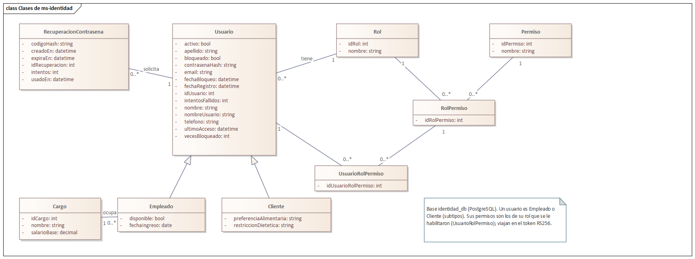
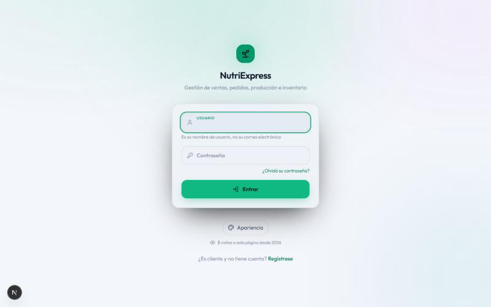
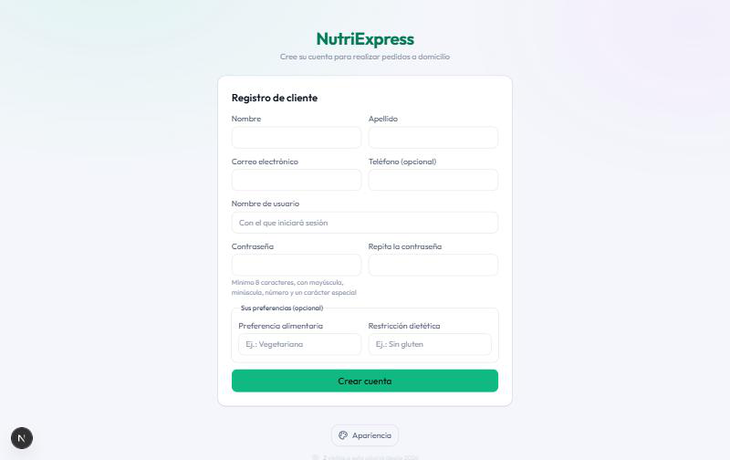
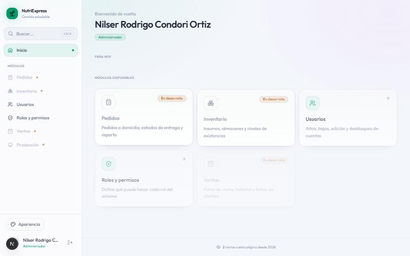
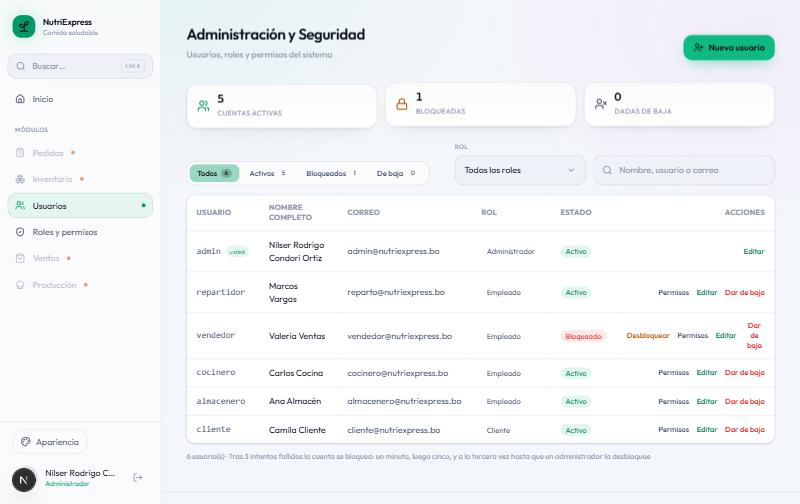
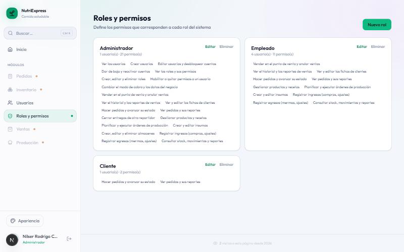
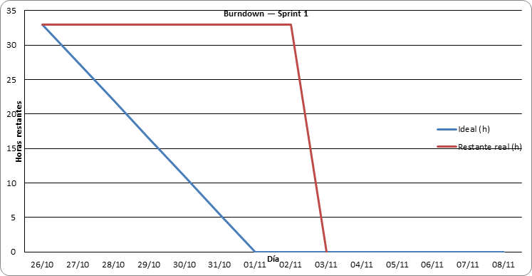
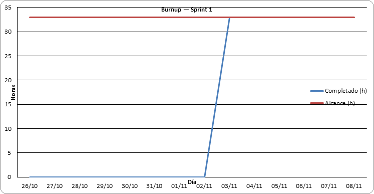
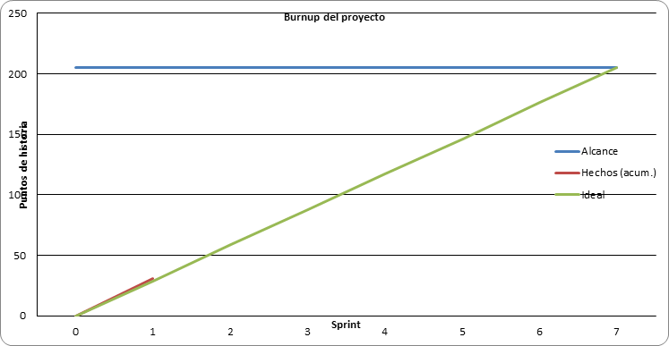

## 3.2 Sprint 1

### 3.2.1 Sprint Planning (objetivo del sprint)

**Objetivo del sprint:** levantar la infraestructura base del sistema de microservicios y el
microservicio de identidad, de modo que se pueda iniciar sesión, administrar usuarios, roles y
permisos, y ver el contador de visitas de cada página.

**Fechas planificadas:** lunes 26 de octubre al domingo 1 de noviembre de 2026.
**Fecha real de ejecución:** martes 3 de noviembre de 2026. La primera semana se perdió configurando
Jira, que finalmente se reemplazó por una planilla de Excel (ver la retrospectiva); el trabajo del
sprint se concentró en un solo día.

**Historias comprometidas:**

| ID | Historia | Microservicio | Pts |
|---|---|---|---|
| HT-01 | Repositorio y Docker Compose | Todos | 5 |
| HT-02 | API Gateway | gateway | 3 |
| HU-01 | Iniciar sesión | ms-identidad | 5 |
| HU-02 | Registro de cliente | ms-identidad | 3 |
| HU-03 | Gestionar usuarios | ms-identidad | 5 |
| HU-04 | Gestionar roles y permisos | ms-identidad | 5 |
| HU-34 | Menú dinámico | frontend | 3 |
| HU-31 | Contador de visitas | ms-reportes | 2 |
| | **Total** | | **31** |

HT-05 (pruebas) se trabaja en todos los sprints: en este se escribieron las pruebas de lo construido.

**Decisión del equipo:** se diseña la arquitectura desde cero, pero se **reutilizan piezas adaptadas
del sistema anterior** (el frontend, las reglas de seguridad y, en sprints siguientes, la pasarela de
pagos y el envío de correos). Cada pieza se mueve al microservicio dueño de sus datos.

### 3.2.2 Sprint Backlog (tareas, responsables y tiempo)

| ID | Historia | Tarea | Responsable | Horas |
|---|---|---|---|---|
| T1.1 | HT-01 | Estructura del repositorio y docker-compose (PostgreSQL, MongoDB, RabbitMQ) | Nilser | 3 |
| T1.2 | HT-01 | Script que crea una base y un usuario por microservicio | Nilser | 1 |
| T1.3 | HT-01 | Dockerfile de ms-identidad y ms-reportes | Nilser | 2 |
| T2.1 | HT-02 | API Gateway en Nginx con una ruta por microservicio | Nilser | 2 |
| T2.2 | HT-02 | CORS en el gateway y respuesta 503 para módulos pendientes | Nilser | 1 |
| T3.1 | HU-01 | Esquema identidad_db (9 tablas) y esquema de Prisma | Nilser | 2 |
| T3.2 | HU-01 | Adaptar inicio de sesión y bloqueo escalonado del sistema anterior | Nilser | 2 |
| T3.3 | HU-01 | Token RS256 con rol, cargo y permisos; ruta de la clave pública | Nilser | 2 |
| T4.1 | HU-02 | Adaptar el autorregistro de cliente con la política de contraseñas | Nilser | 1 |
| T5.1 | HU-03 | Adaptar alta, edición, baja y reactivación de usuarios | Nilser | 2 |
| T6.1 | HU-04 | Adaptar roles y permisos y la carga inicial (seed) | Nilser | 2 |
| T7.1 | HU-34 | Reutilizar el frontend y apuntarlo al API Gateway | Nilser | 2 |
| T7.2 | HU-34 | Ocultar del menú los módulos de sprints futuros | Nilser | 1 |
| T8.1 | HU-31 | ms-reportes con MongoDB: contador de visitas por página | Nilser | 2 |
| T8.2 | HU-31 | Pie de página con el contador de su ruta | Nilser | 1 |
| T9.1 | HT-05 | Pruebas de integración de ms-identidad (adaptadas) | Nilser | 2 |
| T9.2 | HT-05 | Pruebas de integración de ms-reportes | Nilser | 1 |
| T10.1 | Informe | Diagrama de clases de ms-identidad en Enterprise Architect | Nilser | 2 |
| T10.2 | Informe | Documentar el Sprint 1 en el informe | Nilser | 2 |
| | | **Total** | | **33** |

El detalle diario de cada tarea (estado y fecha de término) está en la hoja *Sprint 1* de
`docs/scrum/seguimiento-scrum.xlsx`.

### 3.2.3 Diagramas de clase e interfaces

**Diagrama de clases de ms-identidad.** Son las nueve tablas de su base `identidad_db`. Usuario es el
supertipo de Empleado y Cliente; los permisos de cada usuario son los de su rol que se le habilitaron
(UsuarioRolPermiso) y viajan dentro del token de sesión.

<!-- figura: Diagrama de clases de ms-identidad -->

**Interfaces.** El frontend del sistema anterior se reutilizó apuntándolo al API Gateway. En este
sprint quedan habilitados el inicio de sesión, el registro de cliente, el escritorio con el menú según
los permisos, la gestión de usuarios y la de roles y permisos. El pie de cada pantalla muestra las
visitas de esa página.

<!-- figura: Inicio de sesión -->

<!-- figura: Registro de cliente -->

<!-- figura: Escritorio con el menú según los permisos -->

<!-- figura: Gestión de usuarios -->

<!-- figura: Roles y permisos -->

### 3.2.4 Daily Meeting

Entre el 26 de octubre y el 1 de noviembre no se realizaron reuniones diarias: el equipo estaba
detenido intentando configurar Jira. La única reunión del sprint fue la del día de ejecución:

| Fecha | Integrante | ¿Qué hice? | ¿Qué haré hoy? | Impedimentos |
|---|---|---|---|---|
| 03/11 | Nilser | Cerré el Sprint 0: informe, diagramas en EA y backlog. Se descartó Jira y se pasó el seguimiento a Excel. | Todo el Sprint 1: Docker Compose, API Gateway, ms-identidad, ms-reportes y el frontend reutilizado. | Sprint atrasado una semana. Docker Desktop no arrancaba: archivos trabados de un apagado brusco, la máquina virtual WSL detenida y el disco C: con 0,8 GB libres. MongoDB 7 no corre en el procesador (sin AVX). |

### 3.2.5 Scrumboard (To Do, Doing, Done)

| Historia | Tareas | Estado inicial | Estado final |
|---|---|---|---|
| HT-01 Repositorio y Docker Compose | 3 | 3 en To Do | 3 en Done |
| HT-02 API Gateway | 2 | 2 en To Do | 2 en Done |
| HU-01 Iniciar sesión | 3 | 3 en To Do | 3 en Done |
| HU-02 Registro de cliente | 1 | 1 en To Do | 1 en Done |
| HU-03 Gestionar usuarios | 1 | 1 en To Do | 1 en Done |
| HU-04 Gestionar roles y permisos | 1 | 1 en To Do | 1 en Done |
| HU-34 Menú dinámico | 2 | 2 en To Do | 2 en Done |
| HU-31 Contador de visitas | 2 | 2 en To Do | 2 en Done |
| HT-05 Pruebas | 2 | 2 en To Do | 2 en Done |
| Informe | 2 | 2 en To Do | 2 en Done |

### 3.2.6 Product Increment

| Entregable | Descripción |
|---|---|
| Infraestructura | `docker compose up` levanta siete contenedores: PostgreSQL (una base y un usuario por servicio, sin permiso de conexión a las bases ajenas), MongoDB 4.4, RabbitMQ, ms-identidad, ms-reportes y el API Gateway. |
| API Gateway | Nginx en el puerto 8080: reparte `/api/auth`, `/api/usuarios`, `/api/roles`, `/api/cargos` y `/api/perfil` a ms-identidad y `/api/visitas` a ms-reportes; resuelve CORS; lo que aún no existe responde 503 con un aviso. |
| ms-identidad | Inicio de sesión con contraseña cifrada (bcrypt), política de contraseñas y bloqueo escalonado (1 minuto, 5 minutos, definitivo); registro de cliente; usuarios, roles, permisos y cargos. Firma el token con RS256 e incluye rol, cargo y permisos; publica su clave pública en `/api/auth/clave-publica`. |
| ms-reportes | Contador de visitas por página en MongoDB, con incremento atómico (`$inc`). |
| Frontend | Inicio de sesión, registro, escritorio con menú según los permisos (los módulos de sprints futuros aparecen «En desarrollo»), usuarios y roles. |
| Pruebas | 59 de integración en ms-identidad, 6 en ms-reportes, 215 de componentes en el frontend y 6 de punta a punta con Playwright. |

**Usuarios de prueba:**

| Usuario | Contraseña | Rol | Cargo |
|---|---|---|---|
| admin | Admin1234! | Administrador | Administrador |
| vendedor | Vendedor2026! | Empleado | Vendedor |
| cocinero | Cocinero2026! | Empleado | Cocinero |
| almacenero | Almacen2026! | Empleado | Almacenero |
| repartidor | Reparto1234! | Empleado | Repartidor |
| cliente | Cliente2026! | Cliente | — |

### 3.2.7 Burndown y Burnup

<!-- figura: Burndown del Sprint 1 -->

**Análisis:** la línea ideal baja de 33 horas a cero el 1 de noviembre. La real se mantiene en 33 horas
hasta el 2 de noviembre y cae a cero el día 3: el sprint se cumplió completo, pero con dos días de
atraso y todo el trabajo concentrado en un solo día.

<!-- figura: Burnup del Sprint 1 -->

**Análisis:** el alcance no cambió durante el sprint (33 horas). El trabajo completado sube de una vez
el 3 de noviembre.

<!-- figura: Burnup del proyecto al cierre del Sprint 1 -->

**Análisis:** de los 205 puntos del Product Backlog, se completaron 31 en el Sprint 1, levemente por
encima de la línea ideal (29 puntos por sprint).

| Métrica | Valor |
|---|---|
| Horas planificadas | 33 h |
| Horas completadas | 33 h |
| Puntos comprometidos / completados | 31 / 31 |
| Días de atraso respecto al plan | 2 |
| Pruebas automatizadas que pasan | 286 (59 + 6 + 215 + 6) |

### 3.2.8 Sprint Review

**Demostraciones:**

1. **Arranque del sistema.** `docker compose up -d --build` levanta los siete contenedores; `GET
   /api/health` del gateway responde. Resultado: correcto.
2. **Inicio de sesión.** El administrador entra y llega a su escritorio. El token devuelto está firmado
   con RS256 y lleva su rol, su cargo y sus 21 permisos. Resultado: correcto.
3. **Bloqueo por intentos fallidos.** Tres contraseñas incorrectas: «le quedan 2 intentos», «le queda 1
   intento» y «cuenta bloqueada por 1 minuto». Resultado: correcto.
4. **Permisos verificados en el servidor.** Sin token, `/api/usuarios` responde 401; con el token de un
   cliente, 403; con el del administrador, la lista de usuarios. Resultado: correcto.
5. **Gestión de usuarios y roles.** Desde la pantalla se ven las seis cuentas de prueba, la cuenta
   bloqueada en la demostración anterior y los permisos de cada rol. Resultado: correcto.
6. **Menú dinámico.** El administrador ve Usuarios y Roles activos y los demás módulos marcados «En
   desarrollo». Resultado: correcto.
7. **Contador de visitas.** El pie de cada página muestra las visitas de esa página; visitar otra
   página no altera el contador de la primera. Resultado: correcto.

**Retroalimentación del Product Owner:** el incremento cumple el objetivo del sprint. Para los
siguientes sprints pide no repetir el atraso y empezar a usar RabbitMQ en cuanto haya dos servicios que
deban avisarse (Sprint 3).

### 3.2.9 Sprint Retrospective

**¿Qué salió bien?**

- Reutilizar el frontend y la lógica de seguridad del sistema anterior permitió terminar el sprint en un
  día: el API Gateway conserva las rutas antiguas y el frontend no notó el cambio de arquitectura.
- Las 59 pruebas de integración heredadas detectaron un error en la carga inicial antes de construir
  la imagen de Docker.
- Las gráficas del Excel muestran la realidad del sprint, incluido el atraso.

**¿Qué salió mal?**

- Se perdió la primera semana intentando usar Jira, que el equipo no llegó a entender.
- El entorno de desarrollo falló de varias formas: Docker Desktop no arrancaba, el disco C: tenía
  0,8 GB libres y el procesador no admite MongoDB 7 (se usa la 4.4).
- No hubo reuniones diarias durante la semana planificada.

**¿Qué mejorar?**

- Seguimiento en Excel desde el primer día del sprint, con la Daily anotada cada día.
- Mantener al menos 15 GB libres en el disco y cerrar Docker Desktop antes de apagar la computadora.
- Repartir las tareas entre los dos integrantes desde el Sprint Planning (en el Sprint 2, Joseph toma
  ms-catalogo y Nilser ms-inventario).
