## 3.3 Sprint 2

### 3.3.1 Sprint Planning (objetivo del sprint)

**Objetivo del sprint:** catálogo e inventario básico. Se registran productos con su información
nutricional, el cliente los ve y los busca en el portal, y el almacén registra insumos, almacenes,
ingresos, egresos y consulta el stock.

**Fechas:** jueves 22 al miércoles 28 de octubre de 2026.

**Historias comprometidas:**

| ID | Historia | Microservicio | Pts |
|---|---|---|---|
| HU-08 | Gestionar productos | ms-catalogo | 5 |
| HU-11 | Catálogo y búsqueda | ms-catalogo | 5 |
| HU-12 | Gestionar insumos | ms-inventario | 3 |
| HU-13 | Gestionar almacenes | ms-inventario | 2 |
| HU-14 | Notas de ingreso | ms-inventario | 8 |
| HU-15 | Notas de egreso | ms-inventario | 5 |
| HU-16 | Stock y alertas | ms-inventario | 5 |
| | **Total** | | **33** |

### 3.3.2 Sprint Backlog (tareas, responsables y tiempo)

| ID | Historia | Tarea | Responsable | Horas | Terminada |
|---|---|---|---|---|---|
| T1.1 | HU-08 | ms-catalogo: esquema catalogo_db (producto, categoría, valor nutricional) | Joseph | 2 | 22/10 |
| T1.2 | HU-08 | Adaptar alta, edición y foto de productos | Joseph | 3 | 23/10 |
| T2.1 | HU-11 | Catálogo público y búsqueda sin tildes ni mayúsculas | Joseph | 2 | 25/10 |
| T2.2 | HU-11 | Información del negocio (horario, contacto) y búsqueda en el encabezado | Joseph | 2 | 26/10 |
| T3.1 | HU-12 | ms-inventario: esquema inventario_db (insumo, unidad, almacén, stock) | Nilser | 2 | 22/10 |
| T3.2 | HU-12 | Adaptar alta y edición de insumos | Nilser | 2 | 23/10 |
| T4.1 | HU-13 | Adaptar almacenes por tipo de conservación | Nilser | 1 | 24/10 |
| T5.1 | HU-14 | Notas de ingreso con costo promedio y lotes | Nilser | 4 | 25/10 |
| T6.1 | HU-15 | Notas de egreso sin superar el stock | Nilser | 3 | 26/10 |
| T7.1 | HU-16 | Consulta de stock por almacén y alertas de mínimo | Nilser | 2 | 27/10 |
| T8.1 | HT-02 | Rutas de ms-catalogo y ms-inventario en el API Gateway | Joseph | 1 | 26/10 |
| T8.2 | HU-34 | Habilitar en el menú Producción e Inventario | Joseph | 1 | 27/10 |
| T9.1 | HT-05 | Pruebas de integración de ms-catalogo y ms-inventario | Joseph | 3 | 27/10 |
| T10.1 | Informe | Diagramas de clases de ms-catalogo y ms-inventario en EA | Joseph | 2 | 28/10 |
| T10.2 | Informe | Documentar el Sprint 2 en el informe | Nilser | 2 | 28/10 |
| | | **Total** | | **32** | |

En el Sprint Planning las tareas se repartieron por microservicio: Joseph tomó ms-catalogo, las rutas
del gateway, el menú, las pruebas de integración y los diagramas de clases; Nilser, ms-inventario y el
informe. Horas asignadas: 16 h cada uno.

El detalle diario de cada tarea (estado y fecha de término) está en la hoja *Sprint 2* de
`docs/scrum/seguimiento-scrum.xlsx`.

### 3.3.3 Diagramas de clase e interfaces

**Diagrama de clases de ms-catalogo.** Son las cuatro tablas de su base `catalogo_db`. Cada producto
pertenece a una categoría y puede tener su información nutricional; Configuración guarda los datos del
negocio que muestra el portal (horario, contacto). El stock no está en este servicio: lo pide a
ms-inventario.

<!-- figura: Diagrama de clases de ms-catalogo -->
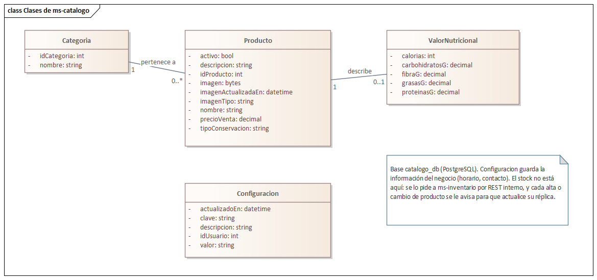

**Diagrama de clases de ms-inventario.** Son las quince tablas de `inventario_db`. Las existencias se
guardan por almacén (IngredienteAlmacen, ProductoAlmacen y, para los perecederos, LoteAlmacen); cada
entrada y salida queda en una nota de ingreso o de egreso con su detalle. Producto y Empleado son
**réplicas** (estereotipo «réplica»): copias locales con lo mínimo que inventario necesita, para no leer
la base de otro servicio (RNF-ARQ-02).

<!-- figura: Diagrama de clases de ms-inventario -->
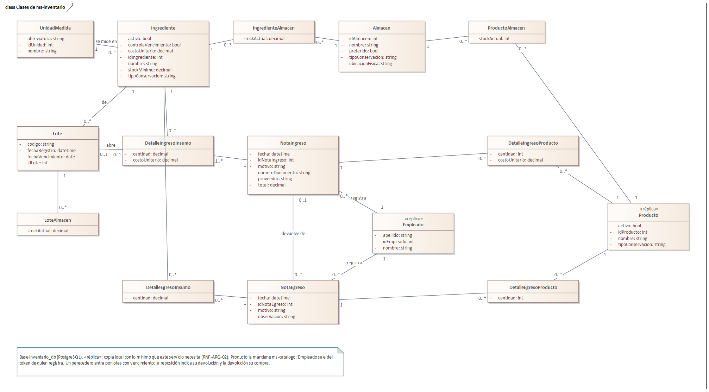

**Comunicación entre los dos servicios.** Hasta que llegue RabbitMQ (Sprint 3) se comunican por REST
interno, en rutas `/interno/*` que el API Gateway no expone:

| Quién llama | Ruta | Para qué |
|---|---|---|
| ms-catalogo → ms-inventario | `PUT /interno/productos/:id` | Al crear o editar un producto, actualizar su réplica. |
| ms-catalogo → ms-inventario | `DELETE /interno/productos/:id` | Al eliminar un producto. Responde 409 si ya tuvo movimientos, y entonces no se elimina. |
| ms-catalogo → ms-inventario | `GET /interno/productos/existencias` | Stock y costo promedio de los productos que muestra el catálogo. Si inventario no responde, el catálogo se sigue viendo, sin stock (RNF-DIS-01). |
| ms-inventario → ms-catalogo | `GET /interno/productos` | Al arrancar, traer la lista completa de productos para ponerse al día. |

La réplica del empleado no necesita llamadas: el token de quien registra una nota ya trae su nombre y
apellido, y ms-inventario lo guarda al verificarlo.

**Interfaces.** Quedan habilitados los módulos Producción (pestaña Productos) e Inventario (Stock,
Movimientos, Lotes, Insumos y Almacenes), y en el portal el catálogo con existencias reales y la
búsqueda del encabezado. Las pestañas Órdenes (Sprint 3) y Reportes (Sprint 6) todavía no se muestran.

<!-- figura: Productos con su información nutricional y stock -->
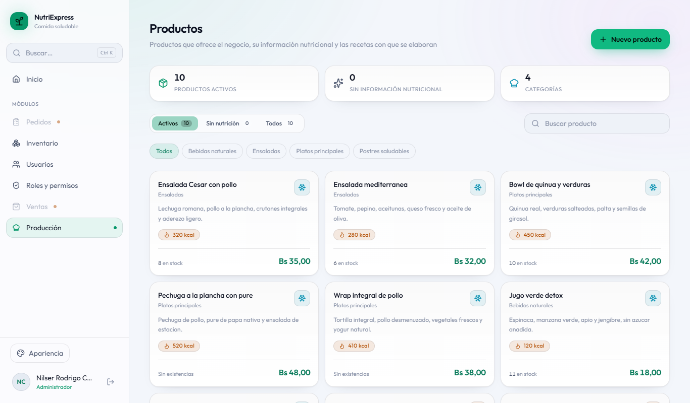

<!-- figura: Control de stock con lotes por vencer -->
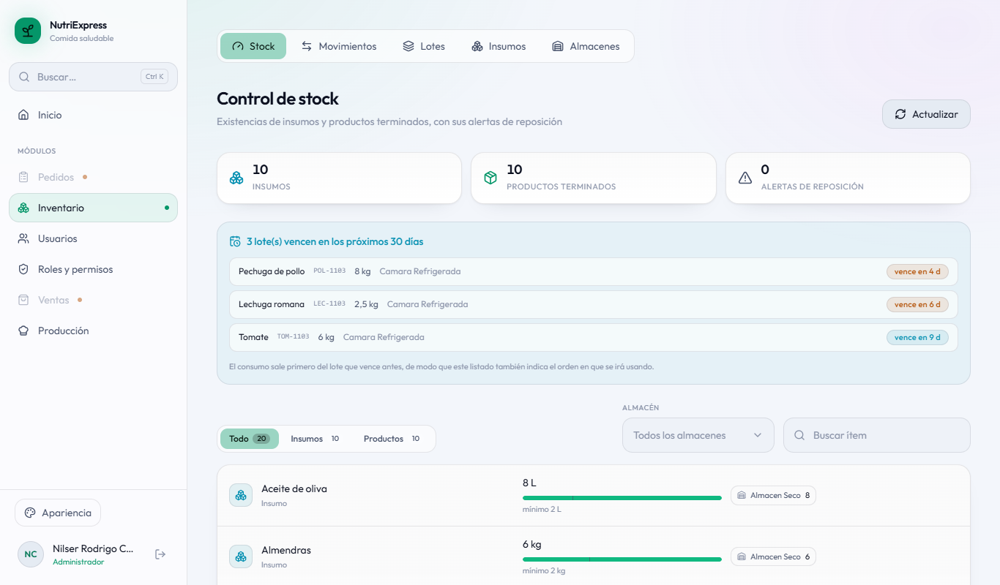

<!-- figura: Insumos con costo promedio y existencias -->
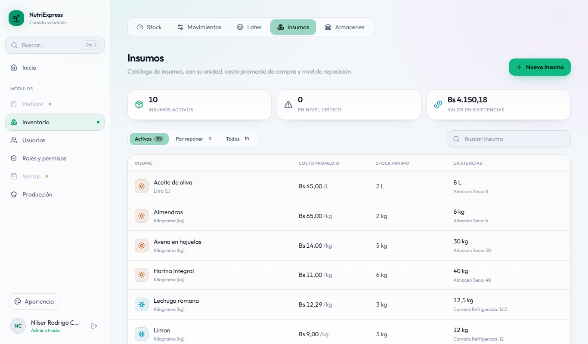

<!-- figura: Notas de ingreso y egreso -->
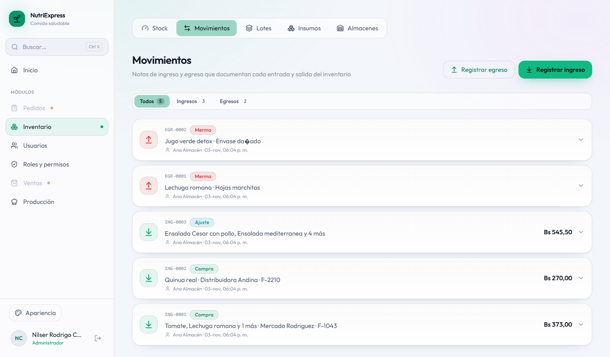

<!-- figura: Registro de una nota de ingreso -->
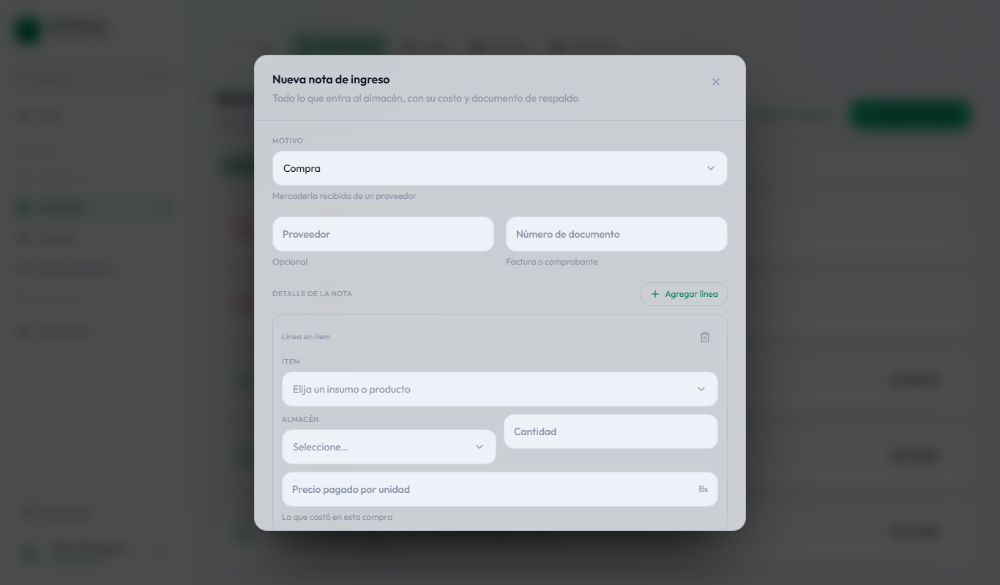

<!-- figura: Lotes: cada ingreso con su costo por unidad -->
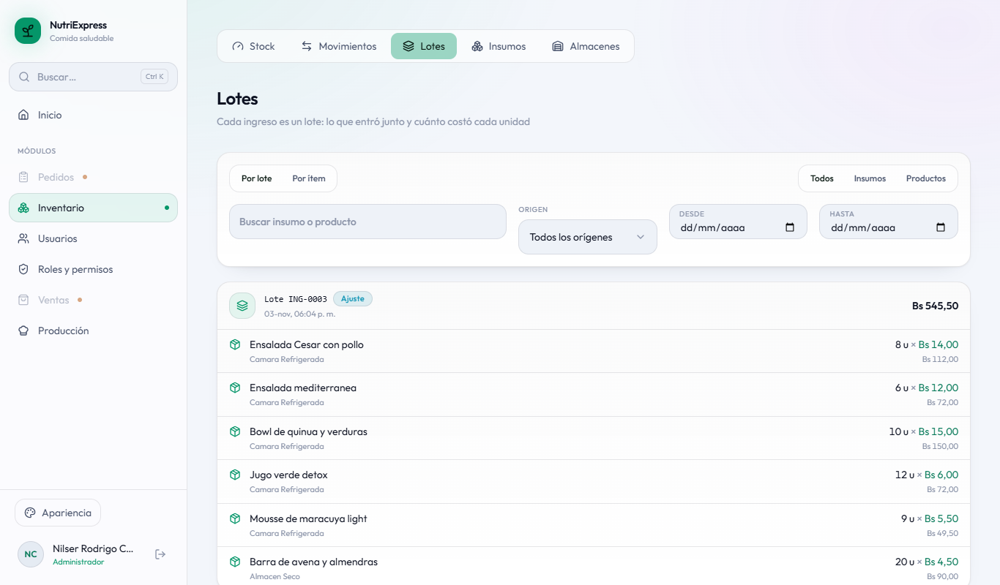

<!-- figura: Catálogo del portal con existencias -->
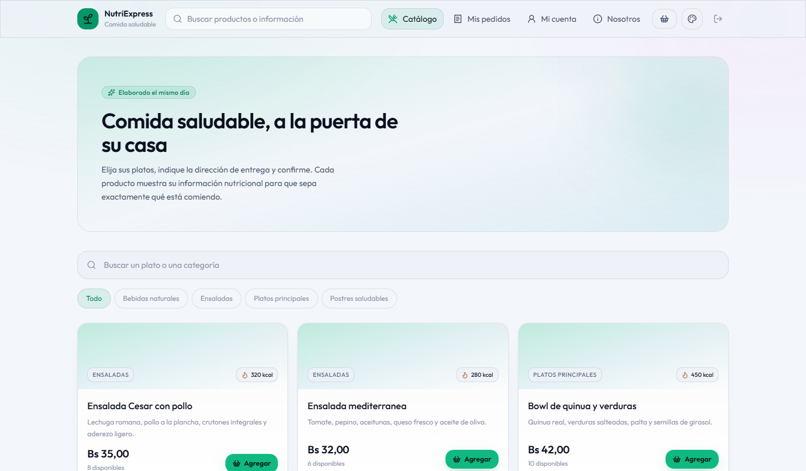

<!-- figura: Búsqueda del encabezado -->
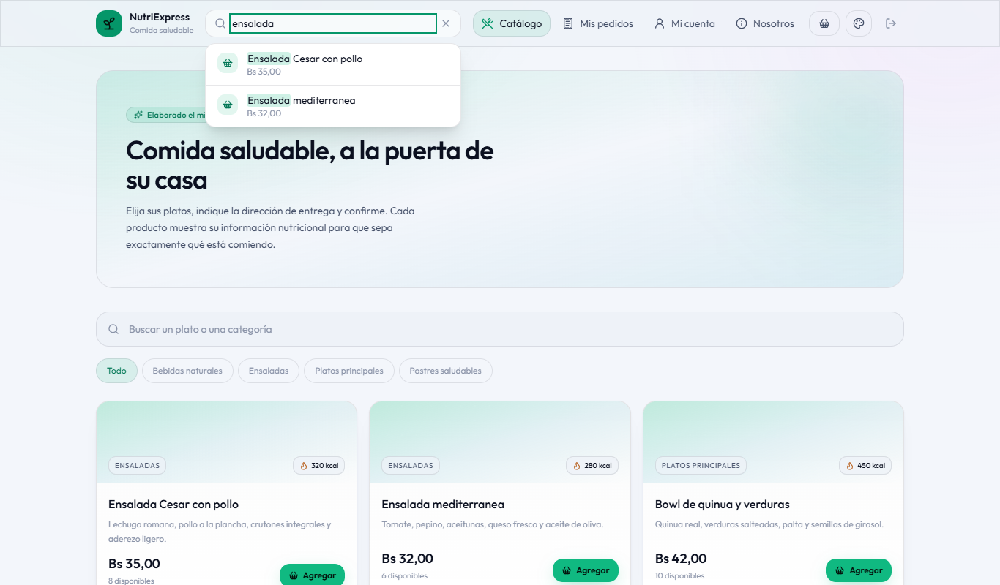

### 3.3.4 Daily Meeting

| Fecha | Integrante | ¿Qué hice? | ¿Qué haré hoy? | Impedimentos |
|---|---|---|---|---|
| 22/10 | Joseph | Sprint Planning con Nilser. | Esquema de catalogo_db (producto, categoría, valor nutricional). | Ninguno. |
| 22/10 | Nilser | Sprint Planning. | Esquema de inventario_db (insumo, unidad, almacén, stock). | Ninguno. |
| 23/10 | Joseph | Esquema de catalogo_db. | Adaptar alta, edición y foto de productos. | Ninguno. |
| 23/10 | Nilser | Esquema de inventario_db. | Adaptar alta y edición de insumos. | Ninguno. |
| 24/10 | Joseph | Productos con foto. | Catálogo público con búsqueda. | No está definido cómo sabe inventario qué productos existen sin leer la base del catálogo. Se acuerda una réplica local actualizada por REST interno. |
| 24/10 | Nilser | Insumos. | Almacenes por tipo de conservación; diseñar la réplica de productos con Joseph. | El mismo: se pierde la tarde definiendo las rutas internas. |
| 25/10 | Joseph | Rutas internas acordadas. | Catálogo público y búsqueda sin tildes. | Ninguno. |
| 25/10 | Nilser | Almacenes y réplica de productos. | Notas de ingreso con costo promedio y lotes. | Ninguno. |
| 26/10 | Joseph | Catálogo público y búsqueda. | Información del negocio y rutas de los dos servicios en el gateway. | Ninguno. |
| 26/10 | Nilser | Notas de ingreso. | Notas de egreso sin superar el stock. | Ninguno. |
| 27/10 | Joseph | Gateway y encabezado del portal. | Menú de Producción e Inventario y pruebas de integración de los dos servicios. | Next.js en modo desarrollo es lento en la máquina y las pruebas de punta a punta fallaban por tiempos: se corren contra el frontend compilado. |
| 27/10 | Nilser | Notas de egreso. | Stock por almacén y alertas de mínimo. | Ninguno. |
| 28/10 | Joseph | Menú y pruebas (las pruebas encontraron dos errores, ya corregidos). | Diagramas de clases en EA. | Ninguno. |
| 28/10 | Nilser | Stock y alertas. | Documentar el Sprint 2. Sprint Review y Retrospective. | Ninguno. |

### 3.3.5 Scrumboard (To Do, Doing, Done)

| Historia | Tareas | Estado inicial | Estado final |
|---|---|---|---|
| HU-08 Gestionar productos | 2 | 2 en To Do | 2 en Done |
| HU-11 Catálogo y búsqueda | 2 | 2 en To Do | 2 en Done |
| HU-12 Gestionar insumos | 2 | 2 en To Do | 2 en Done |
| HU-13 Gestionar almacenes | 1 | 1 en To Do | 1 en Done |
| HU-14 Notas de ingreso | 1 | 1 en To Do | 1 en Done |
| HU-15 Notas de egreso | 1 | 1 en To Do | 1 en Done |
| HU-16 Stock y alertas | 1 | 1 en To Do | 1 en Done |
| HT-02 API Gateway | 1 | 1 en To Do | 1 en Done |
| HU-34 Menú dinámico | 1 | 1 en To Do | 1 en Done |
| HT-05 Pruebas | 1 | 1 en To Do | 1 en Done |
| Informe | 2 | 2 en To Do | 2 en Done |

### 3.3.6 Product Increment

| Entregable | Descripción |
|---|---|
| Infraestructura | `docker compose up` levanta nueve contenedores: se suman ms-catalogo (puerto 4002, base `catalogo_db`) y ms-inventario (puerto 4003, base `inventario_db`). Cada uno crea sus tablas y su carga inicial al arrancar si su base está vacía. |
| API Gateway | Reparte `/api/productos`, `/api/catalogo` y `/api/negocio` a ms-catalogo, y `/api/almacenes`, `/api/insumos`, `/api/ingresos`, `/api/egresos` y `/api/stock` a ms-inventario. Si un servicio está caído responde 503 con un aviso en JSON, en vez de la página de error de Nginx. |
| ms-catalogo | Productos con categoría, precio, foto e información nutricional (alta, edición, baja y eliminación); catálogo público con búsqueda sin tildes ni mayúsculas; información del negocio y búsqueda del encabezado del portal. |
| ms-inventario | Insumos (kilogramo, litro o unidad), almacenes por tipo de conservación, notas de ingreso (con costo promedio ponderado y lotes con vencimiento) y de egreso (sin superar el stock), stock por almacén con alertas de reposición y lotes por vencer. Réplicas locales de productos y empleados. |
| ms-identidad | El token incluye el nombre y el apellido del usuario, que ms-inventario usa para su réplica de empleados. |
| ms-reportes | Corregido: si dos personas abrían a la vez una página que nunca se había visitado, una de las dos visitas fallaba (error 500). |
| Frontend | Producción (Productos) e Inventario habilitados en el menú; las pestañas de sprints futuros no se muestran. |
| Pruebas | 59 de integración en ms-identidad, 10 en ms-catalogo, 11 en ms-inventario, 6 en ms-reportes, 214 de componentes en el frontend y 8 de punta a punta. Otras 4 (2 de componentes y 2 de punta a punta) quedan en espera hasta el sprint de su módulo y se activan solas. |

Los usuarios de prueba son los mismos del Sprint 1 (sección 3.2.6).

### 3.3.7 Burndown y Burnup

<!-- figura: Burndown del Sprint 2 -->
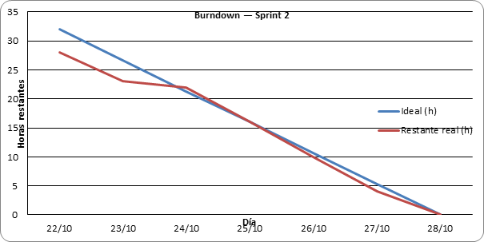

**Análisis:** la línea ideal baja de 32 horas a cero el 28 de octubre. La real va por debajo de ella
los dos primeros días y se aplana el sábado 24 (solo 1 hora), cuando el equipo tuvo que definir cómo se
comunicarían catálogo e inventario sin compartir la base. Desde el domingo 25 vuelve a la línea ideal y
el sprint cierra el miércoles 28, en la fecha planificada.

<!-- figura: Burnup del Sprint 2 -->
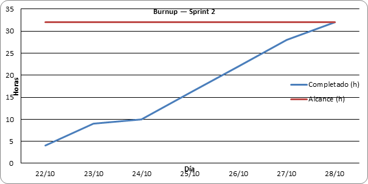

**Análisis:** el alcance no cambió durante el sprint (32 horas). El trabajo completado tiene un
escalón el día 24 y lo alcanza el 28 de octubre.

<!-- figura: Burnup del proyecto al cierre del Sprint 2 -->
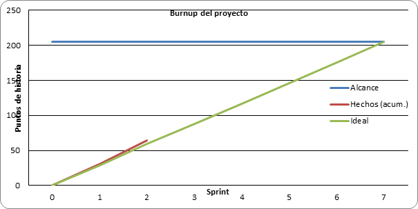

**Análisis:** con los 33 puntos del Sprint 2 el proyecto suma 64 de 205 puntos, por encima de la línea
ideal (59 puntos al cierre del segundo sprint).

| Métrica | Valor |
|---|---|
| Horas planificadas | 32 h |
| Horas completadas | 32 h |
| Puntos comprometidos / completados | 33 / 33 |
| Días de atraso respecto al plan | 0 |
| Pruebas automatizadas que pasan | 308 (59 + 10 + 11 + 6 + 214 + 8) |

### 3.3.8 Sprint Review

**Demostraciones:**

1. **Arranque.** `docker compose up -d --build` levanta los nueve contenedores; ms-inventario se pone al
   día solo con los diez productos de ms-catalogo («réplica de 10 productos al día»). Resultado: correcto.
2. **Catálogo e información nutricional.** En Producción › Productos se ven los diez productos con su
   categoría, calorías, precio y stock. Resultado: correcto.
3. **Compra de insumos con lote.** La almacenera registra una compra de tomate, lechuga y pollo con su
   lote y vencimiento; el stock sube, el costo promedio se recalcula y los lotes aparecen en «vencen en
   los próximos 30 días». Resultado: correcto.
4. **Egreso sin superar el stock.** Una merma mayor que lo que hay es rechazada; una merma válida
   descuenta el stock. Resultado: correcto.
5. **Quién registró cada nota.** La nota muestra el nombre de la almacenera, tomado de su token y
   guardado en la réplica de empleados. Resultado: correcto.
6. **El stock llega al portal.** Tras ingresar productos terminados, el catálogo del cliente pasa de
   «Agotado» a «8 disponibles». La búsqueda del encabezado encuentra «ensalada». Resultado: correcto.
7. **Integridad entre servicios.** Eliminar un producto que ya tuvo movimientos responde 409 (se ofrece
   darlo de baja); las rutas internas no se pueden llamar desde fuera del gateway. Resultado: correcto.
8. **Tolerancia a fallos.** Con ms-inventario detenido, el catálogo se sigue viendo (sin stock) y las
   pantallas de inventario reciben un aviso en lugar de un error de Nginx; al volver, el stock reaparece.
   Resultado: correcto.

**Retroalimentación del Product Owner:** el incremento cumple el objetivo del sprint. Pide que en el
Sprint 3 las réplicas pasen a actualizarse por eventos en RabbitMQ, como estaba diseñado.

### 3.3.9 Sprint Retrospective

**¿Qué salió bien?**

- Repartir por microservicio (ms-catalogo para Joseph, ms-inventario para Nilser) permitió avanzar en
  paralelo: cada uno trabajó en su servicio y su base sin depender del otro.
- Reutilizar la lógica del sistema anterior volvió a acelerar el trabajo.
- Las réplicas locales evitaron que inventario lea la base del catálogo, y la prueba con el servicio
  detenido mostró que el catálogo sigue funcionando.
- Las pruebas detectaron dos errores antes de la entrega: el contador de visitas fallaba con dos
  visitas simultáneas y el gateway devolvía una página HTML cuando un servicio estaba caído.

**¿Qué salió mal?**

- La comunicación entre los dos servicios no se definió en el Sprint Planning: el sábado 24 se perdió
  definiendo las rutas internas.
- Next.js en modo desarrollo es lento en la máquina y las pruebas de punta a punta fallaban por
  tiempos; costó encontrar la causa.

**¿Qué mejorar?**

- Acordar en el Sprint Planning los contratos entre servicios (rutas y eventos) antes de repartir las
  tareas.
- Correr las pruebas de punta a punta contra el frontend compilado (`npm run build` y `next start`).
- Pasar las réplicas a eventos de RabbitMQ, como estaba diseñado.
