## 3.4 Sprint 3

### 3.4.1 Sprint Planning (objetivo del sprint)

**Objetivo del sprint:** recetas y producción, con los servicios comunicados por eventos. Cada
producto tiene su receta y su costo; el cocinero registra y finaliza órdenes de producción que
descuentan los insumos y suman el producto terminado; y los servicios se avisan por RabbitMQ: la
réplica de productos, la reserva de stock, los cambios de permisos y el correo con el código para
recuperar la contraseña.

**Fechas:** jueves 29 de octubre al miércoles 4 de noviembre de 2026.

**Gestores de bases de datos.** Al cerrar el Sprint 2, el equipo fijó los gestores:
PostgreSQL y MongoDB, con Redis como complemento en memoria de ms-identidad y ms-catalogo.
Elasticsearch se evaluó y se descartó (RNF-ARQ-03; justificación en la sección 3.1.7). El martes 3 de
noviembre se agregó Redis al Docker Compose (tarea T1.1); sus usos se programan con las historias que
los necesitan.

**Historias comprometidas:**

| ID | Historia | Microservicio | Pts |
|---|---|---|---|
| HT-03 | Eventos en RabbitMQ | Todos | 5 |
| HU-09 | Gestionar recetas | ms-catalogo | 5 |
| HU-10 | Órdenes de producción | ms-catalogo + ms-inventario | 8 |
| HU-17 | Reservar y liberar stock | ms-inventario | 8 |
| HU-05 | Permisos por usuario | ms-identidad | 3 |
| HU-06 | Recuperar contraseña | ms-identidad + ms-reportes | 5 |
| | **Total** | | **34** |

### 3.4.2 Sprint Backlog (tareas, responsables y tiempo)

| ID | Historia | Tarea | Responsable | Horas | Terminada |
|---|---|---|---|---|---|
| T1.1 | RNF-ARQ-03 | Redis como complemento en Docker Compose, instalación e informe | Joseph | 2 | 03/11 |
| T2.1 | HT-03 | Módulo de eventos compartido: publicar y consumir en RabbitMQ con identificador único y registro de los ya procesados | Joseph | 3 | 03/11 |
| T2.2 | HT-03 | La réplica de productos de ms-inventario se actualiza por eventos (`ProductoGuardado`, `ProductoEliminado`) | Nilser | 2 | 04/11 |
| T3.1 | HU-09 | ms-catalogo: esquema de recetas y réplica de los insumos de inventario (por eventos) | Nilser | 2 | 04/11 |
| T3.2 | HU-09 | Adaptar recetas con sus insumos y cantidades, una sola activa por producto, y su costo | Nilser | 3 | 04/11 |
| T4.1 | HU-17 | ms-inventario: reservar y liberar stock a pedido de otro servicio; repetir una reserva no descuenta dos veces | Nilser | 3 | 04/11 |
| T5.1 | HU-10 | ms-catalogo: esquema y alta de órdenes de producción, con los insumos calculados según el rendimiento | Nilser | 2 | 04/11 |
| T5.2 | HU-10 | Finalizar la orden: reserva los insumos y publica `OrdenFinalizada`; inventario descuenta los insumos y suma el producto | Nilser | 3 | 04/11 |
| T5.3 | HU-10 | Habilitar la pestaña Órdenes en el menú y sus rutas en el API Gateway | Nilser | 1 | 04/11 |
| T6.1 | HU-05 | El cambio de permisos rige en la siguiente petición también en los demás servicios (evento `PermisosCambiados`) | Joseph | 2 | 03/11 |
| T7.1 | HU-06 | ms-identidad: pedir y canjear el código con su tabla en PostgreSQL (vence a los 15 minutos, sirve una vez) | Joseph | 3 | 03/11 |
| T7.2 | HU-06 | ms-reportes envía el código por correo al recibir `CodigoRecuperacionGenerado` (adaptar el envío del sistema anterior) | Joseph | 2 | 03/11 |
| T7.3 | HU-06 | Los contadores de intentos por IP de ms-identidad pasan a Redis, para que no se reinicien al reiniciar el servicio | Joseph | 1 | 03/11 |
| T8.1 | HT-05 | Pruebas de integración de los eventos, las recetas, las reservas y las órdenes | Nilser | 3 | 04/11 |
| T8.2 | HT-05 | Pruebas de integración de permisos y recuperación de contraseña; punta a punta de Órdenes | Nilser | 2 | 04/11 |
| T9.1 | Informe | Diagramas de clases de las tablas nuevas, diagramas C4 con los tres gestores y eventos en EA | Nilser | 2 | 04/11 |
| T9.2 | Informe | Documentar el Sprint 3 en el informe | Nilser | 2 | 04/11 |
| | | **Total** | | **38** | |

En el Sprint Planning las tareas se repartieron por área: Joseph tomó ms-identidad (HU-05 y HU-06), el
módulo de eventos, el envío del código por correo desde ms-reportes, la prueba de punta a punta de
Órdenes, los diagramas y el informe; Nilser, ms-catalogo y ms-inventario. Horas asignadas: 19 h cada
uno. Las tres últimas tareas de Joseph (T8.2, T9.1 y T9.2) las terminó Nilser el 4 de noviembre, y la
tabla muestra quién las hizo.

**Orden de trabajo.** El módulo de eventos (T2.1) va primero, porque lo usan casi todas las demás
tareas; lo hace Joseph, que necesita los eventos para HU-05 y HU-06. Después siguen la ruta del
código de recuperación (T7.1) y las tareas que publican o consumen eventos. HU-09 y HU-17 van antes de HU-10, porque una orden de producción usa la receta activa y
reserva los insumos al finalizarse. Guardar los eventos en MongoDB para los reportes queda para el
Sprint 6, con los reportes.

**Qué ya existe.** El panel de permisos por usuario (HU-05) llegó con el frontend reutilizado y
ms-identidad ya lo respeta en la petición siguiente; falta que lo respeten los demás servicios, que hoy
confían en los permisos del token hasta que vence. HU-06 tiene la pantalla, el límite de pedidos por
IP y su tabla `recuperacion_contrasena`, pero no la ruta.

El detalle diario de cada tarea (estado y fecha de término) está en la hoja *Sprint 3* de
`docs/scrum/seguimiento-scrum.xlsx`.

### 3.4.3 Diagramas de clase e interfaces

**Diagrama de clases de ms-catalogo (tablas nuevas).** Cada producto tiene una o varias versiones de su
receta, con sus insumos y cantidades; solo una está activa. Insumo es una **réplica** de los insumos de
ms-inventario, con lo que la receta necesita: nombre, unidad y costo. Una orden de producción se
registra con la receta activa y, al finalizarse, guarda lo consumido (DetalleOrdenInsumo): si la receta
cambia después, la orden sigue mostrando lo que se usó. Los números de las notas de egreso e ingreso
llegan de ms-inventario por un evento.

<!-- figura: Diagrama de clases de ms-catalogo (Sprint 3) -->
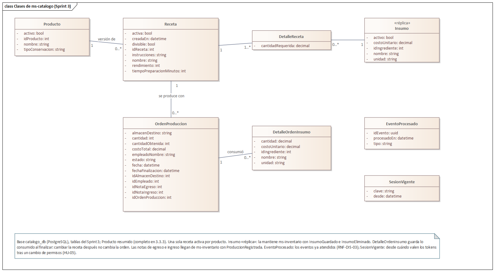

**Diagrama de clases de ms-inventario (tablas nuevas).** Una reserva aparta insumos o productos
terminados a pedido de otro servicio, con un identificador que pone quien la pide: repetirla no
descuenta dos veces. Lo disponible es el stock menos lo reservado y todavía activo. Una reserva para
producir indica además el almacén donde entrará el producto terminado.

<!-- figura: Diagrama de clases de ms-inventario (Sprint 3) -->
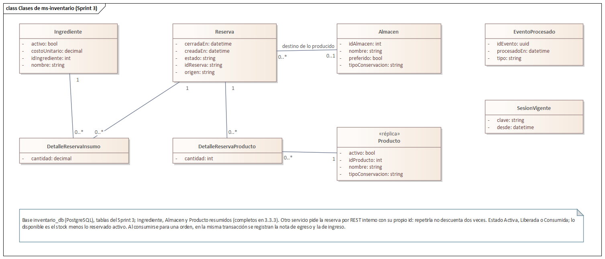

Los dos servicios suman además `evento_procesado` (los eventos ya atendidos, para no procesar uno dos
veces, RNF-DIS-03) y `sesion_vigente` (desde cuándo valen los tokens de un usuario o rol después de un
cambio de permisos, HU-05). En ms-reportes el registro de eventos es la colección
`eventos_procesados` de MongoDB. ms-identidad no suma tablas: la de recuperación de contraseña ya
estaba en su esquema desde el Sprint 1.

**Finalizar una orden de producción.** Es la primera saga del sistema. ms-catalogo reserva los insumos
en ms-inventario por REST, porque necesita la respuesta en el momento (si no alcanzan, la orden no se
finaliza); después avisa `OrdenFinalizada` y ms-inventario registra la producción por su cuenta. Si el
aviso no se puede publicar, la compensación deja la orden como estaba y libera la reserva.

<!-- figura: Finalizar una orden de producción -->
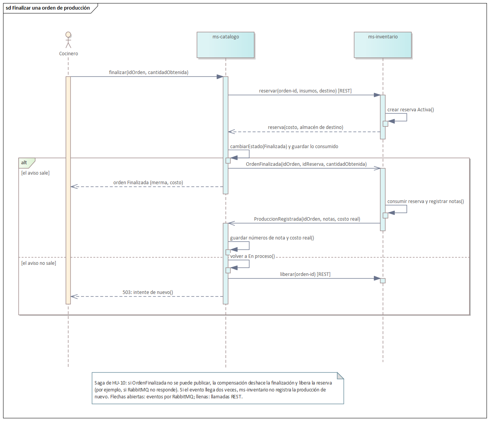

**Eventos en RabbitMQ (HT-03).** Cada servicio publica en el exchange `nutriexpress.eventos` y
consume de su propia cola; lo que falla dos veces pasa a su cola de fallidos. En el diagrama de
contenedores de la sección 3.1.7 se actualizaron las líneas hacia RabbitMQ: ms-identidad publica y
ms-catalogo también consume.

| Evento | Lo publica | Lo consumen | Para qué |
|---|---|---|---|
| `PermisosCambiados` | ms-identidad | ms-catalogo, ms-inventario | Rechazar los tokens emitidos antes del cambio: los permisos nuevos rigen en la siguiente petición. |
| `CodigoRecuperacionGenerado` | ms-identidad | ms-reportes | Enviar por correo el código para recuperar la contraseña. |
| `ProductoGuardado` | ms-catalogo | ms-inventario | Actualizar la réplica de productos. |
| `InsumoGuardado` / `InsumoEliminado` | ms-inventario | ms-catalogo | Actualizar la réplica de insumos que usan las recetas. |
| `OrdenFinalizada` | ms-catalogo | ms-inventario | Registrar la producción: nota de egreso de los insumos e ingreso del producto terminado. |
| `ProduccionRegistrada` | ms-inventario | ms-catalogo | Dejar en la orden los números de nota y el costo real. |

**Comunicación por REST interno** (rutas `/interno/*`, que el API Gateway no expone). Eliminar un
producto o un insumo sigue por REST porque el otro servicio puede negarse en el momento:

| Quién llama | Ruta | Para qué |
|---|---|---|
| ms-catalogo → ms-inventario | `POST /interno/reservas/verificar` | Al registrar una orden, saber si alcanzan los insumos y cuánto cuestan, sin reservar. |
| ms-catalogo → ms-inventario | `POST /interno/reservas` y `POST /interno/reservas/:id/liberar` | Reservar los insumos al finalizar una orden; liberarlos si la orden se cancela o la finalización no se completa. |
| ms-catalogo → ms-inventario | `DELETE /interno/productos/:id` | Eliminar un producto: 409 si ya tuvo movimientos. |
| ms-inventario → ms-catalogo | `GET /interno/insumos/:id/recetas` | Antes de eliminar un insumo, saber si alguna receta lo usa (409). |
| ms-catalogo → ms-inventario | `GET /interno/insumos` | Al arrancar, ponerse al día con la lista completa de insumos. |

**Interfaces.** Se habilita la pestaña Órdenes de Producción. Las recetas, la recuperación de
contraseña y los permisos por usuario ya estaban en el frontend reutilizado y ahora funcionan contra los
microservicios.

<!-- figura: Versiones de la receta de un producto -->
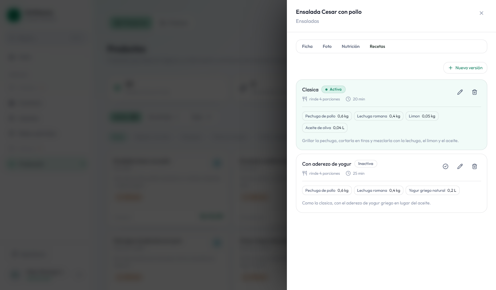

<!-- figura: Órdenes de producción por estado -->
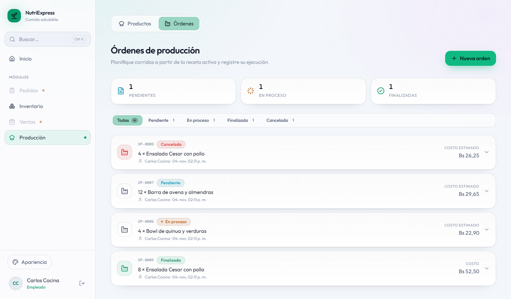

<!-- figura: Nueva orden: insumos calculados según el rendimiento -->
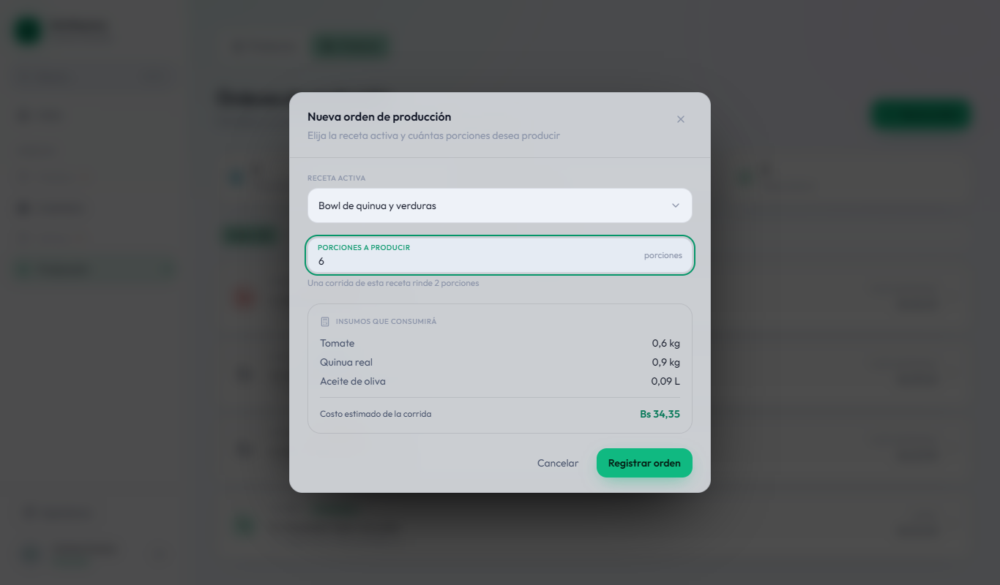

<!-- figura: Orden finalizada con merma, insumos consumidos y notas -->
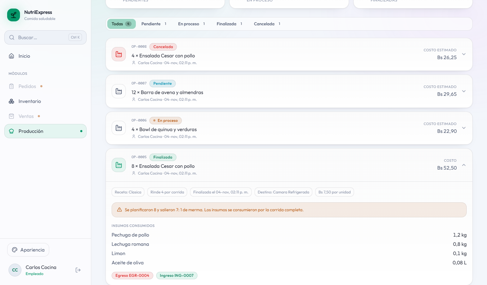

<!-- figura: Notas de producción en inventario -->
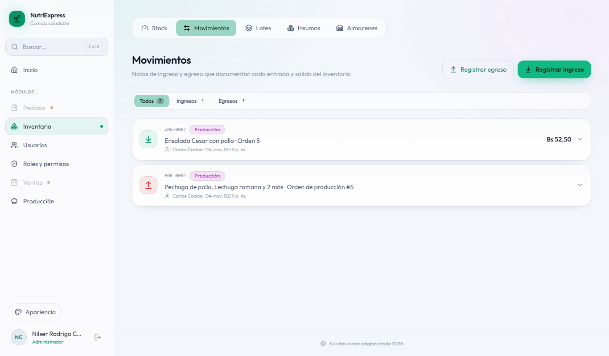

<!-- figura: Recuperar la contraseña con un código por correo -->
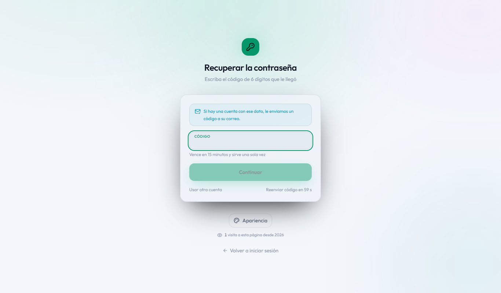

### 3.4.4 Daily Meeting

| Fecha | Integrante | ¿Qué hice? | ¿Qué haré hoy? | Impedimentos |
|---|---|---|---|---|
| 03/11 | Joseph | Revisé el Sprint 2 y planifiqué el Sprint 3 con los gestores definidos; agregué Redis al Docker Compose (T1.1). | Módulo de eventos (T2.1), recuperación de contraseña (T7.1 a T7.3) y permisos en los demás servicios (T6.1). | La conexión lenta cortó la instalación (`npm ci` dentro de Docker): se resolvió repitiéndola. Hubo que alinear con `main` la decisión de los gestores (sin Elasticsearch). |
| 04/11 | Nilser | Revisé lo que Joseph terminó el 3 de noviembre: eventos, HU-05 y HU-06. | Desde la computadora de Joseph: réplica de productos por eventos (T2.2), recetas (HU-09), reservas (HU-17) y órdenes de producción (HU-10) con sus pruebas (T8.1), y las tareas de Joseph que quedaban: punta a punta de Órdenes (T8.2), diagramas (T9.1) e informe (T9.2). | Las pruebas publicaban en el mismo RabbitMQ que los servicios levantados y ensuciaban sus réplicas: pasaron a un virtual host propio. Enterprise Architect de esa computadora crea el modelo pero no exporta las imágenes: los diagramas se exportan en la de Nilser. |

### 3.4.5 Scrumboard (To Do, Doing, Done)

| Historia | Tareas | Estado inicial | Estado final |
|---|---|---|---|
| RNF-ARQ-03 Gestores de bases de datos | 1 | 1 en To Do | 1 en Done |
| HT-03 Eventos en RabbitMQ | 2 | 2 en To Do | 2 en Done |
| HU-09 Gestionar recetas | 2 | 2 en To Do | 2 en Done |
| HU-17 Reservar y liberar stock | 1 | 1 en To Do | 1 en Done |
| HU-10 Órdenes de producción | 3 | 3 en To Do | 3 en Done |
| HU-05 Permisos por usuario | 1 | 1 en To Do | 1 en Done |
| HU-06 Recuperar contraseña | 3 | 3 en To Do | 3 en Done |
| HT-05 Pruebas | 2 | 2 en To Do | 2 en Done |
| Informe | 2 | 2 en To Do | 2 en Done |

### 3.4.6 Product Increment

| Entregable | Descripción |
|---|---|
| Infraestructura | Redis 7.4 se suma al Docker Compose como complemento en memoria de ms-identidad. Las tablas nuevas se crean solas al arrancar, también en una base que ya tenía datos. |
| Eventos (HT-03) | Módulo compartido sobre RabbitMQ: cada evento lleva un identificador único y cada consumidor registra los ya procesados, de modo que uno repetido no se procesa dos veces; lo que falla dos veces va a una cola de fallidos. Si RabbitMQ se cae, los servicios siguen respondiendo y se reconectan solos. |
| ms-identidad | Recuperar la contraseña con un código de seis dígitos que vence a los 15 minutos y sirve una vez (HU-06). Un cambio de permisos de un usuario o de un rol rige en la siguiente petición también en los demás servicios (HU-05). Los contadores de intentos por dirección IP viven en Redis y no se reinician al reiniciar el servicio. |
| ms-catalogo | Recetas por producto con sus insumos, cantidades, rendimiento y costo; varias versiones y una sola activa (HU-09). Órdenes de producción: se registran con la receta activa y los insumos calculados según el rendimiento, se inician, se cancelan y se finalizan registrando lo obtenido y la merma (HU-10). |
| ms-inventario | Reservas de stock a pedido de otro servicio (HU-17): una reserva sin stock se rechaza diciendo qué falta, una liberada vuelve al disponible y repetirla no descuenta dos veces. Al finalizar una orden registra, en una sola transacción, la nota de egreso de los insumos y la de ingreso del producto terminado al costo real. La réplica de productos se actualiza por eventos. |
| ms-reportes | Envía por correo el código de recuperación. Sin servidor de correo configurado (desarrollo), el mensaje se muestra en su registro. |
| API Gateway | `/api/recetas` y `/api/ordenes` van a ms-catalogo. |
| Frontend | Se muestra la pestaña Órdenes de Producción (`SPRINT_ACTUAL = 3`); el cocinero entra directo a sus órdenes. |
| Pruebas | 77 de integración en ms-identidad, 42 en ms-catalogo, 36 en ms-inventario, 14 en ms-reportes, 216 de componentes en el frontend y 9 de punta a punta. Las pruebas usan su propio virtual host de RabbitMQ: lo que publican no llega a los servicios levantados. Otras 2 de punta a punta quedan en espera hasta los sprints 4 y 6. |

Los usuarios de prueba son los mismos del Sprint 1 (sección 3.2.6); las órdenes las registra el
cocinero (`cocinero` / `Cocinero2026!`).

### 3.4.7 Burndown y Burnup

<!-- figura: Burndown del Sprint 3 -->
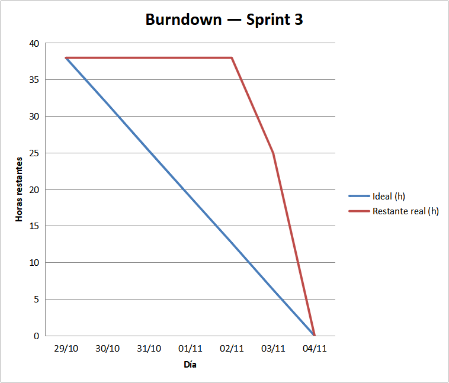

**Análisis:** la línea ideal baja de 38 horas a cero entre el 29 de octubre y el 4 de noviembre. La real
se queda en 38 hasta el 2 de noviembre, porque ninguna tarea se terminó antes del 3: ese día se
terminaron 13 horas (Redis, el módulo de eventos, HU-05 y HU-06) y el 4 las 25 restantes. El sprint
cerró en su fecha, pero con el trabajo concentrado en sus dos últimos días.

<!-- figura: Burnup del Sprint 3 -->
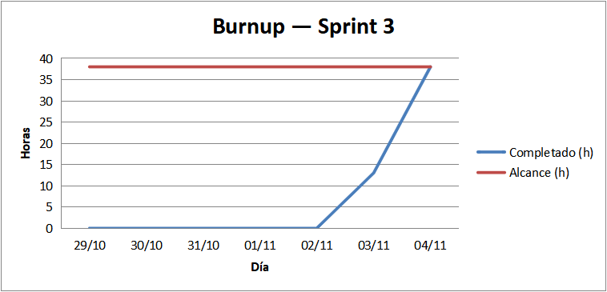

**Análisis:** el alcance no cambió durante el sprint (38 horas) y el trabajo completado lo alcanza el 4
de noviembre.

<!-- figura: Burnup del proyecto al cierre del Sprint 3 -->
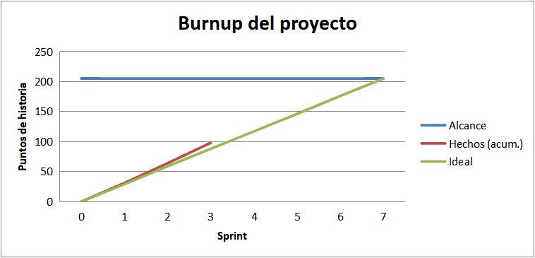

**Análisis:** con los 34 puntos del Sprint 3 el proyecto suma 98 de 205, por encima de la línea ideal
(88 puntos al cierre del tercer sprint).

| Métrica | Valor |
|---|---|
| Horas planificadas | 38 h |
| Horas completadas | 38 h |
| Puntos comprometidos / completados | 34 / 34 |
| Horas terminadas por integrante | Joseph 13 h, Nilser 25 h |
| Días con tareas terminadas | 2 (3 y 4 de noviembre) |
| Pruebas automatizadas que pasan | 394 (77 + 42 + 36 + 14 + 216 + 9) |

### 3.4.8 Sprint Review

**Demostraciones:**

1. **Receta con su costo.** En Producción › Productos, la ensalada César tiene dos versiones de receta;
   activar una desactiva la otra y cada una muestra sus insumos y el costo de la corrida. Un insumo que
   usa una receta no se puede eliminar en inventario. Resultado: correcto.
2. **Orden de producción completa.** El cocinero registra 8 ensaladas con la receta activa (la
   pantalla calcula 1,2 kg de pollo para dos corridas de 4), la inicia y la finaliza con 7 porciones
   obtenidas: la orden registra 1 de merma, el costo por unidad y las notas EGR e ING; en Inventario
   bajan los insumos y entran 7 ensaladas a la cámara refrigerada. Resultado: correcto.
3. **Sin insumos no se produce.** Una orden que pide más de lo que hay se rechaza diciendo qué falta y
   cuánto hay disponible. Resultado: correcto.
4. **Si RabbitMQ no responde al finalizar.** La orden vuelve a «En proceso» y la reserva se libera, así
   que nada queda descontado y la orden se puede volver a finalizar. Resultado: correcto.
5. **Recuperar la contraseña.** Un cliente pide el código, le llega por correo (en desarrollo, en el
   registro de ms-reportes), lo escribe y elige una contraseña nueva; el código no sirve una segunda vez.
   Resultado: correcto.
6. **Permisos que rigen al instante.** El administrador quita un permiso a un empleado: su siguiente
   petición a inventario ya lo rechaza y el frontend lo lleva al inicio de sesión para tomar los
   permisos nuevos. Resultado: correcto.
7. **Réplicas por eventos.** Un producto creado en el catálogo aparece en inventario, y un insumo
   creado en inventario se puede usar en una receta, sin llamadas directas entre los servicios.
   Resultado: correcto.

**Retroalimentación del Product Owner:** el incremento cumple el objetivo del sprint: recetas y
producción funcionando, con los servicios comunicados por eventos. Pide que en el Sprint 4 los pedidos
reutilicen las reservas de stock de HU-17 y que se corrija un detalle encontrado en la revisión: una
petición con JSON mal formado responde 500 en lugar de 400.

### 3.4.9 Sprint Retrospective

**¿Qué salió bien?**

- El módulo de eventos se hizo primero, como se planificó, y las demás tareas lo usaron sin cambios.
- Las pruebas corren contra RabbitMQ, PostgreSQL y Redis reales. Durante el sprint se corrigieron,
  cada uno con su prueba, dos errores que no se veían a simple vista: un índice que en una base nueva
  no dejaba registrar dos almacenes del mismo tipo, y pruebas que ensuciaban las réplicas de la base de
  desarrollo.
- Como pidió la retrospectiva anterior, el contrato entre servicios se fijó antes de programar: el
  catálogo de eventos de la sección 3.1.7 y el módulo de eventos (T2.1), que se hizo primero.

**¿Qué salió mal?**

- El trabajo se concentró en los dos últimos días del sprint, y la carga quedó desigual: Nilser
  terminó además las tres últimas tareas de Joseph, desde la computadora de Joseph.
- La conexión lenta de esa computadora cortó la instalación y Enterprise Architect no exporta las
  imágenes en ella.
- Los cambios se acumularon en ramas encadenadas que esperan revisión: cuanto más larga la cadena, más
  difícil revisar cada pull request.

**¿Qué mejorar?**

- Abrir el pull request de cada historia apenas se termina, para que el otro integrante la revise el
  mismo día.
- Terminar tareas desde el primer día del sprint, para que el avance se reparta y se vea en la Daily.
- Corregir en el Sprint 4 la respuesta a un JSON mal formado (400 en lugar de 500).
