## 3.5 Sprint 4

### 3.5.1 Sprint Planning (objetivo del sprint)

**Objetivo del sprint:** pedido a domicilio con pago en línea (saga completa). El cliente arma su
carrito, elige una dirección guardada o marca una nueva en el mapa y confirma; el stock queda reservado
y, si paga con QR o tarjeta, el cobro se abre en la pasarela (Libélula o la simulada). Al confirmarse el
pago el pedido entra a la cocina; si el plazo vence, se cancela y el stock se libera. Desde «Mis
pedidos» el cliente sigue el estado de cada pedido y puede cancelarlo antes de que salga.

**Fechas:** jueves 5 al miércoles 11 de noviembre de 2026.

**Microservicios nuevos:** ms-pedidos (base `pedidos_db`) y ms-pagos (base `pagos_db`), los dos en
PostgreSQL. Con ellos el sistema llega a seis microservicios y once contenedores.

**Historias comprometidas:**

| ID | Historia | Microservicio | Pts |
|---|---|---|---|
| HU-21 | Carrito y pedido | ms-pedidos | 8 |
| HU-22 | Direcciones en mapa | ms-pedidos | 3 |
| HU-26 | Pago en línea (saga) | ms-pagos + ms-pedidos + ms-inventario | 13 |
| HU-27 | Modo de cobro | ms-pagos | 2 |
| HU-25 | Mis pedidos y seguimiento | ms-pedidos | 5 |
| | **Total** | | **31** |

**Qué se reutiliza.** Del sistema anterior se adaptan las reglas del pedido, las direcciones, el cobro,
la pasarela simulada y la de Libélula, que ya funcionaban con dinero real. El frontend del carrito, «Mis
pedidos», el selector de direcciones, el diálogo de cobro y el modo de cobro ya estaban: se conserva su
contrato con la API, así que funcionan contra los microservicios sin cambios grandes.

### 3.5.2 Sprint Backlog (tareas, responsables y tiempo)

| ID | Historia | Tarea | Responsable | Horas | Terminada |
|---|---|---|---|---|---|
| T1.1 | HT-01 | ms-pedidos y ms-pagos en Docker Compose, el API Gateway y el instalador | Joseph | 2 | 05/11 |
| T2.1 | HU-22 | ms-pedidos: esquema `pedidos_db` y direcciones, con una principal y coordenadas de seis decimales | Joseph | 3 | 05/11 |
| T3.1 | HU-21 | Confirmar el pedido: precios del catálogo, reserva del stock en inventario (HU-17) y compensación de cada paso | Joseph | 4 | 07/11 |
| T3.2 | HU-21 | Ruta de precios en ms-catalogo; el portal muestra el stock disponible (sin lo reservado) | Nilser | 2 | 06/11 |
| T4.1 | HU-26 | ms-pagos: esquema `pagos_db` y adaptar la pasarela simulada y la de Libélula | Nilser | 4 | 06/11 |
| T4.2 | HU-26 | Abrir el cobro, aviso de la pasarela, vencimiento y eventos `PagoConfirmado` / `PagoFallido` | Nilser | 4 | 09/11 |
| T4.3 | HU-26 | ms-pedidos aplica el desenlace del cobro; `PedidoCancelado` libera la reserva en ms-inventario | Joseph | 3 | 09/11 |
| T5.1 | HU-27 | Modo de cobro simulado o real, solo el administrador; cada pago conserva su modo | Nilser | 2 | 08/11 |
| T6.1 | HU-25 | Mis pedidos, cancelar y seguimiento del repartidor | Joseph | 3 | 10/11 |
| T6.2 | HU-22 | La dirección principal en el carrito | Nilser | 1 | 10/11 |
| T7.1 | HT-05 | Pruebas de integración de ms-pedidos | Joseph | 2 | 10/11 |
| T7.2 | HT-05 | Pruebas de integración de ms-pagos | Nilser | 2 | 10/11 |
| T7.3 | HT-05 | Punta a punta del pedido en efectivo y con QR | Joseph | 2 | 11/11 |
| T8.1 | Informe | Diagramas de clases de ms-pedidos y ms-pagos y de secuencia del pago en línea en EA | Nilser | 2 | 11/11 |
| T8.2 | Informe | Documentar el Sprint 4 en el informe | Nilser | 2 | 11/11 |
| | | **Total** | | **38** | |

En el Sprint Planning las tareas se repartieron por microservicio: Joseph tomó ms-pedidos (HU-21,
HU-22, HU-25), la infraestructura y la prueba de punta a punta; Nilser, ms-pagos (HU-26, HU-27), el
cambio en el catálogo, los diagramas y el informe. Horas asignadas: 19 h cada uno.

**Contrato entre servicios, acordado antes de programar** (lo pidió la retrospectiva del Sprint 2):
las rutas internas y los eventos de la tabla de la sección 3.5.3 se fijaron el primer día, para que
cada uno avanzara en su servicio sin esperar al otro.

El detalle diario de cada tarea (estado y fecha de término) está en la hoja *Sprint 4* de
`docs/scrum/seguimiento-scrum.xlsx`.

### 3.5.3 Diagramas de clase e interfaces

**Diagrama de clases de ms-pedidos.** Un pedido se entrega en una dirección del cliente y tiene sus
líneas con el nombre y el precio que tenían **al confirmarlo**: si el catálogo cambia después, la
historia del pedido no cambia. No hay claves foráneas a otros servicios: el cliente, los productos, la
reserva de stock, el cobro y el repartidor se guardan por su número (RNF-ARQ-02). Cada cliente tiene una
sola dirección principal. La posición del repartidor la escribirá él mismo desde «Mis entregas»
(Sprint 5); en este sprint solo se lee.

<!-- figura: Diagrama de clases de ms-pedidos -->
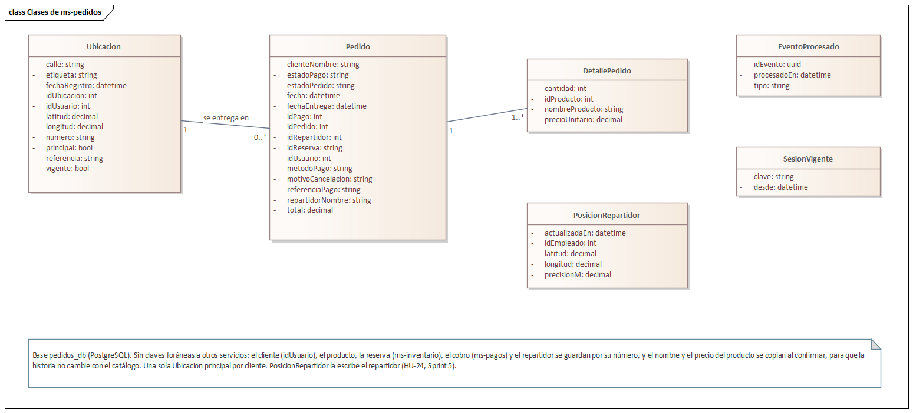

**Diagrama de clases de ms-pagos.** Un cobro es de un pedido (o, desde el Sprint 5, de una venta de
mostrador). Guarda el modo con que nació —simulado o real— y lo que hay que mostrarle al cliente: el
contenido del QR o el enlace de pago. `EventoPago` es la bitácora de todo lo que le pasó al cobro,
avisos de la pasarela incluidos: es lo que permite responder un reclamo de «yo pagué y no me llegó».

<!-- figura: Diagrama de clases de ms-pagos -->
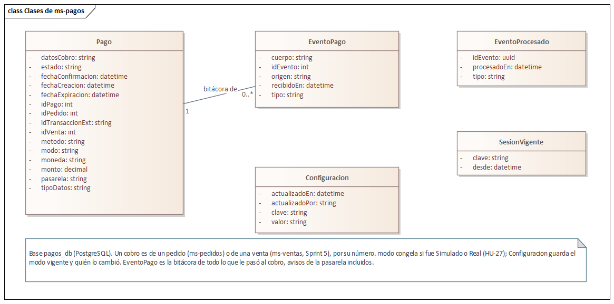

**Saga del pedido pagado en línea.** Confirmar el pedido toca tres servicios. El precio lo pide al
catálogo (RNF-SEG-03: nunca el del navegador); el stock lo reserva inventario, con las reservas de HU-17;
y, si se paga en línea, ms-pagos abre el cobro. Estas tres son **REST**, porque el cliente necesita la
respuesta en el momento: si hay stock y cuál es su QR. Cada paso tiene su **compensación**: si el
pedido no se puede guardar, se libera la reserva; si el cobro no se puede abrir, el pedido se cancela y
se libera el stock. El desenlace del cobro llega después por **eventos**.

<!-- figura: Pago en línea de un pedido -->
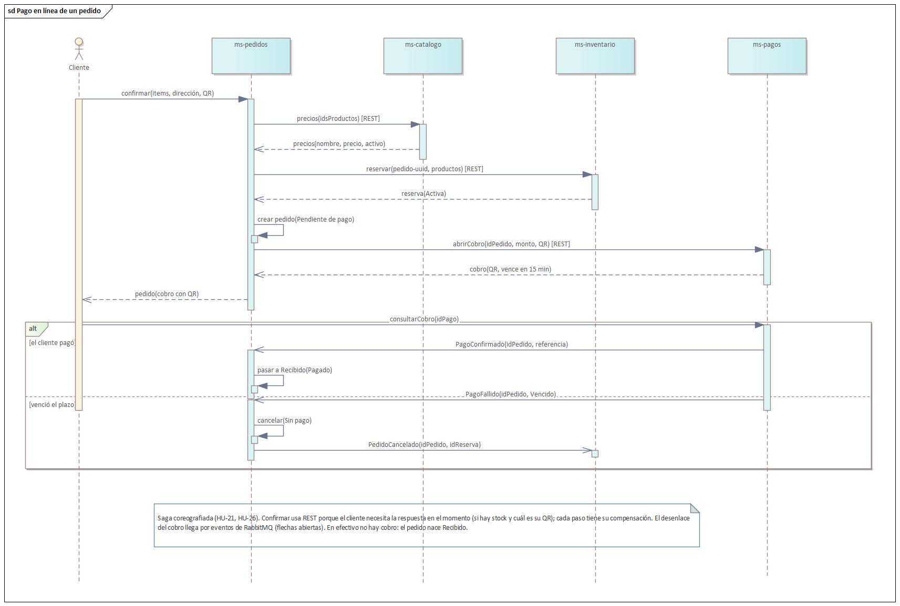

**Cambio respecto del diseño del Sprint 0.** El catálogo de eventos de la sección 3.1.7 preveía que
ms-pedidos publicara `PedidoCreado` y que inventario contestara `StockReservado` o
`StockInsuficiente`. Se reemplazó por una reserva REST, como en las órdenes de producción del Sprint 3:
con eventos, el cliente esperaría sin respuesta y el aviso de «falta stock de tal producto» llegaría
tarde. Los eventos del pago y de la cancelación se mantienen:

| Evento | Lo publica | Lo consumen | Para qué |
|---|---|---|---|
| `PagoConfirmado` | ms-pagos | ms-pedidos | El pedido pasa de «Pendiente de pago» a «Recibido» y entra a la cocina. |
| `PagoFallido` | ms-pagos | ms-pedidos | El cobro venció o se anuló: el pedido se cancela («Sin pago»). |
| `PedidoCancelado` | ms-pedidos | ms-inventario, ms-pagos | Inventario libera la reserva; ms-pagos cierra el cobro si seguía pendiente. |
| `PedidoEstadoCambiado` | ms-pedidos | ms-reportes (Sprint 6) | Avisar al cliente por correo y alimentar los reportes. |

**Comunicación por REST interno:**

| Quién llama | Ruta | Para qué |
|---|---|---|
| ms-pedidos → ms-catalogo | `GET /interno/productos/precios` | El precio vigente y si el producto sigue activo. |
| ms-pedidos → ms-inventario | `POST /interno/reservas` y `POST /interno/reservas/:id/liberar` | Reservar el stock del pedido; liberarlo si el pedido no llega a existir. |
| ms-pedidos → ms-pagos | `POST /interno/pagos` | Abrir el cobro con QR o tarjeta y recibir lo que se le muestra al cliente. |
| ms-pedidos → ms-pagos | `GET /interno/pagos/pedido/:id` | El cobro del pedido, para retomar un pago interrumpido. |

**Si un aviso se pierde.** Si RabbitMQ no responde cuando ms-pagos publica `PagoConfirmado`, el cobro
queda cerrado igual. Cuando el cliente mira su pedido, ms-pedidos le pregunta a ms-pagos y aplica lo
mismo que habría hecho el evento (RNF-DIS-01). Si lo que no se puede publicar es `PedidoCancelado`,
ms-pedidos libera la reserva directamente por REST.

**Interfaces.** El portal del cliente queda completo: carrito, entrega y pago, cobro con QR,
comprobante y «Mis pedidos». El tablero de pedidos del personal llega con HU-23, en el Sprint 5.

<!-- figura: Entrega y pago: la dirección principal elegida y el pago con QR -->
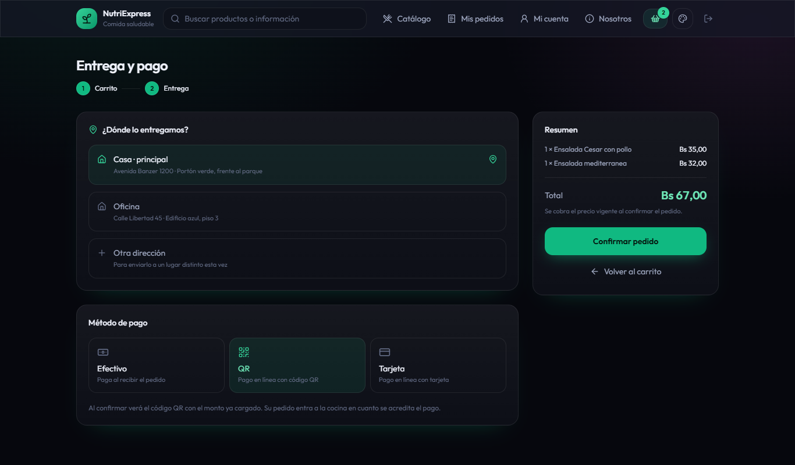

<!-- figura: Cobro con QR de la pasarela simulada -->
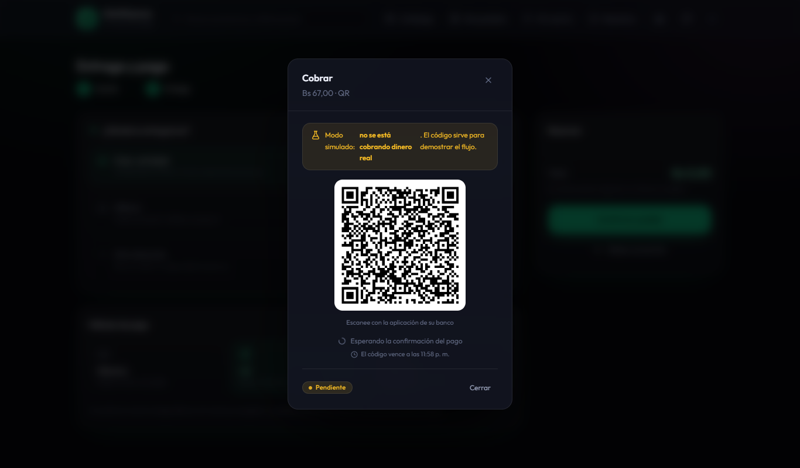

<!-- figura: Comprobante del pedido pagado -->
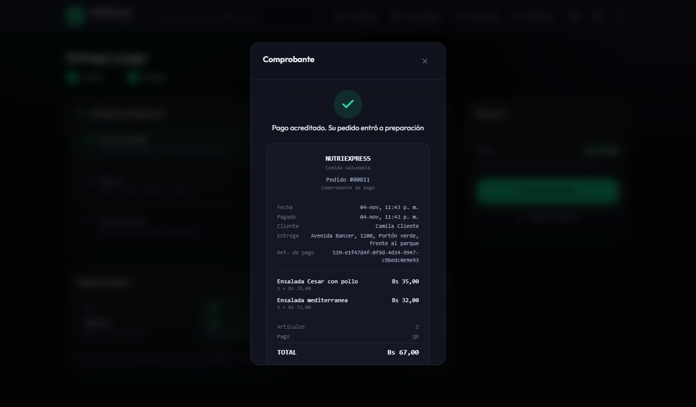

<!-- figura: Mis pedidos: estado, dirección en el mapa y acciones -->
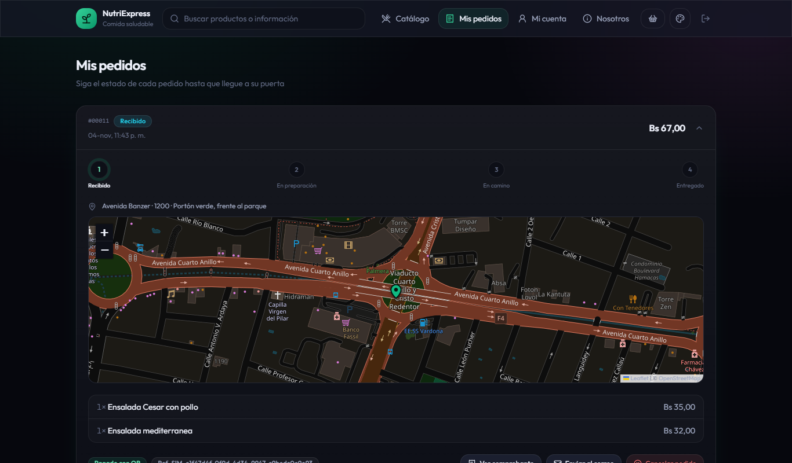

<!-- figura: Modo de cobro del administrador -->
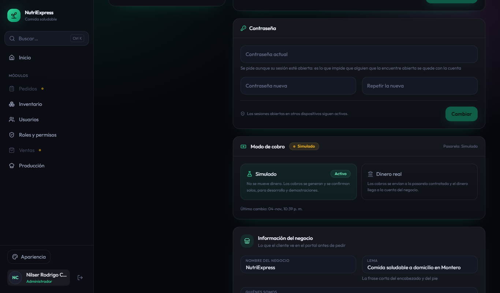

### 3.5.4 Daily Meeting

| Fecha | Integrante | ¿Qué hice? | ¿Qué haré hoy? | Impedimentos |
|---|---|---|---|---|
| 05/11 | Joseph | Sprint Planning con Nilser: tareas repartidas y contrato entre servicios acordado. | ms-pedidos y ms-pagos en Docker y el gateway (T1.1); esquema de pedidos y direcciones (T2.1). | Ninguno. |
| 05/11 | Nilser | Sprint Planning. | Esquema de pagos y adaptar las pasarelas del sistema anterior (T4.1). | Ninguno. |
| 06/11 | Joseph | Contenedores, gateway y direcciones. | Confirmar el pedido con reserva y compensación (T3.1). | Ninguno. |
| 06/11 | Nilser | Pasarelas simulada y de Libélula adaptadas. | Ruta de precios del catálogo y stock disponible en el portal (T3.2). | Ninguno. |
| 07/11 | Joseph | Avancé la confirmación del pedido. | Terminar la confirmación (T3.1). | Ninguno. |
| 07/11 | Nilser | Precios y stock disponible. | Abrir el cobro y el aviso de la pasarela (T4.2). | Ninguno. |
| 08/11 | Joseph | Confirmación con reserva y compensación terminada. | Ayudar a Nilser con el error de las transacciones. | En la computadora de Nilser, con los once contenedores, confirmar un pedido devolvía «Error interno»: la transacción no alcanzaba a empezar en los 2 s de Prisma (P2028). |
| 08/11 | Nilser | Avancé el cobro y el aviso de la pasarela. | Modo de cobro (T5.1) y seguir con el cobro (T4.2). | El mismo: se perdió el día buscando la causa. Se dio a las transacciones el margen que ya usaba inventario y la base ocupada responde 503. |
| 09/11 | Joseph | Margen de las transacciones probado. | Aplicar el desenlace del cobro y `PedidoCancelado` (T4.3). | Ninguno. |
| 09/11 | Nilser | Modo de cobro (T5.1) y el margen de las transacciones. | Terminar el cobro, el vencimiento y sus eventos (T4.2). | Ninguno. |
| 10/11 | Joseph | Desenlace del cobro y liberación de la reserva. | Mis pedidos, cancelar y seguimiento (T6.1); pruebas de ms-pedidos (T7.1). | Ninguno. |
| 10/11 | Nilser | Cobro, aviso de la pasarela y vencimiento con sus eventos. | Pruebas de ms-pagos (T7.2) y dirección principal en el carrito (T6.2). | El comprobante decía «Le enviamos una copia a su correo», que recién ocurre en el Sprint 6: se oculta hasta entonces. |
| 11/11 | Joseph | Mis pedidos y pruebas de ms-pedidos. | Punta a punta del pedido en efectivo y con QR (T7.3). Sprint Review y Retrospective. | En la computadora de Nilser la prueba con QR se pasa de sus tiempos mientras Chrome dibuja el mapa: el recorrido se verificó a mano. |
| 11/11 | Nilser | Pruebas de ms-pagos y dirección principal. | Diagramas en EA (T8.1) y documentar el Sprint 4 (T8.2). | Ninguno. |

### 3.5.5 Scrumboard (To Do, Doing, Done)

| Historia | Tareas | Estado inicial | Estado final |
|---|---|---|---|
| HT-01 Infraestructura | 1 | 1 en To Do | 1 en Done |
| HU-22 Direcciones en mapa | 2 | 2 en To Do | 2 en Done |
| HU-21 Carrito y pedido | 2 | 2 en To Do | 2 en Done |
| HU-26 Pago en línea (saga) | 3 | 3 en To Do | 3 en Done |
| HU-27 Modo de cobro | 1 | 1 en To Do | 1 en Done |
| HU-25 Mis pedidos y seguimiento | 1 | 1 en To Do | 1 en Done |
| HT-05 Pruebas | 3 | 3 en To Do | 3 en Done |
| Informe | 2 | 2 en To Do | 2 en Done |

### 3.5.6 Product Increment

| Entregable | Descripción |
|---|---|
| Infraestructura | `docker compose up` levanta once contenedores: se suman ms-pedidos (puerto 4004, base `pedidos_db`) y ms-pagos (puerto 4005, base `pagos_db`). El API Gateway reparte `/api/pedidos` y `/api/ubicaciones` a ms-pedidos, y `/api/pagos` y `/api/configuracion` a ms-pagos. |
| ms-pedidos | Direcciones del cliente con una principal y coordenadas de seis decimales (HU-22). Confirmar el pedido con el precio del catálogo y la reserva del stock; si falta, dice qué producto y cuánto hay (HU-21). «Mis pedidos», cancelar mientras no haya salido (libera el stock), seguimiento del repartidor solo en camino y comprobante del pedido pagado (HU-25). |
| ms-pagos | Cobro con QR o tarjeta en la pasarela simulada o en Libélula; aviso de la pasarela con verificación de firma y de monto; consulta directa a la pasarela si el aviso no llega; vencimiento automático cada minuto (HU-26). Modo de cobro que cambia el administrador sin reiniciar; cada cobro conserva el modo con que nació (HU-27). |
| ms-catalogo e inventario | El catálogo da los precios a ms-pedidos y el portal muestra lo disponible: el stock menos lo reservado para pedidos. Inventario libera la reserva al recibir `PedidoCancelado`. |
| Frontend | `SPRINT_ACTUAL` sube a 4. El carrito ofrece primero la dirección principal y permite cambiarla; el comprobante no promete el correo hasta el Sprint 6. |
| Pruebas | Integración: 77 en ms-identidad, 43 en ms-catalogo, 37 en ms-inventario, 14 en ms-reportes, 20 en ms-pedidos y 14 en ms-pagos. Componentes: 217 (y 1 en espera hasta el Sprint 6). Punta a punta: 2 nuevas del pedido, en efectivo y con QR. |

### 3.5.7 Burndown y Burnup

<!-- figura: Burndown del Sprint 4 -->
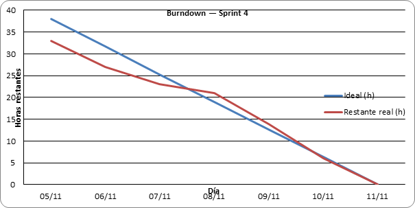

**Análisis:** la línea ideal baja de 38 horas a cero entre el 5 y el 11 de noviembre. La real empieza
por debajo de ella, pero el domingo 8 casi no avanza (2 horas): confirmar un pedido fallaba en la
computadora de Nilser porque las transacciones no alcanzaban a empezar. Del 9 al 11 se recupera y el
sprint cierra el miércoles 11, en la fecha planificada.

<!-- figura: Burnup del Sprint 4 -->
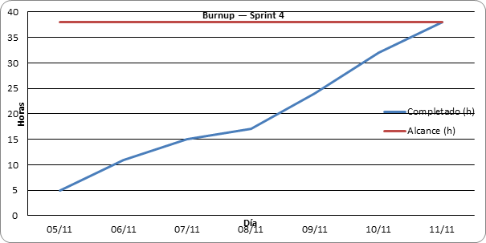

**Análisis:** el alcance no cambió durante el sprint (38 horas). El trabajo completado se aplana el día
8 y lo alcanza el 11 de noviembre.

<!-- figura: Burnup del proyecto al cierre del Sprint 4 -->
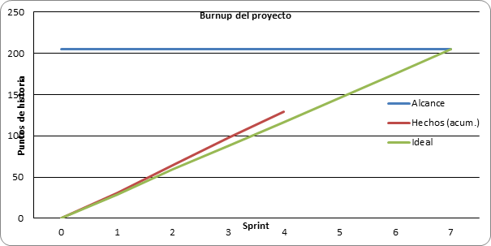

**Análisis:** con los 31 puntos del Sprint 4 el proyecto suma 129 de 205, por encima de la línea ideal
(117 puntos al cierre del cuarto sprint).

| Métrica | Valor |
|---|---|
| Horas planificadas | 38 h |
| Horas completadas | 38 h |
| Puntos comprometidos / completados | 31 / 31 |
| Horas asignadas por integrante | 19 h cada uno |
| Días de atraso respecto al plan | 0 |
| Pruebas de integración y de componentes que pasan | 422 (77 + 43 + 37 + 14 + 20 + 14 + 217) |

### 3.5.8 Sprint Review

**Demostraciones:**

1. **Arranque.** `docker compose up -d --build` levanta los once contenedores; ms-pedidos y ms-pagos
   crean sus tablas y ms-pagos nace en modo simulado. Resultado: correcto.
2. **Direcciones.** La cliente guarda «Casa» y «Oficina»; la primera queda como principal y el carrito
   la ofrece elegida; cambiarla a «Oficina» la pone primero la próxima vez. Resultado: correcto.
3. **Pedido en efectivo.** Pide dos ensaladas: el pedido nace «Recibido», el precio es el del catálogo y
   el portal muestra dos disponibles menos (quedan reservadas). Resultado: correcto.
4. **Sin stock.** Pedir 99 ensaladas se rechaza diciendo «se necesitan 99 u y hay 7 u disponibles», y no
   se crea ningún pedido. Resultado: correcto.
5. **Pago con QR.** El pedido queda «Pendiente de pago» con su código; la pasarela simulada lo acredita
   en unos segundos y aparece el comprobante; el pedido pasa a «Recibido». Resultado: correcto.
6. **Vencimiento.** Un cobro cuyo plazo venció pasa a «Vencido»: el pedido se cancela («Sin pago») y su
   reserva vuelve al disponible (prueba de integración). Resultado: correcto.
7. **Cancelar.** La cliente cancela un pedido «Recibido»: queda «Cancelado» por ella y el stock vuelve;
   un pedido «En camino» ya no se puede cancelar. Resultado: correcto.
8. **Modo de cobro.** Solo el administrador lo ve; activar el modo real sin la configuración de Libélula
   se rechaza diciendo qué falta; un cobro abierto antes del cambio conserva su modo. Resultado: correcto.
9. **Tolerancia a fallos.** Con ms-pagos sin responder, un pedido con QR se deshace (el stock se libera)
   y el cliente lee que puede intentar de nuevo o pagar en efectivo. Resultado: correcto.

**Retroalimentación del Product Owner:** el incremento cumple el objetivo: el cliente pide y paga en
línea de punta a punta. Para el Sprint 5 pide el tablero del personal (HU-23), que reutilice la reserva
del pedido al entregarlo, y probar el modo real con Libélula en el servidor, donde hay una dirección
pública para sus avisos.

### 3.5.9 Sprint Retrospective

**¿Qué salió bien?**

- Acordar el contrato entre servicios el primer día permitió que cada uno avanzara en su servicio en
  paralelo, como pidió la retrospectiva del Sprint 2.
- Reutilizar la pasarela de Libélula y la simulada del sistema anterior: el cobro funcionó sin cambiar
  su lógica, solo lo que antes tocaba el pedido pasó a ser un evento.
- Las pruebas de ms-pedidos usan un catálogo, un inventario y un ms-pagos falsos: se prueban la
  compensación y el «aviso perdido» sin levantar los otros servicios.

**¿Qué salió mal?**

- El domingo 8 se perdió buscando por qué confirmar un pedido daba «Error interno» en la computadora
  de Nilser: con los once contenedores, la transacción no alcanzaba a empezar en el tiempo de Prisma.
- Las pruebas de punta a punta son lentas en esa computadora: mientras Chrome dibuja el mapa, el catálogo
  llega a mostrarse sin stock (inventario tarda más de 3 s) y la prueba con QR se pasa de sus tiempos.
- El comprobante reutilizado prometía una copia por correo que todavía no se envía.

**¿Qué mejorar?**

- Correr las pruebas de punta a punta en la computadora de Joseph, que tiene más memoria, antes de
  cerrar cada sprint.
- Dar el margen de las transacciones desde el primer día a cada servicio nuevo.
- Revisar los textos del frontend reutilizado contra lo que el sprint realmente entrega.
