## 3.6 Sprint 5

### 3.6.1 Sprint Planning (objetivo del sprint)

**Objetivo del sprint:** despacho de pedidos, reparto y venta de mostrador. El personal ve los pedidos
en un tablero, los pasa de estado y les asigna un repartidor; el repartidor ve sus entregas, comparte su
ubicación con el cliente y cierra cada entrega, cobrando el efectivo. En el local, el vendedor registra
ventas de mostrador en efectivo o con QR, emite su comprobante, anula las equivocadas y mantiene las
fichas de los clientes.

**Fechas:** jueves 12 al miércoles 18 de noviembre de 2026.

**Microservicio nuevo:** ms-ventas (base `ventas_db`, PostgreSQL). Con él el sistema llega a siete
microservicios y doce contenedores. ms-pedidos suma el lado del personal, ms-inventario la salida por
venta y la devolución, ms-pagos el cobro en efectivo y ms-identidad la gestión de clientes.

**Historias comprometidas:**

| ID | Historia | Microservicio | Pts |
|---|---|---|---|
| HU-23 | Tablero de pedidos | ms-pedidos + ms-identidad | 8 |
| HU-24 | Mis entregas (repartidor) | ms-pedidos + ms-inventario + ms-pagos | 8 |
| HU-18 | Venta de mostrador | ms-ventas + ms-inventario + ms-pagos | 8 |
| HU-19 | Comprobante y anulación | ms-ventas | 5 |
| HU-20 | Gestionar clientes | ms-identidad | 3 |
| | **Total** | | **32** |

**Qué se reutiliza.** Del sistema anterior se adaptan las reglas del tablero y del reparto
(`pedido-gestion.service.ts` y `reparto.service.ts`), la venta de mostrador y su comprobante, y la
búsqueda de clientes sin tildes. El frontend del tablero, «Mis entregas», el punto de venta, el
historial de ventas y la lista de clientes ya estaban: se conserva su contrato con la API y solo se
habilitan sus pestañas.

**HU-20 en ms-identidad.** El Product Backlog la ubicaba en ms-ventas, pero la ficha del cliente (su
nombre, correo y preferencias) ya vive en ms-identidad desde el Sprint 1. Para no copiarla en dos bases,
el equipo decidió dejarla allí: ms-ventas guarda solo el número y el nombre del cliente de cada venta.

### 3.6.2 Sprint Backlog (tareas, responsables y tiempo)

| ID | Historia | Tarea | Responsable | Horas | Terminada |
|---|---|---|---|---|---|
| T1.1 | HT-01 | ms-ventas en Docker Compose; el API Gateway reparte `/api/ventas`, `/api/gestion` y `/api/clientes`; el instalador | Joseph | 2 | 12/11 |
| T2.1 | HU-23 | Tablero: pedidos de todos los clientes con filtros y página, resumen por estado y flujo de estados | Joseph | 3 | 13/11 |
| T2.2 | HU-23 | Asignar repartidor: rutas internas de ms-identidad (repartidores y cargo) y sugerencia por turno y carga | Joseph | 3 | 14/11 |
| T3.1 | HU-24 | Mis entregas: turno del repartidor, compartir su posición y cerrar la entrega (solo el asignado) | Joseph | 3 | 16/11 |
| T3.2 | HU-24 | Entregar consume la reserva (nota de egreso por Venta en ms-inventario) y registra el efectivo en ms-pagos | Joseph | 3 | 16/11 |
| T4.1 | HU-18 | ms-ventas: esquema `ventas_db`, precios del catálogo, reserva y consumo del stock, venta en efectivo | Nilser | 4 | 13/11 |
| T4.2 | HU-18 | Venta con QR: cobro en ms-pagos con `idVenta`, `PagoConfirmado` / `PagoFallido` y deshacer si ms-pagos no responde | Nilser | 3 | 16/11 |
| T5.1 | HU-19 | Comprobante de la venta y anulación: el stock vuelve al mismo almacén y el cobro se cierra | Nilser | 3 | 17/11 |
| T6.1 | HU-20 | Gestionar clientes en ms-identidad: buscar sin tildes, corregir la ficha, correo único, pedidos y ventas de cada uno | Nilser | 2 | 14/11 |
| T7.1 | HT-05 | Pruebas de integración de ms-pedidos (tablero y reparto) | Joseph | 2 | 17/11 |
| T7.2 | HT-05 | Pruebas de integración de ms-ventas, ms-pagos, ms-inventario y ms-identidad | Nilser | 2 | 17/11 |
| T7.3 | HT-05 | `SPRINT_ACTUAL` 5 y punta a punta del despacho del pedido | Joseph | 2 | 18/11 |
| T8.1 | Informe | Diagramas de clases de ms-ventas y del reparto, y de secuencia de la venta y de la entrega en EA | Nilser | 2 | 18/11 |
| T8.2 | Informe | Documentar el Sprint 5 en el informe | Nilser | 2 | 18/11 |
| | | **Total** | | **36** | |

En el Sprint Planning las tareas se repartieron por área: Joseph tomó el despacho (HU-23 y HU-24 en
ms-pedidos, con la salida del stock al entregar), la infraestructura y la prueba de punta a punta;
Nilser, el mostrador (HU-18 y HU-19 en ms-ventas), los clientes (HU-20), los diagramas y el informe.
Horas asignadas: 18 h cada uno.

**Contrato entre servicios.** Como en el Sprint 4, las rutas internas y los eventos de la sección 3.6.3
se acordaron el primer día. La ruta que consume una reserva en ms-inventario y la del cobro en efectivo
en ms-pagos las usan los dos (el pedido entregado y la venta), así que se definieron una sola vez.

El detalle diario de cada tarea (estado y fecha de término) está en la hoja *Sprint 5* de
`docs/scrum/seguimiento-scrum.xlsx`.

### 3.6.3 Diagramas de clase e interfaces

**Diagrama de clases de ms-ventas.** Una venta de mostrador tiene sus líneas con el nombre y el precio
que tenían al venderse y el almacén del que salió cada producto: al anularla, el stock vuelve al mismo
almacén. El cliente es opcional (sin él, es «consumidor final») y quien atendió sale del token. Como en
ms-pedidos, no hay claves foráneas a otros servicios: el cliente, los productos, la reserva consumida, su
nota de egreso y el cobro con QR se guardan por su número (RNF-ARQ-02).

<!-- figura: Diagrama de clases de ms-ventas -->
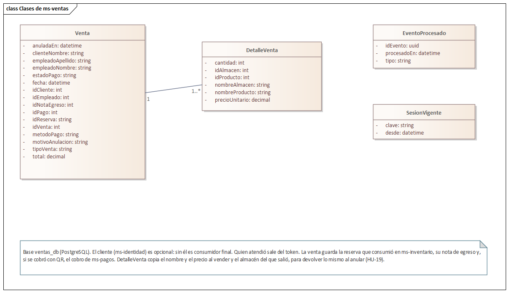

**Diagrama de clases del reparto en ms-pedidos.** El pedido ya tenía su repartidor y la posición que se
muestra al cliente (Sprint 4). Se suma `TurnoRepartidor`: el repartidor marca si está de turno y el
tablero sugiere al que está disponible y tiene menos entregas en curso. Los repartidores son empleados de
ms-identidad con cargo Repartidor; ms-pedidos los consulta por REST interno, no los copia.

<!-- figura: Diagrama de clases de ms-pedidos (reparto) -->
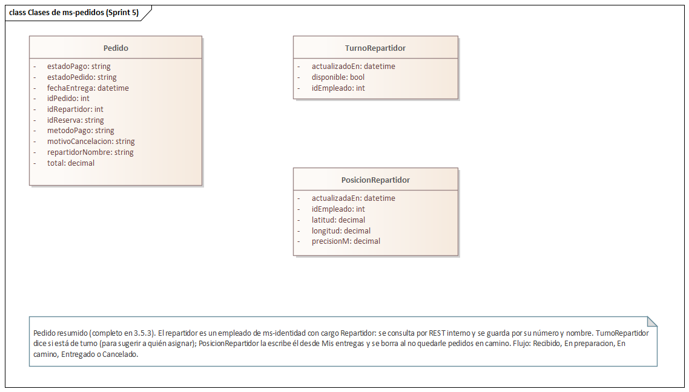

**Venta de mostrador.** El vendedor necesita la respuesta en el momento, así que todo es **REST**: el
precio sale del catálogo, inventario reserva el stock y lo consume en el acto con una nota de egreso por
venta, y en efectivo ms-pagos registra el cobro ya pagado. Con QR, la venta queda pendiente hasta que
llega `PagoConfirmado`; si el QR vence (`PagoFallido`), la venta se anula y el stock vuelve.

<!-- figura: Venta de mostrador -->
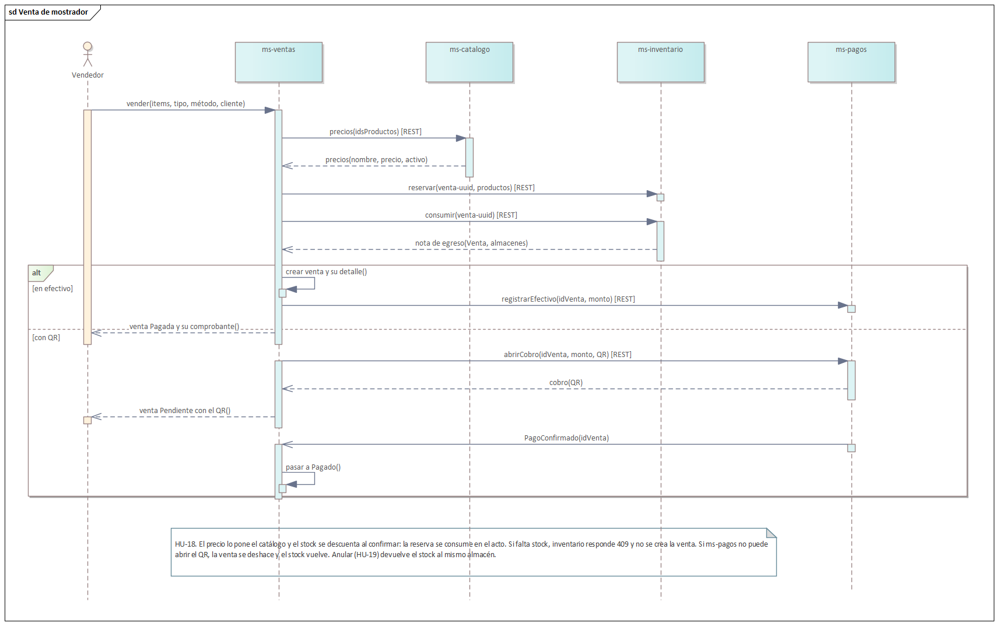

**Entregar un pedido.** Al asignar, ms-pedidos le pregunta a ms-identidad el cargo del empleado. Al
entregar, consume la reserva que se hizo al confirmar el pedido (HU-17) y, si era en efectivo, registra
el cobro en ms-pagos. «No entregado» cancela el pedido con ese motivo y publica `PedidoCancelado`, que
libera la reserva.

<!-- figura: Entregar un pedido -->
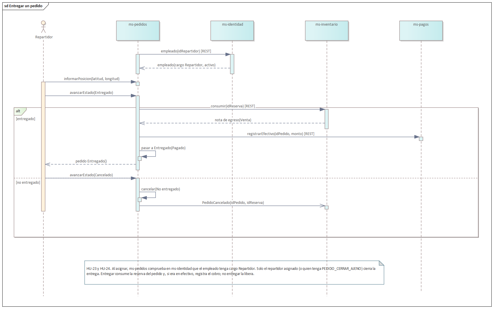

**Flujo de estados del pedido.** El tablero solo ofrece el paso siguiente: Recibido → En preparación →
En camino → Entregado, o Cancelado. No se salta a Entregado, y no sale «En camino» sin repartidor.

**Comunicación por REST interno:**

| Quién llama | Ruta | Para qué |
|---|---|---|
| ms-pedidos → ms-identidad | `GET /interno/repartidores` y `GET /interno/empleados/:id` | Los repartidores activos y el cargo del empleado que se asigna. |
| ms-ventas → ms-identidad | `GET /interno/clientes/:id` | El cliente de una venta, si se indica. |
| ms-identidad → ms-pedidos y ms-ventas | `GET /interno/pedidos/conteo` y `GET /interno/ventas/conteo` | Cuántos pedidos y ventas tiene cada cliente, para su ficha. |
| ms-pedidos y ms-ventas → ms-inventario | `POST /interno/reservas/:id/consumir` | Descontar el stock reservado con una nota de egreso por venta. |
| ms-ventas → ms-inventario | `POST /interno/devoluciones` | Devolver lo de una venta anulada, al mismo almacén. |
| ms-pedidos y ms-ventas → ms-pagos | `POST /interno/pagos/efectivo` | Registrar el efectivo cobrado al entregar o en el mostrador. |
| ms-ventas → ms-pagos | `POST /interno/pagos` y `POST /interno/pagos/venta/:id/anular` | Abrir el cobro con QR de la venta y cerrarlo al anularla. |

**Eventos:**

| Evento | Lo publica | Lo consumen | Para qué |
|---|---|---|---|
| `PagoConfirmado` / `PagoFallido` | ms-pagos | ms-pedidos, ms-ventas | Ahora traen `idVenta`: la venta con QR pasa a Pagado, o se anula y su stock vuelve. |
| `PedidoCancelado` | ms-pedidos | ms-inventario, ms-pagos | Con el motivo «No entregado» cuando el repartidor no pudo entregar: libera la reserva. |
| `VentaRegistrada` (nuevo) | ms-ventas | ms-reportes (Sprint 6) | Cada venta y su estado (Pagado, Pendiente o Anulado), para el reporte de ventas. |

**Las dos salidas del stock son idempotentes** (RNF-DIS-03). Consumir una reserva ya consumida no
descuenta de nuevo, y una devolución se reconoce por su referencia («Venta 12 anulada»): si ms-ventas la
repite porque no recibió la respuesta, inventario devuelve la misma nota de ingreso.

**Interfaces.** Se habilitan las pestañas Pedidos, Mis entregas y Ventas.

<!-- figura: Tablero de pedidos del personal -->
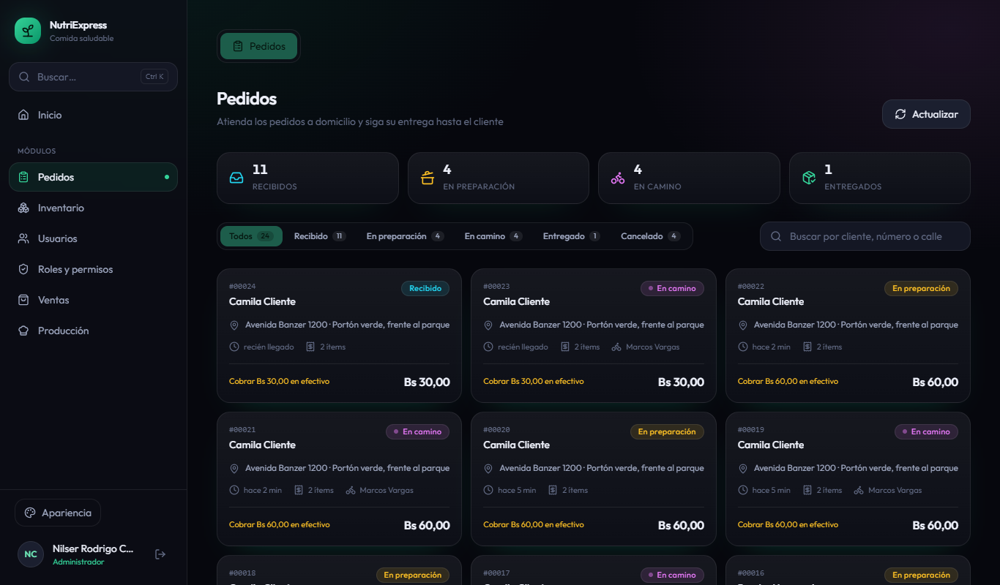

<!-- figura: Asignar un repartidor con la sugerencia del sistema -->

<!-- figura: Mis entregas del repartidor -->
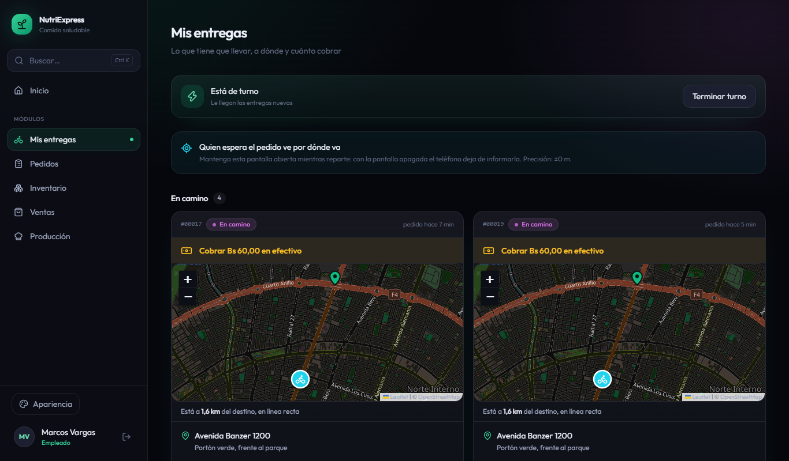

<!-- figura: Punto de venta del mostrador -->
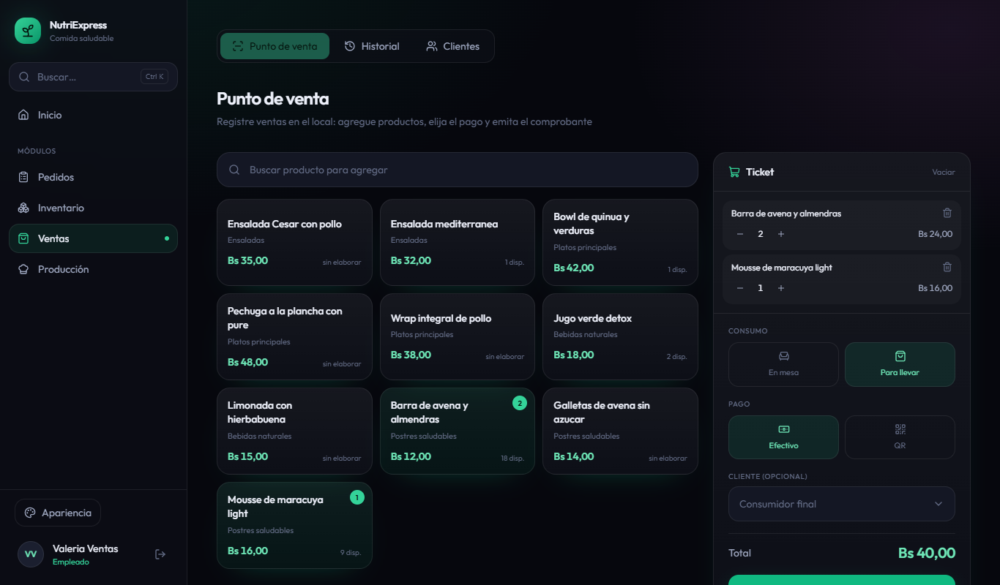

<!-- figura: Comprobante de una venta de mostrador -->
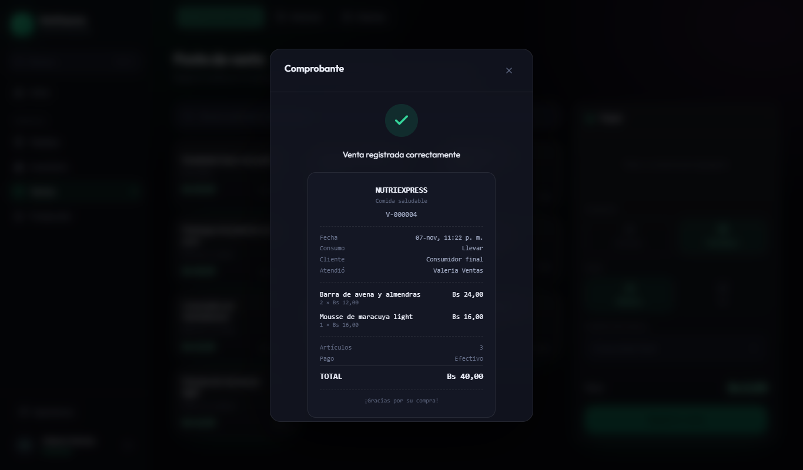

<!-- figura: Gestión de clientes -->
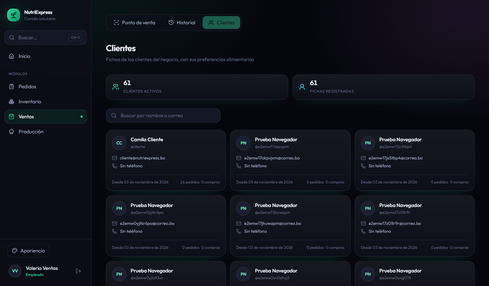

### 3.6.4 Daily Meeting

| Fecha | Integrante | ¿Qué hice? | ¿Qué haré hoy? | Impedimentos |
|---|---|---|---|---|
| 12/11 | Joseph | Sprint Planning con Nilser: tareas repartidas y rutas internas acordadas. | ms-ventas en Docker y las rutas nuevas del gateway (T1.1). | Ninguno. |
| 12/11 | Nilser | Sprint Planning. | Esquema de ventas, precios y reserva del stock (T4.1). | Ninguno. |
| 13/11 | Joseph | Contenedores y gateway. | Tablero con filtros, resumen y flujo de estados (T2.1). | Ninguno. |
| 13/11 | Nilser | Avancé la venta en efectivo. | Terminar la venta en efectivo (T4.1). | Ninguno. |
| 14/11 | Joseph | Tablero y flujo de estados terminados. | Asignar repartidor con las rutas internas de ms-identidad (T2.2). | Ninguno. |
| 14/11 | Nilser | Venta en efectivo con el stock descontado. | Gestionar clientes en ms-identidad (T6.1). | Ninguno. |
| 15/11 | Joseph | Asignación y sugerencia de repartidor. | Entregar el pedido consumiendo su reserva (T3.2). | Registrar la salida por venta fallaba: la restricción `CHECK` de `nota_egreso` no admitía el motivo «Venta», y las bases ya creadas había que corregirlas al arrancar el servicio. |
| 15/11 | Nilser | Clientes con búsqueda sin tildes. | Venta con QR (T4.2). | El mismo: la venta también consume su reserva, así que esperó la corrección. |
| 16/11 | Joseph | Corregida la restricción en la parte del esquema que se aplica en cada arranque. | Terminar la entrega y Mis entregas (T3.1, T3.2). | Las pruebas del tablero respondían 503: faltaba la dirección de ms-identidad en el entorno de pruebas. |
| 16/11 | Nilser | Avancé la venta con QR. | Terminar la venta con QR; empezar el comprobante y la anulación (T5.1). | Ninguno. |
| 17/11 | Joseph | Mis entregas y la entrega con cobro del efectivo. | Pruebas de integración de ms-pedidos (T7.1). | Ninguno. |
| 17/11 | Nilser | Venta con QR y su vencimiento. | Comprobante y anulación (T5.1); pruebas de ms-ventas y de los demás servicios (T7.2). | Al habilitar la pestaña Pedidos, una prueba del buscador general cambió de resultado («io» ahora coincide con «domicilio»): se ajustó según el sprint. |
| 18/11 | Joseph | Pruebas de ms-pedidos. | `SPRINT_ACTUAL` 5 y punta a punta del despacho (T7.3). Sprint Review y Retrospective. | En la computadora de Nilser la prueba de punta a punta del despacho se pasa de sus tiempos (el navegador tarda en salir del inicio de sesión con los doce contenedores): se corre en la de Joseph y el recorrido se verificó a mano. |
| 18/11 | Nilser | Anulación y pruebas de integración. | Diagramas en EA (T8.1) y documentar el Sprint 5 (T8.2). | Reconstruir las siete imágenes a la vez agotó el tiempo de descarga de npm: se construyeron de a una. |

### 3.6.5 Scrumboard (To Do, Doing, Done)

| Historia | Tareas | Estado inicial | Estado final |
|---|---|---|---|
| HT-01 Infraestructura | 1 | 1 en To Do | 1 en Done |
| HU-23 Tablero de pedidos | 2 | 2 en To Do | 2 en Done |
| HU-24 Mis entregas | 2 | 2 en To Do | 2 en Done |
| HU-18 Venta de mostrador | 2 | 2 en To Do | 2 en Done |
| HU-19 Comprobante y anulación | 1 | 1 en To Do | 1 en Done |
| HU-20 Gestionar clientes | 1 | 1 en To Do | 1 en Done |
| HT-05 Pruebas | 3 | 3 en To Do | 3 en Done |
| Informe | 2 | 2 en To Do | 2 en Done |

### 3.6.6 Product Increment

| Entregable | Descripción |
|---|---|
| Infraestructura | `docker compose up` levanta doce contenedores: se suma ms-ventas (puerto 4006, base `ventas_db`). El API Gateway reparte `/api/ventas` a ms-ventas, `/api/gestion` a ms-pedidos y `/api/clientes` a ms-identidad. |
| ms-pedidos | Tablero de todos los pedidos con filtros, página y resumen por estado; el paso de estado sigue el flujo (HU-23). Asignar solo empleados con cargo Repartidor, con la sugerencia del que está de turno y tiene menos entregas. «Mis entregas»: turno, posición compartida con el cliente mientras haya un pedido en camino y cierre de la entrega solo por el asignado o con el permiso `PEDIDO_CERRAR_AJENO` (HU-24). |
| ms-ventas | Venta de mostrador para comer en el local o para llevar, en efectivo o con QR, con el precio del catálogo y el stock descontado al confirmar; si falta stock dice qué producto (HU-18). Historial con filtros, comprobante `V-000001` y anulación que devuelve el stock y avisa si hay que devolver el dinero (HU-19). |
| ms-inventario | Salida por venta: consume la reserva con una nota de egreso por Venta, del almacén que tiene el producto. Devolución de una venta anulada, al mismo almacén. Las dos son idempotentes. |
| ms-pagos | Cobro en efectivo registrado como pagado (al entregar o en el mostrador); cobro con QR de una venta; al anular, un cobro pendiente se cierra y uno pagado queda Reembolsado. |
| ms-identidad | Gestión de clientes: búsqueda sin tildes por nombre o correo, ficha con sus pedidos y ventas, corrección de datos y preferencias, correo único y desactivación (HU-20). Rutas internas de repartidores, empleados y clientes. |
| Frontend | `SPRINT_ACTUAL` sube a 5: se habilitan Pedidos, Mis entregas y Ventas. |
| Pruebas | Integración: 88 en ms-identidad, 43 en ms-catalogo, 42 en ms-inventario, 14 en ms-reportes, 30 en ms-pedidos, 17 en ms-pagos y 13 en ms-ventas. Componentes: 217 (y 1 en espera hasta el Sprint 6). Punta a punta: se activa la parte del personal del pedido (el tablero lo encuentra) y se suma el despacho: el administrador lo prepara y asigna al repartidor sugerido, y el repartidor lo entrega cobrando el efectivo. |

### 3.6.7 Burndown y Burnup

<!-- figura: Burndown del Sprint 5 -->
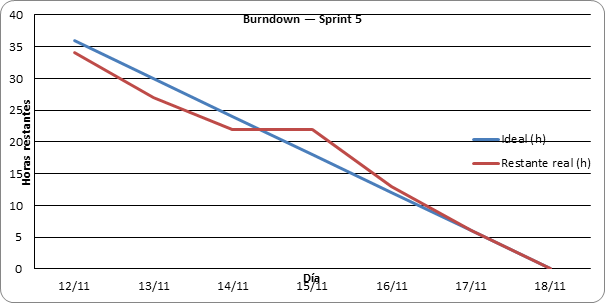

**Análisis:** la línea ideal baja de 36 horas a cero entre el 12 y el 18 de noviembre. La real va por
debajo de ella los primeros días, pero el domingo 15 no baja: la salida del stock por venta fallaba por
la restricción del motivo de la nota de egreso, y la entrega y la venta dependían de ella. El lunes 16
se recupera (9 horas) y el sprint cierra el miércoles 18, en la fecha planificada.

<!-- figura: Burnup del Sprint 5 -->
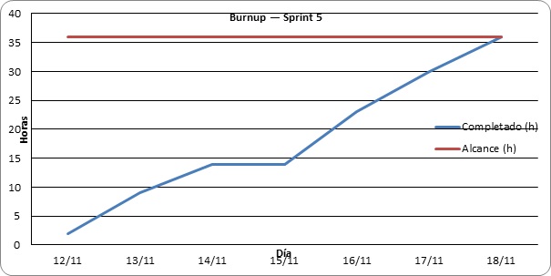

**Análisis:** el alcance no cambió durante el sprint (36 horas). El trabajo completado se aplana el día
15 y lo alcanza el 18 de noviembre.

<!-- figura: Burnup del proyecto al cierre del Sprint 5 -->
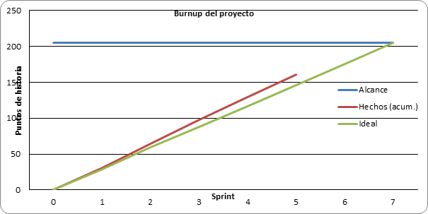

**Análisis:** con los 32 puntos del Sprint 5 el proyecto suma 161 de 205, por encima de la línea ideal
(146 puntos al cierre del quinto sprint).

| Métrica | Valor |
|---|---|
| Horas planificadas | 36 h |
| Horas completadas | 36 h |
| Puntos comprometidos / completados | 32 / 32 |
| Horas asignadas por integrante | 18 h cada uno |
| Días de atraso respecto al plan | 0 |
| Pruebas de integración y de componentes que pasan | 464 (88 + 43 + 42 + 14 + 30 + 17 + 13 + 217) |

### 3.6.8 Sprint Review

**Demostraciones:**

1. **Arranque.** `docker compose up -d --build` levanta los doce contenedores; ms-ventas crea sus tablas,
   ms-pedidos la de turnos y ms-inventario admite el motivo «Venta» en una base que ya existía.
   Resultado: correcto.
2. **Tablero.** La vendedora ve los pedidos de todos los clientes y cuántos hay en cada estado; un
   pedido «Recibido» solo ofrece pasar a «En preparación». Resultado: correcto.
3. **Asignar repartidor.** Con dos repartidores de turno, el sistema sugiere al que tiene menos entregas;
   asignar a una vendedora se rechaza («cargo Repartidor»), y sin repartidor el pedido no sale «En
   camino». Resultado: correcto.
4. **Mis entregas.** El repartidor ve el pedido en camino y comparte su ubicación: la cliente lo sigue en
   el mapa de «Mis pedidos». Otro repartidor no puede cerrar esa entrega. Resultado: correcto.
5. **Entregar.** Al marcarlo entregado, el pedido en efectivo queda pagado, ms-pagos registra el cobro y
   el stock reservado se descuenta con una nota de egreso por venta. Resultado: correcto.
6. **No entregado.** El pedido se cancela con ese motivo y su stock vuelve al disponible. Resultado:
   correcto.
7. **Venta de mostrador.** Dos ensaladas y un jugo para llevar, en efectivo: el precio es el del catálogo,
   el stock baja y sale el comprobante `V-000001`. Pedir más de lo que hay se rechaza diciendo qué
   producto falta. Resultado: correcto.
8. **Venta con QR.** Queda pendiente con su código hasta que la pasarela simulada lo acredita; si
   ms-pagos no responde, la venta no queda y el stock vuelve. Resultado: correcto.
9. **Anular.** Una venta cobrada se anula con su motivo: el stock vuelve al mismo almacén, no cuenta en
   lo recaudado y el sistema avisa que hay que devolver el dinero. Anularla otra vez se rechaza.
   Resultado: correcto.
10. **Clientes.** Buscar «nunez» encuentra a «Núñez»; corregir el correo por uno que ya usa otra cuenta
    se rechaza; la ficha muestra cuántos pedidos y ventas tiene. Resultado: correcto.

**Retroalimentación del Product Owner:** el incremento cumple el objetivo: el pedido se despacha y se
entrega de punta a punta, y el local ya puede vender en el mostrador. Para el Sprint 6 pide los reportes
y el correo al cliente cuando cambia el estado de su pedido, y que el cierre de caja del día no cuente
las ventas anuladas.

### 3.6.9 Sprint Retrospective

**¿Qué salió bien?**

- Acordar el primer día las rutas que comparten la entrega y la venta (consumir la reserva y registrar
  el efectivo): se programaron una sola vez y las usaron los dos.
- Las reservas del Sprint 3 sirvieron otra vez: la venta y la entrega solo las consumen, y lo que no se
  vende se libera con la misma regla.
- Dejar los clientes en ms-identidad evitó copiar la misma ficha en dos bases.

**¿Qué salió mal?**

- El domingo 15 se perdió con la restricción del motivo de la nota de egreso: el esquema del Sprint 2 no
  preveía la salida por venta, y en las bases ya creadas hubo que corregirla al arrancar.
- Las pruebas del tablero fallaban con 503 por una variable de entorno que faltaba en las pruebas.
- Habilitar una pestaña cambió el resultado de una prueba del buscador que no tenía que ver con el
  sprint.
- Con doce contenedores, la computadora de Nilser quedó al límite: construir todas las imágenes a la vez
  agotó la descarga de npm, el DNS interno de Docker falló por momentos («EAI_AGAIN postgres») y la
  prueba de punta a punta del despacho se pasa de sus tiempos.

**¿Qué mejorar?**

- Revisar las restricciones `CHECK` de las tablas que una historia nueva va a usar antes de programarla.
- Copiar el `.env.test` completo cuando un servicio empieza a llamar a otro.
- Escribir las pruebas que dependen de las pestañas visibles en función de `SPRINT_ACTUAL`.
- En computadoras con poca memoria, construir las imágenes de a una (`docker compose build <servicio>`)
  y correr las pruebas de punta a punta en la de Joseph.
