## 3.7 Sprint 6

### 3.7.1 Sprint Planning (objetivo del sprint)

**Objetivo del sprint:** reportes, correo al cliente, temas y despliegue. El administrador consulta los
reportes de ventas y de pedidos, los descarga en PDF y los envía a varios correos; el cliente recibe por
correo el aviso de cada etapa de su pedido y el comprobante; cada usuario conserva su tema y su modo
día/noche en cualquier dispositivo, y el sistema queda publicado en el VPS con HTTPS.

**Fechas:** jueves 19 al miércoles 25 de noviembre de 2026.

**Sin microservicios nuevos:** ms-reportes, que hasta ahora solo contaba visitas, pasa a armar los
reportes y a mandar los avisos al cliente. Es el primer servicio que usa MongoDB para algo más que un
contador: guarda una «foto» de cada venta y de cada pedido, lista para consultar.

**Historias comprometidas:**

| ID | Historia | Microservicio | Pts |
|---|---|---|---|
| HU-28 | Reporte de ventas | ms-reportes + ms-ventas | 8 |
| HU-29 | Reporte de pedidos | ms-reportes + ms-pedidos | 5 |
| HU-32 | Notificaciones por correo | ms-reportes | 5 |
| HU-33 | Temas y modo día/noche | frontend + ms-identidad | 5 |
| HT-04 | Despliegue en el VPS | Todos | 5 |
| | **Total** | | **28** |

**Qué se reutiliza.** Del sistema anterior se adaptan los cálculos de los reportes (ganancia,
participación, tiempo de entrega), el generador de PDF, el comprobante en forma de tique y las
plantillas de los correos. Los temas Niños, Jóvenes y Adultos y el modo según la hora ya venían con el
frontend reutilizado: lo nuevo de HU-33 es que la elección quede en la cuenta. El servidor es el mismo
VPS en que corría el sistema anterior, que se retira para dejarle lugar.

### 3.7.2 Sprint Backlog (tareas, responsables y tiempo)

| ID | Historia | Tarea | Responsable | Horas | Terminada |
|---|---|---|---|---|---|
| T1.1 | HU-28 | La foto completa de cada venta en `VentaRegistrada`, con el costo de lo vendido (ms-ventas, ms-inventario), y la lista interna | Nilser | 3 | 20/11 |
| T1.2 | HU-28 | Reporte de ventas en ms-reportes: por fechas, producto y vendedor, anuladas aparte, PDF y envío a varios correos | Nilser | 4 | 23/11 |
| T1.3 | HU-28 | Filtro y tabla por vendedor en la pantalla del reporte | Joseph | 1 | 23/11 |
| T2.1 | HU-29 | La foto del pedido en `PedidoEstadoCambiado` (repartidor al asignarlo, costo al entregar) y la lista interna | Joseph | 3 | 20/11 |
| T2.2 | HU-29 | Reporte de pedidos: cancelados fuera del total, asignados y entregados por repartidor, PDF y correo | Joseph | 3 | 23/11 |
| T3.1 | HU-32 | Avisos al cliente con bandeja de salida y reintentos; comprobante en PDF al pagar o al entregar | Joseph | 4 | 24/11 |
| T3.2 | HU-32 | El correo del cliente por REST interno (ms-identidad); ms-reportes entrega al Postfix del servidor web | Joseph | 1 | 21/11 |
| T4.1 | HU-33 | El tema y el modo en la cuenta (ms-identidad) y aplicados al iniciar sesión (frontend) | Nilser | 3 | 21/11 |
| T5.1 | HT-04 | VPS: retirar el sistema anterior con respaldo, `docker-compose.prod.yml`, Caddy con HTTPS y Libélula en modo real | Joseph | 3 | 21/11 |
| T5.2 | HT-04 | Respaldo diario automático y actualizar el VPS con el sprint | Nilser | 2 | 25/11 |
| T6.1 | HT-05 | Pruebas de integración de ms-reportes | Joseph | 2 | 24/11 |
| T6.2 | HT-05 | Pruebas de ms-ventas, ms-pedidos, ms-identidad y componentes; `SPRINT_ACTUAL` 6 | Nilser | 2 | 24/11 |
| T6.3 | HT-05 | Punta a punta del reporte de ventas (PDF y envío a dos cuentas) | Joseph | 1 | 25/11 |
| T7.1 | Informe | Diagramas de ms-reportes, de los avisos y del despliegue en EA | Nilser | 2 | 25/11 |
| T7.2 | Informe | Documentar el Sprint 6 en el informe | Nilser | 2 | 25/11 |
| | | **Total** | | **36** | |

En el Sprint Planning las tareas se repartieron por área: Joseph tomó los pedidos (HU-29), los avisos
al cliente (HU-32) y el servidor; Nilser, las ventas (HU-28), los temas (HU-33), los respaldos, los
diagramas y el informe. Horas asignadas: 18 h cada uno.

**Contrato entre servicios.** Como en los sprints anteriores, la forma de las dos fotos (la de la venta y
la del pedido) se fijó el primer día: cada uno trabajó en su lado sin esperar al otro.

El detalle diario de cada tarea (estado y fecha de término) está en la hoja *Sprint 6* de
`docs/scrum/seguimiento-scrum.xlsx`.

### 3.7.3 Diagramas de clase e interfaces

**Diagrama de clases de ms-reportes.** ms-reportes no lee las bases de ms-ventas ni de ms-pedidos
(RNF-ARQ-02): guarda en MongoDB la última foto que cada uno publicó. Son documentos listos para
consultar por fechas, con sus líneas adentro; por eso conviene un gestor de documentos y no tablas. La
bandeja de salida guarda los avisos al cliente hasta que salen, y `EventoProcesado` y `SesionVigente` son
las mismas piezas que en los demás servicios.

<!-- figura: Diagrama de clases de ms-reportes -->
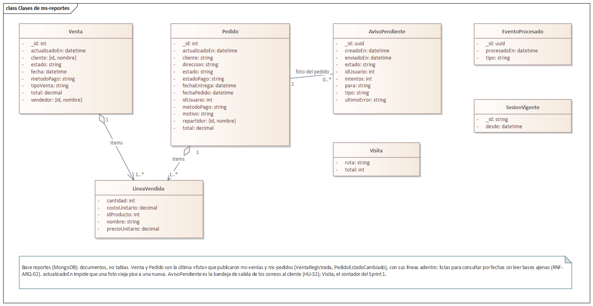

**Cómo se mantiene la copia.** Por dos caminos, como las réplicas de los Sprints 2 y 3: por eventos
(`VentaRegistrada` y `PedidoEstadoCambiado` traen la foto completa) y, al arrancar, pidiendo la lista
entera por REST interno, por si ms-reportes estuvo apagado o un aviso se perdió. Cada foto lleva el
momento en que se tomó: una más vieja no pisa a una más nueva.

**Aviso al cliente (HU-32).** ms-pedidos publica la foto del pedido y sigue con lo suyo. ms-reportes la
guarda y, si cambió de etapa, anota el aviso en la bandeja; un envío cada 20 segundos pide el correo del
cliente a ms-identidad y lo manda. Si el correo o ms-identidad fallan, el aviso espera y se reintenta,
pero el reporte ya quedó al día. Así «el correo sale aunque el servicio de pedidos esté ocupado».

<!-- figura: Aviso al cliente cuando cambia su pedido -->
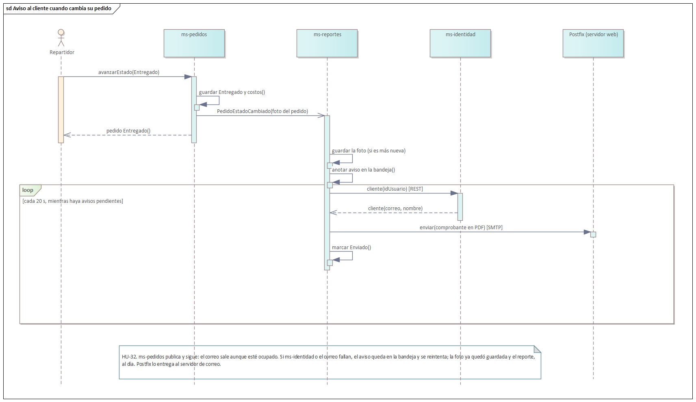

**Qué aviso corresponde a cada etapa:**

| El pedido pasa a… | Aviso |
|---|---|
| Recibido (en efectivo) | «Recibimos su pedido», con cuánto tener listo |
| Recibido (venía de «Pendiente de pago») | Comprobante de pago, con el tique en PDF |
| En preparación / En camino | El aviso de la etapa |
| Entregado | En efectivo, el comprobante en PDF; si ya estaba pagado, «fue entregado» |
| Cancelado | Solo si el repartidor no pudo entregar; si lo canceló el cliente, ya lo sabe |
| Misma etapa (por ejemplo, se asignó repartidor) | Ninguno |

**Despliegue (HT-04).** Como el sistema anterior, en dos servidores: el **servidor web** (el VPS) y el
**servidor de correo**. En el servidor web, Caddy recibe todo por HTTPS con un certificado de Let's
Encrypt que renueva solo, y reparte: `/api` al API Gateway y el resto al portal. Solo esos dos publican
un puerto, y solo hacia adentro del servidor. PostgreSQL, MongoDB, Redis y RabbitMQ no se ven desde
internet. El correo sale por el Postfix del servidor web, que lo entrega al servidor de correo.

<!-- figura: Despliegue en el VPS -->
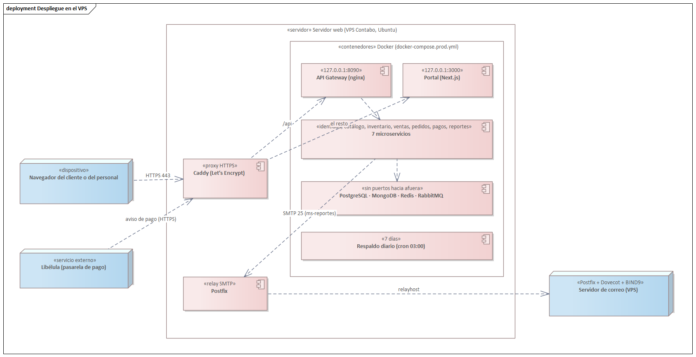

**Comunicación por REST interno:**

| Quién llama | Ruta | Para qué |
|---|---|---|
| ms-reportes → ms-ventas | `GET /interno/ventas/reporte` | La foto de todas las ventas, al arrancar. |
| ms-reportes → ms-pedidos | `GET /interno/pedidos/reporte` | La foto de todos los pedidos, al arrancar. |
| ms-reportes → ms-identidad | `GET /interno/clientes/:id` | El correo del cliente al que va el aviso. |

**Eventos:**

| Evento | Lo publica | Lo consume | Para qué |
|---|---|---|---|
| `VentaRegistrada` | ms-ventas | ms-reportes | La foto de la venta al venderla, al acreditarse el QR y al anularla (HU-28). |
| `PedidoEstadoCambiado` | ms-pedidos | ms-reportes | La foto del pedido en cada cambio y al asignar repartidor (HU-29, HU-32). |
| `PermisosCambiados` | ms-identidad | ms-reportes (nuevo) | Los reportes también rechazan un token anterior a un cambio de permisos (HU-05). |

**Interfaces.** Se habilitan los reportes de ventas y de pedidos; los de producción e inventario (HU-30)
esperan al Sprint 7.

<!-- figura: Reporte de ventas por vendedor -->
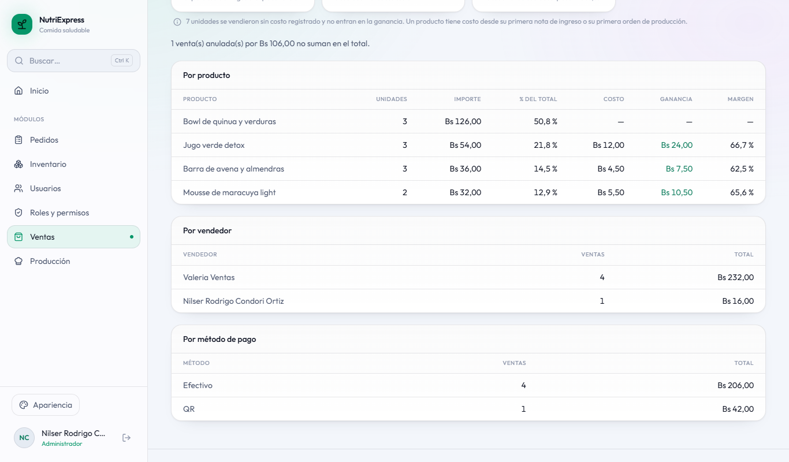

<!-- figura: Reporte de pedidos por repartidor -->
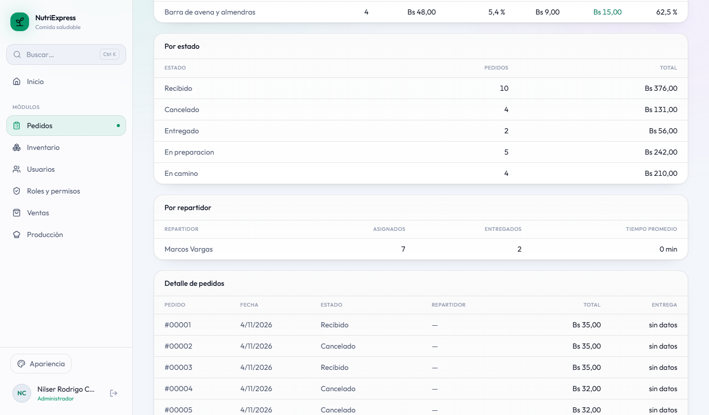

<!-- figura: Enviar un reporte a varios correos -->
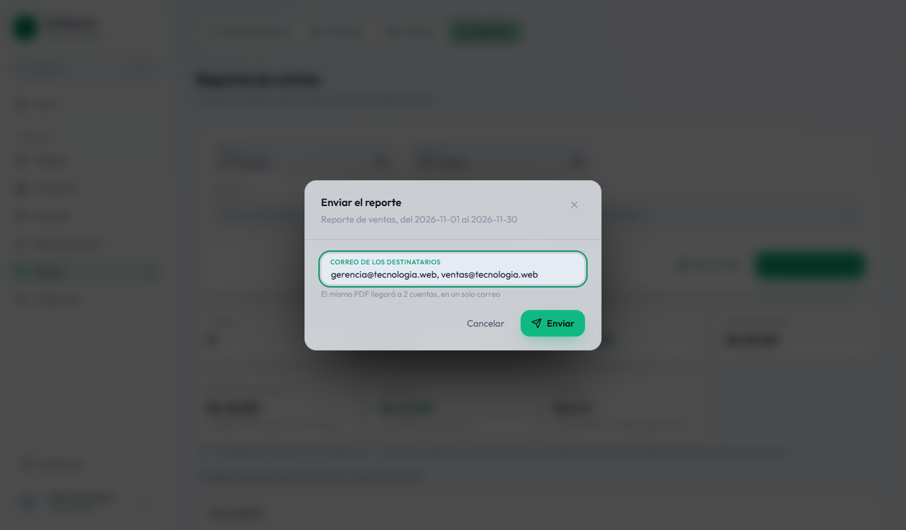

<!-- figura: Reporte de ventas en PDF -->
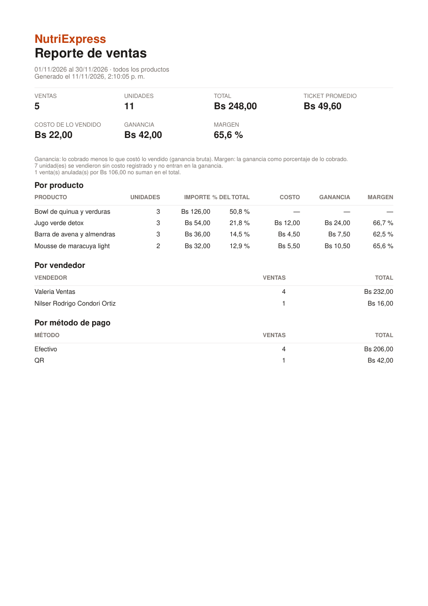

<!-- figura: Tema Niños en modo día -->
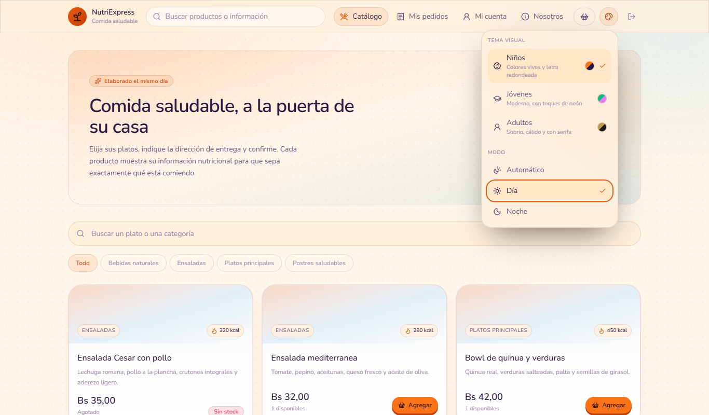

### 3.7.4 Daily Meeting

| Fecha | Integrante | ¿Qué hice? | ¿Qué haré hoy? | Impedimentos |
|---|---|---|---|---|
| 19/11 | Joseph | Sprint Planning con Nilser: tareas repartidas y forma de las fotos acordada. | La foto del pedido y su lista interna (T2.1). | Ninguno. |
| 19/11 | Nilser | Sprint Planning. | La foto de la venta con su costo (T1.1). | Ninguno. |
| 20/11 | Joseph | Foto del pedido con repartidor y costo al entregar. | Servidor: retirar el sistema anterior con respaldo y levantar los contenedores (T5.1); correo del cliente (T3.2). | Ninguno. |
| 20/11 | Nilser | Foto de la venta, con el costo que devuelve inventario. | Tema y modo en la cuenta (T4.1). | Ninguno. |
| 21/11 | Joseph | VPS con HTTPS y Libélula en modo real; ruta del correo del cliente. | Reporte de pedidos (T2.2) y avisos al cliente (T3.1). | Docker publica los puertos saltándose el firewall del servidor: PostgreSQL y MongoDB quedaban abiertos a internet. Se resolvió con `docker-compose.prod.yml`. |
| 21/11 | Nilser | Tema y modo guardados en la cuenta. | Reporte de ventas en ms-reportes (T1.2). | Ninguno. |
| 22/11 | Joseph | Avancé el reporte de pedidos y los avisos. | Seguir con los avisos (T3.1). | El correo de los contenedores no llegaba: el Postfix del servidor tiene un certificado autofirmado y el envío lo rechazaba. Además, el servidor de correo del proyecto está dado de baja y los correos quedan en cola. |
| 22/11 | Nilser | Avancé el reporte de ventas. | Terminarlo (T1.2). | El mismo: sin correo no se podía comprobar el envío del reporte; se probó con el buzón local de las pruebas. |
| 23/11 | Joseph | Tramo contenedor → Postfix sin TLS (no sale del servidor); reporte de pedidos terminado. | Filtro por vendedor (T1.3); avisos con bandeja de salida (T3.1). | Ninguno. |
| 23/11 | Nilser | Reporte de ventas con PDF y envío a varios correos. | Pruebas de los servicios y `SPRINT_ACTUAL` 6 (T6.2). | Ninguno. |
| 24/11 | Joseph | Bandeja de salida y comprobante en PDF. | Pruebas de ms-reportes (T6.1). | Una prueba del tablero falló al cambiar el orden de los archivos: otra prueba del Sprint 4 dejaba un pedido en camino con el mismo repartidor. Se separaron. |
| 24/11 | Nilser | Pruebas de los servicios y de componentes. | Respaldos y actualizar el VPS (T5.2). | Ninguno. |
| 25/11 | Joseph | Pruebas de ms-reportes. | Punta a punta del reporte (T6.3). Sprint Review y Retrospective. | Ninguno. |
| 25/11 | Nilser | Respaldo diario y VPS actualizado. | Diagramas en EA (T7.1) y documentar el Sprint 6 (T7.2). | Ninguno. |

### 3.7.5 Scrumboard (To Do, Doing, Done)

| Historia | Tareas | Estado inicial | Estado final |
|---|---|---|---|
| HU-28 Reporte de ventas | 3 | 3 en To Do | 3 en Done |
| HU-29 Reporte de pedidos | 2 | 2 en To Do | 2 en Done |
| HU-32 Notificaciones por correo | 2 | 2 en To Do | 2 en Done |
| HU-33 Temas y modo día/noche | 1 | 1 en To Do | 1 en Done |
| HT-04 Despliegue en el VPS | 2 | 2 en To Do | 2 en Done |
| HT-05 Pruebas | 3 | 3 en To Do | 3 en Done |
| Informe | 2 | 2 en To Do | 2 en Done |

### 3.7.6 Product Increment

| Entregable | Descripción |
|---|---|
| ms-reportes | Reporte de ventas por fechas, producto y vendedor: las anuladas no suman y se cuentan aparte; ganancia con el costo de lo vendido (HU-28). Reporte de pedidos por fechas, estado y repartidor: los cancelados no suman y cada repartidor muestra asignados y entregados (HU-29). Los dos en PDF y enviables a hasta cinco correos. Avisos al cliente en cada etapa, con el comprobante en PDF al pagar o al entregar en efectivo (HU-32). |
| ms-ventas, ms-pedidos, ms-inventario | La foto completa de cada venta y de cada pedido para los reportes; inventario devuelve el costo de lo que sale y ventas y pedidos lo guardan. |
| ms-identidad | El tema y el modo de cada cuenta (HU-33); el correo del cliente en la ruta interna (HU-32). |
| Frontend | `SPRINT_ACTUAL` sube a 6: reportes de ventas (con filtro por vendedor) y de pedidos. La elección de tema y modo se guarda en la cuenta y se aplica al iniciar sesión. |
| Servidor (HT-04) | https://nutriexpress.109-123-254-213.sslip.io en el VPS: Docker detrás de Caddy, sin puertos de datos públicos, Libélula en modo real, correo por el Postfix del servidor web y respaldo diario de PostgreSQL y MongoDB con siete días de historia. |
| Pruebas | Integración: 91 en ms-identidad, 43 en ms-catalogo, 42 en ms-inventario, 28 en ms-reportes, 32 en ms-pedidos, 17 en ms-pagos y 15 en ms-ventas. Componentes: 219. Punta a punta: se activa la del reporte de ventas. |

### 3.7.7 Burndown y Burnup

<!-- figura: Burndown del Sprint 6 -->
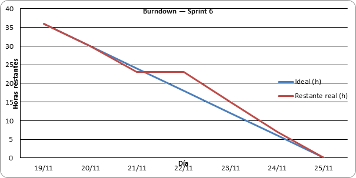

**Análisis:** la línea ideal baja de 36 horas a cero entre el 19 y el 25 de noviembre. El primer día no
se cierra ninguna tarea (es el de la planificación). El domingo 22 la línea real no baja: el correo de los
contenedores no llegaba al servidor de correo, y los avisos y el envío del reporte dependían de eso. Del
23 al 25 se recupera y el sprint cierra el miércoles 25, en la fecha planificada.

<!-- figura: Burnup del Sprint 6 -->
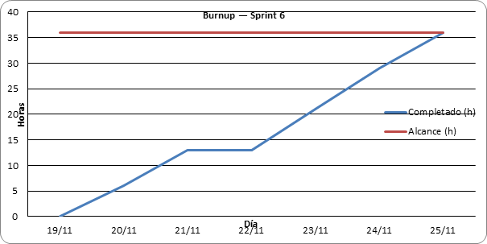

**Análisis:** el alcance no cambió durante el sprint (36 horas). El trabajo completado se aplana el día
22 y lo alcanza el 25 de noviembre.

<!-- figura: Burnup del proyecto al cierre del Sprint 6 -->
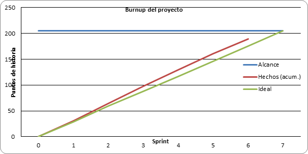

**Análisis:** con los 28 puntos del Sprint 6 el proyecto suma 189 de 205, por encima de la línea ideal
(176 puntos al cierre del sexto sprint). Quedan HU-07 y HU-30 para el Sprint 7, de reserva.

| Métrica | Valor |
|---|---|
| Horas planificadas | 36 h |
| Horas completadas | 36 h |
| Puntos comprometidos / completados | 28 / 28 |
| Horas asignadas por integrante | 18 h cada uno |
| Días de atraso respecto al plan | 0 |
| Pruebas de integración y de componentes que pasan | 487 (91 + 43 + 42 + 28 + 32 + 17 + 15 + 219) |

### 3.7.8 Sprint Review

**Demostraciones:**

1. **El sistema en internet.** https://nutriexpress.109-123-254-213.sslip.io responde con certificado
   válido; los puertos de las bases no responden desde afuera. Resultado: correcto.
2. **Reporte de ventas.** Del período se ven las ventas cobradas; una anulada figura aparte y no suma.
   Filtrado por vendedor, solo las suyas. Resultado: correcto.
3. **PDF y varios correos.** El reporte se descarga en PDF y se envía a dos cuentas; el PDF va adjunto a
   las dos. Una dirección mal escrita se rechaza. Resultado: correcto.
4. **Reporte de pedidos.** Los cancelados figuran en su estado y no suman; cada repartidor muestra los
   pedidos asignados y los que entregó, con el tiempo promedio de entrega. Resultado: correcto.
5. **Avisos al cliente.** Un pedido en efectivo genera «Recibimos su pedido», «Va en camino» y, al
   entregarse, el comprobante en PDF; asignar repartidor no manda nada. Resultado: correcto.
6. **Correo caído.** Con ms-identidad sin responder, el aviso queda en la bandeja y el reporte igual se
   actualiza; al volver, el aviso sale solo. Resultado: correcto.
7. **Temas.** La cliente elige el tema Niños en su computadora; al entrar desde el teléfono, el sistema
   ya lo muestra con ese tema. Con «Automático», el modo cambia según la hora. Resultado: correcto.
8. **Pasarela real.** En el servidor, un pedido con QR abre el cobro en Libélula (su página de pago);
   al cancelarlo, el cobro se cierra. Resultado: correcto.

**Retroalimentación del Product Owner:** el incremento cumple el objetivo: los reportes responden cómo va
el negocio y el sistema ya está en internet. Pide para el Sprint 7 contratar de nuevo el servidor de
correo (hoy los avisos quedan en cola), cambiar las contraseñas de las cuentas de prueba en el servidor y
terminar el reporte de producción e inventario (HU-30).

### 3.7.9 Sprint Retrospective

**¿Qué salió bien?**

- Guardar en MongoDB una foto de cada venta y de cada pedido: los reportes se calculan sin preguntarle
  nada a otros servicios, y la lista completa al arrancar los mantiene al día aunque se pierda un evento.
- La bandeja de salida separa el reporte del correo: un correo que falla no deja atrasado un reporte.
- Reutilizar los cálculos, el PDF y las plantillas del sistema anterior: el trabajo fue cambiar de
  dónde salen los datos, no volver a escribirlos.

**¿Qué salió mal?**

- El domingo 22 se perdió con el correo: el certificado autofirmado del Postfix del servidor y el
  servidor de correo dado de baja.
- Docker abre los puertos que publica saltándose el firewall: con la configuración de desarrollo, las
  bases de datos habrían quedado expuestas en el servidor.
- Dos pruebas de archivos distintos usaban el mismo repartidor y una dependía del orden en que corrían.

**¿Qué mejorar?**

- Revisar qué puertos abre cada contenedor antes de llevarlo a un servidor.
- Dar a cada prueba sus propios datos (otro repartidor, otro cliente) para que el orden no importe.
- Volver a contratar el servidor de correo antes de la defensa, o configurar otro destino en Postfix.
