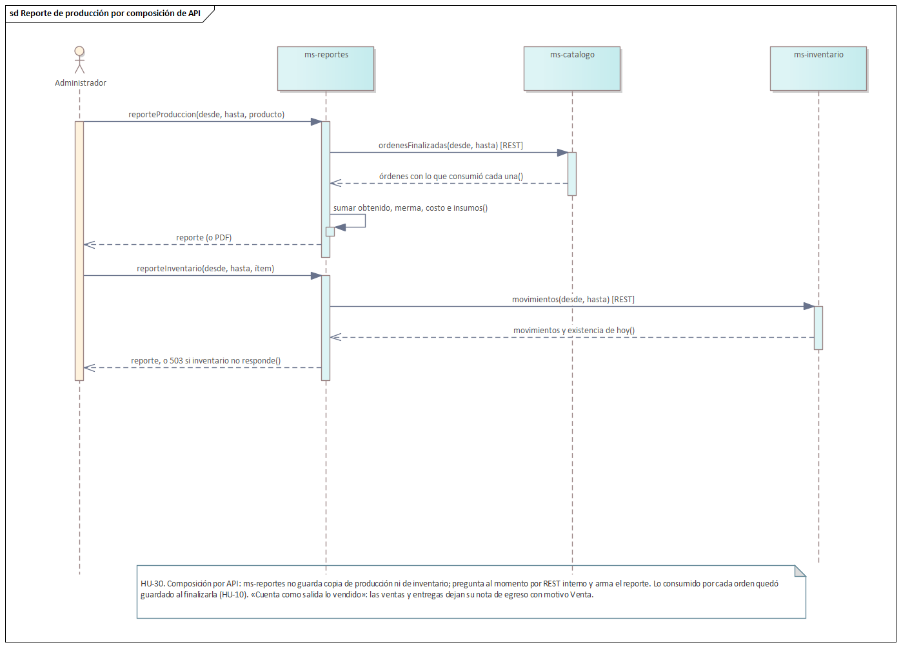
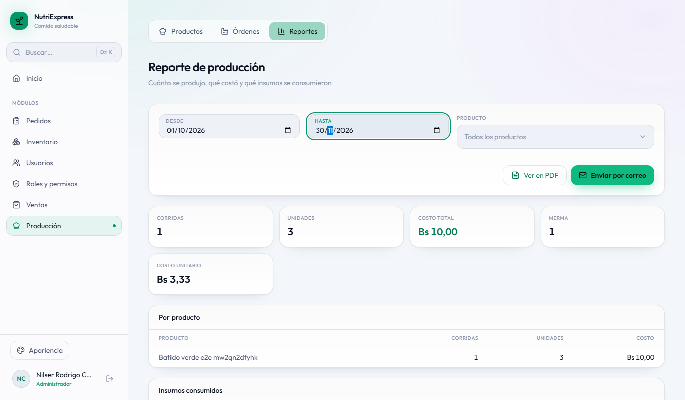
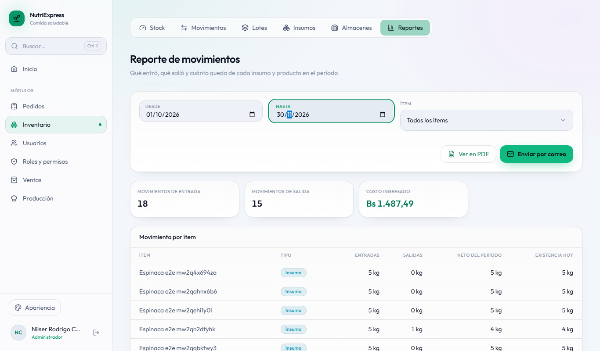
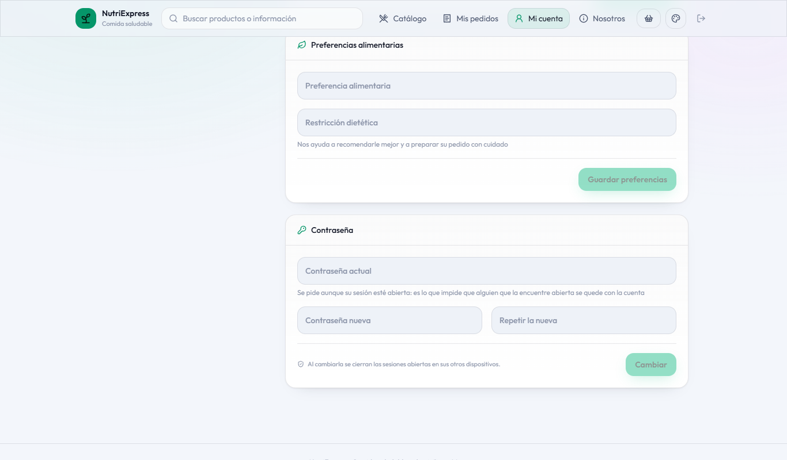
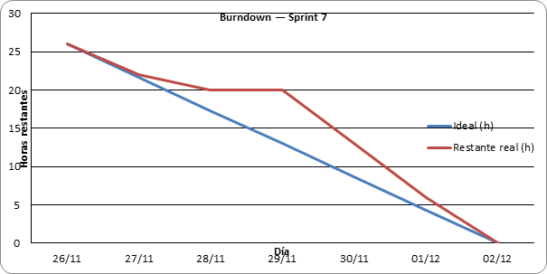
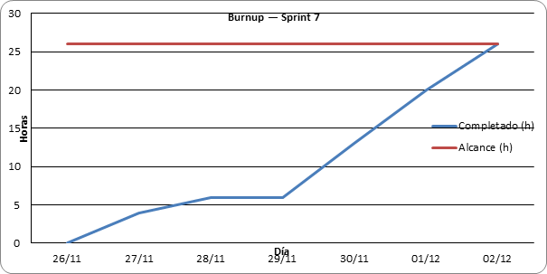

## 3.8 Sprint 7

### 3.8.1 Sprint Planning (objetivo del sprint)

**Objetivo del sprint:** cerrar el producto y el informe. El usuario administra su propio perfil y,
al cambiar su contraseña, se cierra su sesión en los demás dispositivos; el administrador consulta el
reporte de producción y el de movimientos de inventario, con PDF y envío por correo. Con eso se completa
el Product Backlog, y el equipo cierra el informe: artefactos, conclusiones, recomendaciones y anexos.

**Fechas:** jueves 26 de noviembre al miércoles 2 de diciembre de 2026. Era el sprint de reserva: se
usó para las dos historias que habían quedado fuera y para el cierre.

**Historias comprometidas:**

| ID | Historia | Microservicio | Pts |
|---|---|---|---|
| HU-07 | Perfil propio | ms-identidad | 3 |
| HU-30 | Reporte de producción e inventario | ms-reportes + ms-catalogo + ms-inventario | 5 |
| | **Total** | | **8** |

Con ellas se cierra también HT-05 (las pruebas, que corrieron en los Sprints 1 a 6): el proyecto llega a
205 de 205 puntos.

**Qué se reutiliza.** El perfil y su pantalla venían del sistema anterior; lo nuevo es que cambiar la
contraseña cierre las demás sesiones en todos los servicios. Los cálculos y el PDF de los reportes de
producción e inventario son los del sistema anterior, y las dos pantallas ya estaban en el frontend
reutilizado, esperando su sprint.

### 3.8.2 Sprint Backlog (tareas, responsables y tiempo)

| ID | Historia | Tarea | Responsable | Horas | Terminada |
|---|---|---|---|---|---|
| T1.1 | HU-07 | Pruebas de los criterios: la contraseña actual se pide y el titular no cambia su rol ni el estado de su cuenta | Joseph | 2 | 27/11 |
| T1.2 | HU-07 | Cambiar la contraseña cierra la sesión en los otros dispositivos (`PermisosCambiados`) y entrega un token nuevo | Joseph | 2 | 28/11 |
| T2.1 | HU-30 | Ruta interna de las órdenes finalizadas, con lo que consumió cada una (ms-catalogo) | Nilser | 2 | 27/11 |
| T2.2 | HU-30 | Ruta interna de los movimientos del período y la existencia de hoy (ms-inventario) | Joseph | 3 | 30/11 |
| T2.3 | HU-30 | Reportes de producción e inventario en ms-reportes por composición de API, con PDF y correo | Nilser | 4 | 30/11 |
| T2.4 | HU-30 | `SPRINT_ACTUAL` 7: se habilitan las pantallas de los dos reportes | Nilser | 1 | 01/12 |
| T3.1 | HT-05 | Pruebas de integración de los servicios que cambiaron y cierre de HT-05 | Joseph | 2 | 01/12 |
| T3.2 | HT-04 | Actualizar el VPS con el Sprint 7 | Joseph | 1 | 02/12 |
| T4.1 | Informe | Artefactos: Product Backlog final, paquetes, diseño de datos, despliegue y burndown/burnup del proyecto | Nilser | 4 | 01/12 |
| T4.2 | Informe | Conclusiones, recomendaciones y anexos (manual de usuario, instalación y evidencias) | Joseph | 3 | 02/12 |
| T4.3 | Informe | Documentar el Sprint 7 y regenerar el Word | Nilser | 2 | 02/12 |
| | | **Total** | | **26** | |

En el Sprint Planning el trabajo se repartió así: Joseph tomó el perfil (HU-07), la ruta de inventario,
las pruebas, el servidor y el cierre del informe; Nilser, la ruta de catálogo, los reportes en
ms-reportes, los artefactos y el capítulo del sprint. Horas asignadas: 13 h cada uno.

El detalle diario de cada tarea (estado y fecha de término) está en la hoja *Sprint 7* de
`docs/scrum/seguimiento-scrum.xlsx`.

### 3.8.3 Diagramas de clase e interfaces

**Dos maneras de armar un reporte.** Los reportes de ventas y de pedidos (Sprint 6) se arman sobre una
copia que ms-reportes mantiene con eventos. Para producción e inventario se eligió la otra forma
conocida, la **composición por API**: ms-reportes pregunta al momento por REST interno a ms-catalogo y a
ms-inventario, y arma el reporte con las dos respuestas. Se decidió así porque los movimientos de
inventario nacen por muchos caminos (compras, ajustes, producción, ventas, entregas, devoluciones):
publicar un evento desde cada uno multiplicaba los puntos de falla, y el reporte se consulta poco.

| | Copia por eventos (ventas, pedidos) | Composición por API (producción, inventario) |
|---|---|---|
| De dónde salen los datos | De MongoDB, en ms-reportes | De ms-catalogo y ms-inventario, al momento |
| Si el otro servicio no responde | El reporte sale con lo último que llegó | El reporte avisa qué servicio falta (503) |
| Qué hay que mantener | Un evento por cada cambio y la lista al arrancar | Una ruta interna por servicio |
| Cuándo conviene | Se consulta seguido o necesita historia propia | Se consulta poco y los datos cambian por muchos caminos |

<!-- figura: Reporte de producción por composición de API -->

**Lo que cuenta cada reporte.** El de producción suma lo **obtenido** (no lo planificado), la merma y el
costo que cada orden dejó guardado al finalizarse (HU-10): si un insumo sube después, el costo de lo ya
producido no cambia. El de inventario cuenta entradas, salidas y la existencia de hoy de cada ítem, y
«cuenta como salida lo vendido»: las ventas del mostrador y los pedidos entregados ya dejan su nota de
egreso con motivo Venta desde el Sprint 5.

**Cerrar las demás sesiones (HU-07).** Al cambiar la contraseña, ms-identidad publica el mismo aviso que
usa desde el Sprint 3 para los permisos (`PermisosCambiados`): cada servicio anota desde cuándo valen las
sesiones de ese usuario y rechaza los tokens anteriores. El navegador desde el que se cambió recibe un
token nuevo y sigue dentro; los demás dispositivos vuelven al inicio de sesión.

**Comunicación por REST interno:**

| Quién llama | Ruta | Para qué |
|---|---|---|
| ms-reportes → ms-catalogo | `GET /interno/ordenes/reporte` | Las órdenes finalizadas del período, con lo que consumió cada una. |
| ms-reportes → ms-inventario | `GET /interno/movimientos/reporte` | Los movimientos del período y la existencia de hoy de cada ítem. |

**Interfaces.** Se habilitan los reportes de producción y de inventario.

<!-- figura: Reporte de producción -->

<!-- figura: Reporte de movimientos de inventario -->

<!-- figura: Perfil propio: cambiar la contraseña -->

### 3.8.4 Daily Meeting

| Fecha | Integrante | ¿Qué hice? | ¿Qué haré hoy? | Impedimentos |
|---|---|---|---|---|
| 26/11 | Joseph | Sprint Planning con Nilser: tareas del sprint de reserva y del cierre. | Pruebas del perfil (T1.1). | Ninguno. |
| 26/11 | Nilser | Sprint Planning. | Ruta interna de órdenes finalizadas (T2.1). | Ninguno. |
| 27/11 | Joseph | Pruebas de los criterios del perfil. | Cerrar las demás sesiones al cambiar la contraseña (T1.2). | Ninguno. |
| 27/11 | Nilser | Ruta interna de órdenes. | Reportes de producción e inventario en ms-reportes (T2.3). | Ninguno. |
| 28/11 | Joseph | Cambio de contraseña con cierre de sesiones y token nuevo. | Ruta interna de movimientos (T2.2). | Ninguno. |
| 28/11 | Nilser | Avancé el reporte de producción. | Seguir con el de inventario (T2.3). | Ninguno. |
| 29/11 | Joseph | Avancé la ruta de movimientos. | Terminarla y probarla (T2.2). | Con los doce contenedores encendidos en la computadora de Nilser, las pruebas no alcanzaban a preparar su base (tiempo agotado). Hubo que apagar los servicios para correrlas. |
| 29/11 | Nilser | Avancé el reporte de inventario. | Terminarlo (T2.3). | El mismo: sin poder correr las pruebas no se podía cerrar la tarea. |
| 30/11 | Joseph | Ruta de movimientos con su prueba. | Pruebas de los servicios y cierre de HT-05 (T3.1). | Ninguno. |
| 30/11 | Nilser | Reportes de producción e inventario con PDF y correo. | `SPRINT_ACTUAL` 7 (T2.4) y artefactos del informe (T4.1). | Ninguno. |
| 01/12 | Joseph | Pruebas: 499 de integración y de componentes pasan. | Actualizar el VPS (T3.2); conclusiones y anexos (T4.2). | En el seguimiento, HT-05 no figuraba como hecha y el burnup del proyecto no llegaba a 205: se cerró en el Sprint 7. |
| 01/12 | Nilser | Pantallas habilitadas y artefactos del informe. | Documentar el Sprint 7 y regenerar el Word (T4.3). | Ninguno. |
| 02/12 | Joseph | VPS actualizado; conclusiones, recomendaciones y anexos. | Sprint Review y Retrospective. | Ninguno. |
| 02/12 | Nilser | Capítulo del Sprint 7. | Word regenerado; Sprint Review y Retrospective. | Ninguno. |

### 3.8.5 Scrumboard (To Do, Doing, Done)

| Historia | Tareas | Estado inicial | Estado final |
|---|---|---|---|
| HU-07 Perfil propio | 2 | 2 en To Do | 2 en Done |
| HU-30 Reporte de producción e inventario | 4 | 4 en To Do | 4 en Done |
| HT-05 Pruebas | 1 | 1 en To Do | 1 en Done |
| HT-04 Despliegue | 1 | 1 en To Do | 1 en Done |
| Informe | 3 | 3 en To Do | 3 en Done |

### 3.8.6 Product Increment

| Entregable | Descripción |
|---|---|
| ms-identidad | Perfil propio con sus criterios probados (HU-07). Cambiar la contraseña cierra la sesión en los demás dispositivos de todos los servicios y entrega un token nuevo al navegador actual. |
| ms-reportes | Reporte de producción (corridas, unidades obtenidas, merma, costo, insumos consumidos) y de movimientos de inventario (entradas, salidas, neto y existencia de hoy, por ítem), por fechas e ítem, en PDF y por correo (HU-30). |
| ms-catalogo, ms-inventario | Las rutas internas que dan los datos de esos reportes. |
| Frontend | `SPRINT_ACTUAL` sube a 7: se habilitan los reportes de producción e inventario. |
| Servidor | El VPS se actualizó con el Sprint 7. |
| Pruebas | Integración: 95 en ms-identidad, 44 en ms-catalogo, 43 en ms-inventario, 34 en ms-reportes, 32 en ms-pedidos, 17 en ms-pagos y 15 en ms-ventas. Componentes: 219. |

### 3.8.7 Burndown y Burnup

<!-- figura: Burndown del Sprint 7 -->

**Análisis:** la línea ideal baja de 26 horas a cero entre el 26 de noviembre y el 2 de diciembre. El
primer día es de planificación y el domingo 29 la línea no baja: las pruebas no podían correr con todos
los contenedores encendidos. El lunes 30 se recupera y el sprint cierra el miércoles 2, en la fecha
planificada.

<!-- figura: Burnup del Sprint 7 -->

**Análisis:** el alcance no cambió durante el sprint (26 horas). El trabajo completado se aplana el día
29 y lo alcanza el 2 de diciembre.

| Métrica | Valor |
|---|---|
| Horas planificadas | 26 h |
| Horas completadas | 26 h |
| Puntos comprometidos / completados | 8 / 8 (y HT-05, 8 más, cerrada) |
| Horas asignadas por integrante | 13 h cada uno |
| Días de atraso respecto al plan | 0 |
| Pruebas de integración y de componentes que pasan | 499 (95 + 44 + 43 + 34 + 32 + 17 + 15 + 219) |

### 3.8.8 Sprint Review

**Demostraciones:**

1. **Perfil propio.** La cliente corrige su teléfono; si intenta cambiar su rol, el sistema lo ignora.
   Cambiar la contraseña sin la actual se rechaza. Resultado: correcto.
2. **Cerrar las demás sesiones.** Con la cuenta abierta en dos navegadores, cambia la contraseña en uno:
   ese sigue dentro y el otro vuelve al inicio de sesión en su siguiente acción. Resultado: correcto.
3. **Reporte de producción.** Del período se ven las órdenes finalizadas con lo obtenido, la merma y el
   costo; los insumos consumidos suman lo que costó cada corrida. Resultado: correcto.
4. **Reporte de inventario.** Filtrado por un producto, muestra cuánto entró, cuánto salió (incluidas las
   ventas) y cuánto hay hoy. Pedir un insumo y un producto a la vez se rechaza. Resultado: correcto.
5. **Un servicio caído.** Con ms-inventario apagado, el reporte de inventario avisa qué servicio falta en
   vez de mostrar cifras a medias. Resultado: correcto.
6. **El producto completo en el servidor.** En https://nutriexpress.109-123-254-213.sslip.io se recorren
   los siete módulos con las cuentas de prueba. Resultado: correcto.

**Retroalimentación del Product Owner:** el Product Backlog quedó completo (205 de 205 puntos). Antes de
la defensa pide cambiar las contraseñas de las cuentas de prueba del servidor y volver a contratar el
servidor de correo, para que los avisos lleguen de verdad a los clientes.

### 3.8.9 Sprint Retrospective

**¿Qué salió bien?**

- Usar el sprint de reserva para lo que quedaba: las dos historias entraron sin apuro y quedó tiempo
  para cerrar el informe.
- Tener dos formas de armar un reporte y elegir según el caso: la copia por eventos para lo que se
  consulta seguido y la composición por API para lo que cambia por muchos caminos.
- Reutilizar el aviso de permisos del Sprint 3 para cerrar sesiones: no hizo falta nada nuevo en los
  demás servicios.

**¿Qué salió mal?**

- El domingo 29 se perdió porque las pruebas no corrían con los doce contenedores encendidos en una
  computadora de 8 GB.
- El seguimiento no cerraba HT-05, la historia de las pruebas que abarca varios sprints, y el burnup del
  proyecto no llegaba al total.

**¿Qué mejorar?** *(para un próximo proyecto)*

- Definir desde el Sprint 0 cómo se cierra una historia técnica que dura varios sprints.
- Correr las pruebas de integración en un entorno aparte del que se usa para desarrollar (o en un
  servidor de integración continua).
